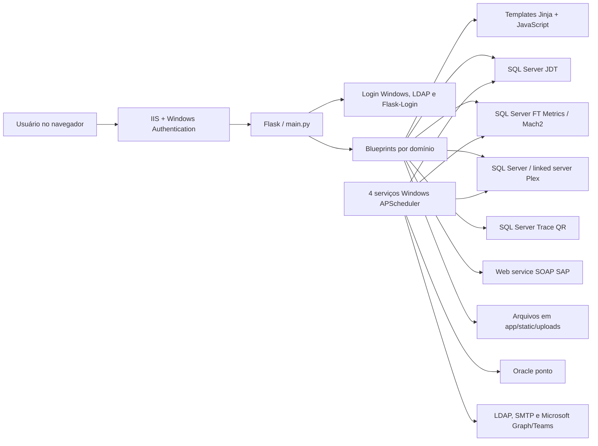

# Guia técnico do Digital JOST

> Documento de onboarding e referência técnica produzido em 07/08/2026 por análise estática do repositório.

## 1. Escopo, precisão e regra de segurança

Este guia foi construído **sem executar a aplicação**. Não foram iniciados servidor, serviços Windows, schedulers, testes, scripts, migrations, builds ou instalação de dependências. Também não foi importado nenhum módulo Python do projeto.

Essa precaução é indispensável neste repositório porque apenas importar/inicializar partes do código pode causar efeitos externos:

- `create_app()` executa `db.create_all()` dentro do contexto Flask;
- `app/utils/dynamic_constants.py` cria uma thread e pode consultar o Plex durante a importação;
- `app/utils/azure_utils.py` cria uma thread e pode solicitar token do Azure durante a importação;
- os schedulers acessam bancos, LDAP, e-mail, Teams, Oracle, Plex e arquivos;
- `teste_h24.py` executa diretamente o job diário de desvios;
- `scripts/laboratory_request_files.py` move arquivos reais e grava um relatório;
- há endpoints que alteram ou excluem arquivos e registros de produção.

Portanto, este documento descreve o comportamento inferido do código. Pontos dependentes de dados, infraestrutura ou configuração do ambiente estão marcados como tal. **Não use `flask run`, `python main.py`, `pytest`, `teste_h24.py`, scripts em `scripts/` ou os arquivos `run_*_scheduler.py` sem autorização formal e ambiente isolado.**

Nenhum segredo foi reproduzido aqui. O código contém credenciais em texto puro; consulte a seção de riscos antes de compartilhar o repositório ou este diagnóstico.

## 2. Resumo executivo

O Digital JOST é um **monólito web Flask para Windows/IIS**. Ele reúne vários sistemas internos em um único portal:

- autenticação corporativa e gestão de usuários/perfis;
- gestão de demandas e tarefas;
- solicitações de melhorias e projetos;
- desvios de processo e planos de ação;
- solicitações e gestão do laboratório;
- solicitação de alteração de paradas de produção;
- Operation Meeting: logística, produção, SSMA, qualidade e planejamento;
- monitoramento industrial, OEE, hardware e integração;
- rastreabilidade QR, plaquetas e matriz de versatilidade;
- cadastros de metas, fatores e auditorias 5S;
- biblioteca de conhecimentos e comunicação em TVs;
- relatórios de manutenção, OEE e Power BI;
- tarefas automáticas executadas como serviços Windows.

Não existe uma API separada nem um projeto frontend independente. O backend Flask renderiza páginas Jinja e as próprias páginas fazem chamadas `fetch`, `XMLHttpRequest` ou formulários para as mesmas rotas Flask. Boa parte do JavaScript fica em arquivos `.js` dentro da pasta de templates e é incluída pelo Jinja.

### Arquitetura em uma figura



## 3. Como ler o projeto

Ordem recomendada para um novo desenvolvedor:

1. `main.py`: lista os módulos realmente registrados.
2. `app/config.py`: cria o Flask, configura banco, sessão, login, e-mail e log de acessos.
3. `app/templates/home.html`: menu global e links para os módulos.
4. `app/utils/permissions.py`: catálogo de perfis.
5. `app/utils/db_utils.py`: quatro engines de banco.
6. O arquivo de rota do módulo desejado em `app/routes/`.
7. O template retornado pela rota em `app/templates/`.
8. O `.js` incluído pelo template ou scripts inline no próprio HTML.
9. Os jobs em `app/services/jobs/`, se a regra também for automática.

Para investigar uma tela, siga sempre esta cadeia:

```text
link do menu ou URL
  -> @blueprint.route(...) no Python
  -> função GET que chama render_template(...)
  -> HTML em app/templates
  -> JS incluído ou inline
  -> POST/PATCH/PUT/DELETE ou fetch para uma rota Flask
  -> SQL / arquivo / e-mail / integração externa
```

## 4. Estrutura do repositório

| Caminho | Responsabilidade |
|---|---|
| `main.py` | Composition root: cria o app e registra os blueprints ativos. |
| `web.config` | Hospedagem no IIS via `httpPlatformHandler`, Windows Authentication e limite de upload de 200 MB. |
| `requirements.txt` | Dependências Python fixadas. Flask, SQLAlchemy, pandas, Plotly, LDAP, Oracle, MSAL, Zeep etc. |
| `app/config.py` | Factory Flask, SQLAlchemy, Flask-Mail, Flask-Login, Flask-Principal, lifecycle e auditoria. |
| `app/errors.py` | Páginas 400, 403, 404 e 500; tentativa de alerta de erro via Teams. |
| `app/models/user.py` | Único modelo ORM explícito: `JDT_USER_DETAILS`. O restante usa SQL textual/pandas. |
| `app/routes/` | Backend por domínio, organizado em blueprints. |
| `app/routes/demandManagement/` | Feature em camadas: HTTP, aplicação, SQL, validação e integração legada. |
| `app/templates/` | Páginas Jinja, JavaScript incluído pelo Jinja e templates de e-mail. |
| `app/static/CSS/` | Folhas de estilo globais e por módulo. |
| `app/static/js/operation.planning/` | Scripts compartilhados das telas de planejamento. |
| `app/static/js/demand-management/` | JavaScript do gerenciador interno de demandas. |
| `app/static/images/`, `videos/` | Imagens e vídeos do portal/cockpit. |
| `app/static/uploads/` | Arquivos gerados ou enviados por usuários. Deve ser tratado como dado operacional. |
| `app/utils/` | Banco, permissões, cache Plex, segurança, arquivos Excel, e-mail, Teams e ping. |
| `app/services/run_*_scheduler.py` | Entradas de quatro serviços Windows APScheduler. |
| `app/services/jobs/` | Regras executadas em segundo plano. |
| `scripts/` | Migrações/manutenções manuais perigosas; não fazem parte do request web. |
| `logs/` | Logs de produção versionados no Git; representam a maior parte do repositório. |

No snapshot analisado há aproximadamente:

- 50 arquivos em `app/routes/`;
- 286 arquivos em `app/templates/`;
- 263 declarações `@...route(...)` nos módulos registrados;
- 596 arquivos de log rastreados, ocupando cerca de 1,6 GB;
- 1.917 MB rastreados no total, embora o código-fonte em si seja relativamente pequeno.

## 5. Inicialização e hospedagem

### 5.1 `web.config`

O ambiente esperado é Windows com IIS. O arquivo aponta para uma instalação em `I:\IIS\Digital_Jost`, inicia `python -m flask run` em uma porta fornecida pelo IIS, repassa o token de autenticação Windows e libera acesso para grupos corporativos específicos. O limite do IIS e o `MAX_CONTENT_LENGTH` do Flask são 200 MB.

Há forte acoplamento a esse caminho físico e a Windows. Várias rotas usam `os.getcwd()` como raiz; uma rota de desvios possui caminho absoluto de produção. Se o diretório de trabalho do processo mudar, templates, estáticos e uploads podem ser procurados no lugar errado.

### 5.2 `main.py`

`main.py`:

1. importa `create_app`;
2. importa todos os blueprints ativos;
3. executa `app = create_app()`;
4. registra os blueprints de negócio;
5. possui `app.run(debug=False)` somente quando executado diretamente.

Os blueprints `main` e `auth` não aparecem nessa lista porque são registrados dentro de `create_app()`.

### 5.3 `create_app()`

Responsabilidades principais de `app/config.py`:

- define `static_folder`, `template_folder` e `upload_folder` com base em `os.getcwd()`;
- configura SQLAlchemy para o banco JDT via ODBC;
- configura pool com `pool_pre_ping`, 50 conexões e até 70 excedentes;
- configura sessão permanente de 60 minutos;
- configura SMTP interno sem TLS/SSL;
- inicializa Flask-Login, Flask-Principal, Flask-Mail e SQLAlchemy;
- registra `main` e `auth`;
- executa `db.create_all()` na inicialização;
- registra handlers de erro;
- audita cada request autenticado após a resposta.

O comentário de `MAX_CONTENT_LENGTH` diz 100 MB, mas o valor é 200 MB.

## 6. Ciclo de uma requisição

1. O IIS entrega a requisição ao Flask e, no ambiente corporativo, inclui `X-Iis-Windowsauthtoken`.
2. Flask-Login recupera o `User` pelo `id` em `JDT_USER_DETAILS` e o guarda em cache no objeto `g` durante a requisição.
3. O `before_request` do blueprint exige usuário autenticado e normalmente o perfil `Jost - Geral` ou `Transformação Digital`.
4. Permissões mais específicas podem existir no decorator da própria rota.
5. A rota consulta bancos com pandas/SQLAlchemy ou ODBC, renderiza HTML ou responde JSON/arquivo.
6. `after_request` guarda o status HTTP.
7. `teardown_request` grava rota, argumentos, payload, método, status e horário em `JDT_USER_LOGS` para usuários não genéricos.
8. `teardown_appcontext` remove a sessão SQLAlchemy.

Observação: o logger de acesso grava payloads de formulários e JSON. Isso pode registrar dados pessoais, justificativas e outros conteúdos sensíveis.

## 7. Autenticação, usuários e permissões

### 7.1 Login

Backend: `app/routes/auth_routes.py`.

- Em IIS, obtém o usuário pelo token Windows.
- Fora do IIS, usa um usuário fixo de fallback embutido no código; isso é perigoso e impede considerar uma execução local como inofensiva.
- Busca o usuário em `JDT_USER_DETAILS`.
- Se não existir, consulta Active Directory via LDAP.
- Bloqueia/encaminha usuário externo e departamento não mapeado para páginas específicas.
- Resolve área, gestor, cargo e departamento.
- Cria o usuário inicialmente com o perfil `Jost - Geral`.
- Atualiza o último login e chama `login_user()`.

Rotas globais:

| URL | Método | Backend | Template/resultado |
|---|---|---|---|
| `/login` | GET, POST | `auth_routes.login` | Login automático; pode enviar e-mails e redireciona. |
| `/denied` | GET | `auth_routes.denied_get` | `general_role_denied.html`. |
| `/denied/external` | GET | `auth_routes.denied_external_user_get` | `general_external_user.html`. |
| `/denied/department` | GET | `auth_routes.denied_department_get` | `general_not_department.html`. |
| `/` | GET | `main_default_routes.landing_page_get` | `home_content.html`, que estende `home.html`. |
| `/research` | GET, POST | `main_default_routes.user_research_*` | Pesquisa; POST grava em `JDT_USER_RESEARCH`. |
| `/tutorial/download` | GET | `main_default_routes.tutorial_download_get` | Baixa PPTX em `static/uploads/tutorial`. |

### 7.2 Modelo de usuário

`app/models/user.py` mapeia `JDT_USER_DETAILS`. Campos: id, matrícula, nome, e-mails, turno, área, roles, cargo, departamento, empresa, gestor, flags de admin/ativo/genérico/temporário.

O campo `role` armazena uma lista JSON em texto. No evento `identity_loaded`, cada item vira um `RoleNeed` do Flask-Principal.

O modelo declara `unique=True` em praticamente todos os campos, inclusive turno, área, role, departamento e flags. Isso não corresponde à natureza desses dados e pode gerar constraints únicas indevidas caso `db.create_all()` crie a tabela do zero.

### 7.3 Perfis

`app/utils/permissions.py` define:

| Chave | Role principal | Uso |
|---|---|---|
| `GENERAL` | `Jost - Geral` | Entrada na maioria dos módulos. |
| `SYSADMIN` / `ADMIN` | `Transformação Digital` | Administração global. |
| `PROCESS` | `Engenharia de Processo` | Metas, fatores e cadastros de processo. |
| `SSMA` | `SSMA` | Manutenção de ocorrências SSMA. |
| `MAINTENANCE` | `Manutenção` | Funções administrativas/manutenção. |
| `QUALITY` | `Engenharia de Qualidade` | Informativo da qualidade e cadastro externo. |
| `LABORATORY` | `Laboratório` | Operação das SSLs e equipamentos. |
| `LOGISTIC` | `Logistica` | Edição dos indicadores de logística. |
| `PRODUCTION` | `Produção` | Cadastro externo de produção. |
| `DEVIATION` | `Desvios` | Administração e aprovação de desvios. |
| `T_ASSEMBLY` | `Rastreabilidade - Montagem` | Cadastro de rastreabilidade QR. |
| `T_ASSEMBLY_PLATES` | rastreabilidade/plaquetas | Gestão de plaquetas. |
| `MATRIX` | `Matriz` | Cadastros e avaliações da matriz. |
| `GOAL_OP_M` | `Metas - Operation Meeting` | Metas e alterações do planejamento. |
| `COMMS` | `Comunicação Interna` | Upload/programação do cockpit. |

O role `Transformação Digital` é incluído em quase todas as permissões e funciona como superperfil.

## 8. Bancos e integrações

### 8.1 Engines em `app/utils/db_utils.py`

| Nome usado no código | Finalidade inferida |
|---|---|
| `jdt` | Banco principal do portal: usuários, demandas, laboratório, desvios, permissões, cadastros etc. |
| `ftm` | FT Metrics/Mach2: tablets, paradas e histórico de eventos. |
| `plex` | Integração com Plex e linked server `PLEX_DSN_JOST`. |
| `trace_qr` | Base de rastreabilidade QR/receitas de montagem. |

Além das engines compartilhadas, há SQL com nomes de banco totalmente qualificados e um job que conecta Oracle para o ponto.

### 8.2 Outras integrações

| Integração | Onde aparece | Uso |
|---|---|---|
| Active Directory/LDAP | login, segurança e job de usuários | Cadastro, atualização e desativação de usuários. |
| SMTP interno | Flask-Mail e `email_utils.py` | Aprovações, prazos e notificações. |
| Microsoft Graph/Teams | `azure_utils.py`, `teams_utils.py`, alertas | Adaptive Cards e alertas de paradas/erros. |
| SAP SOAP | `reports/maintenance.py` | Leitura de tabelas/notas e ordens de manutenção. |
| Plex | SQL/linked server e cache | Workcenters, eventos, OEE, sinais e rastreabilidade. |
| FT Metrics/Mach2 | SQL Server | Paradas, produção, tablets e OEE. |
| Oracle | job de relógio-ponto | Atualiza `TEMP_OPERATORS_CLOCKING`. |
| Power BI | templates iframe | Dashboards incorporados. |
| Sistemas FTWeb/SSRS | menu e templates iframe | Telas legadas externas. |

### 8.3 Cache de referência Plex

`app/utils/dynamic_constants.py` mantém em memória `workcenters` e `events`, atualizados a cada quatro horas por uma thread daemon. Na primeira chamada, se não houver cache, consulta o Plex. Por isso importar esse módulo pode acessar produção.

## 9. Frontend e layout

`app/templates/home.html` é o layout global: Bootstrap 4, Font Awesome, fontes Google, CSS global e todos os menus laterais. `home_content.html` estende esse layout e mostra o vídeo/atalhos da home.

Padrões de frontend encontrados:

- páginas Jinja que estendem `home.html`;
- páginas independentes para TVs, e-mails e algumas telas modernas;
- JavaScript inline em HTML grandes;
- arquivos `.js` colocados em `app/templates` e inseridos com ``;
- scripts compartilhados no planejamento em `app/static/js/operation.planning/` e no gerenciador interno em `app/static/js/demand-management/`;
- Plotly para dashboards;
- `fetch`, `XMLHttpRequest` e formulários tradicionais;
- ausência de framework SPA e ausência de camada de API formal/versionada;
- CSS global e por domínio, com cópias/versões antigas rastreadas.

O menu global contém links internos, links externos de Power BI/SSRS/FTWeb e links comentados. Nem toda rota registrada aparece no menu; várias são acessadas por botões internos ou chamadas assíncronas.

## 10. Mapa completo das telas e seus vínculos

As tabelas seguintes agrupam GET e operações da mesma funcionalidade. Quando o JavaScript está no próprio HTML, isso é indicado como “inline”.

### 10.1 Gestão de demandas

Backend: `app/routes/demands/default.py`  
Banco: `jdt`  
Tabelas/views centrais: `JDT_DEMANDS`, `JDT_DEMANDS_ENTRY`, `JDT_DEMANDS_TASKS`, `JDT_FAMILIES_PROD`, `JDT_GENERAL_AREA`, `JDT_ROLES`, `JDT_USER_DETAILS`, `JDT_VIEW_DEMANDS`, `JDT_VIEW_DEMANDS_GRAPH`, `JDT_VIEW_DEMANDS_TASKS`, `JDT_VIEW_DEMANDS_TASKS_GRAPH`.

| Tela/função | URLs e métodos | Frontend | O que o backend faz |
|---|---|---|---|
| Principal por área | `/demandas` GET/POST | `demands_principal.html` + `.js` | Lista, filtra e ordena demandas e entradas. Exige query `area`. |
| Administração | `/demandas/admin` GET/POST | `demands_admin.html` + `.js` | Visão administrativa e alterações. |
| Apresentação | `/demandas/admin/apresentacao` GET | `demands_presentation.html` + `.js` | Exibe demandas selecionadas em modo apresentação. |
| Entradas | `/demandas/entrada` GET/POST | `demands_entries.html` + `.js` | Cria/exclui tipos de entrada. |
| Criar/editar demanda | `/demandas/criar` GET/POST | `demands_create.html` + `.js` | Cria/atualiza projeto, calcula prioridade/notas e regras por área. |
| Detalhe | `/demandas/detalhes` GET/POST | `demands_detail.html` + `.js` | Consulta, altera e exclui demanda. |
| Exportação | `/demandas/detalhes/download` GET | arquivo Excel | Usa `files_utils.demands_file`. |
| Configuração | `/demandas/gerenciar` GET | `demands_manage.html` + `.js` | Tela de informações base/edição. |
| Criar tarefa | `/demandas/tarefa/criar` GET/POST | `demands_task_new.html` + `.js` | Cria, edita ou exclui tarefa e notifica por e-mail. |
| Gerenciar tarefa | `/demandas/tarefa/gerenciar` GET | `demands_task_manage.html` + `.js` | Formulário de manutenção. |
| Lista de tarefas | `/demandas/tarefas` GET | `demands_task_principal.html` + `.js` | Lista tarefas por projeto/área. |
| Apoio/anexos | `/demandas/detalhes/apoio` GET/POST; `/download` GET | `demands_detail_support.html` + `.js` | Upload, exclusão e download em `static/uploads/demands`. |
| Dashboards | `/demandas/dashboards` GET/POST; `/dash_callback` POST | `demands_dashboards.html` + `.js` | Gera gráficos Plotly e exportações. |

Fluxo típico: entrada/configuração → criação da demanda → priorização → tarefas → anexos → conclusão/notas → dashboard. O job diário também atualiza status/notas e envia alertas de tarefa atrasada.

#### Gerenciador interno de demandas e solicitações

Backend: pacote `app/routes/demandManagement/`  
Frontend: `app/templates/demandManagement/management.html`, `app/static/js/demand-management/` e `app/static/CSS/demand_management.css`  
Banco: `jdt`  
Tabelas: `JDT_DEMAND_MANAGEMENT` e `JDT_DEMAND_MANAGEMENT_TASKS`.

O template do gerenciador é uma página independente e não estende `home.html`, evitando carregar o menu lateral global sobre o quadro de cards.

Este módulo inaugura uma arquitetura em camadas compatível com o monólito Flask atual:

```text
routes.py (HTTP, autenticação e serialização)
  -> composition.py (montagem das dependências concretas)
      -> services.py (casos de uso e transações)
          -> repository.py (SQL parametrizado)
          -> validation.py (regras puras de entrada)
integration.py (adaptador do fluxo legado de solicitações)
review_notifications.py (e-mails de aprovação e recusa)
constants.py / errors.py (contratos compartilhados)
```

`__init__.py` é a interface pública do pacote usada por `main.py`. Para novas features, este é o padrão preferencial: a rota não deve abrir transações nem conter SQL, o serviço deve receber suas dependências sem depender de Flask ou procurar engines globais, e o repositório não deve decidir respostas HTTP.

As regras de extensão e a responsabilidade de cada arquivo estão documentadas em `app/routes/demandManagement/ARCHITECTURE.md`.

O gerenciador é uma camada operacional separada da gestão legada acima. A primeira área configurada é `Transformação Digital`, e o acesso exige o perfil da área ou conta administrativa. Tipo, título e descrições continuam vindo de `JDT_REQUEST_IMPROVEMENTS_SMALL` e são somente leitura; prazo, responsável, status, horas, dificuldade e observações ficam na tabela de gerenciamento. O campo `legacyProjectId` foi reservado para uma futura vinculação explícita com `JDT_DEMANDS`, sem acoplar os dois fluxos agora.

Quando uma demanda pequena é aprovada pela aba **Solicitações** ou iniciada pelo comando legado `start`, `integration.py` cria o vínculo operacional de forma idempotente na mesma transação. A aprovação define prazo, data de início e o usuário que analisou como responsável, envia o mesmo e-mail do fluxo anterior e atualiza as duas abas sem recarregar a página inteira. A recusa exige justificativa, notifica o solicitante e permanece consultável pelo filtro **Recusadas**. Pausa, retomada, reprogramação e conclusão do fluxo legado continuam sincronizando status/prazo em uma única direção, da solicitação para o gerenciador. O script `app/routes/demandManagement/schema.sql` cria as duas tabelas e inclui uma carga inicial idempotente para registros da área 1 já nos status 1, 2 ou 4. A nova aba não exige tabela ou coluna adicional.

| Tela/API | URLs e métodos | Uso |
|---|---|---|
| Painel | `/demandas/gerenciador` GET | Abas **Demandas** e **Solicitações**. O quadro aprovado abre filtrado por `Em Andamento`; no desktop a grade mantém três posições por linha, sem esticar grupos com apenas um ou dois cartões. A aba de solicitações abre em `Em análise` e permite consultar recusadas. |
| Listagem | `/demandas/gerenciador/api` GET | Retorna demandas e responsáveis da área. |
| Fila de análise | `/demandas/gerenciador/api/requests` GET; `.../requests/<request_id>` GET | Lista solicitações em análise/recusadas e entrega os dados completos do modal sem duplicá-los. |
| Aprovar/recusar | `.../requests/<request_id>/approve` POST; `.../decline` POST | Aprova com prazo e cria o card idempotente, ou recusa com justificativa. Ambas as decisões notificam o solicitante. |
| Detalhe/edição | `/demandas/gerenciador/api/<management_id>` GET/PATCH | Consulta o detalhe completo e altera um campo operacional com `rowversion`. |
| Tarefas | `/demandas/gerenciador/api/<management_id>/tasks` POST; `.../<task_id>` PATCH/DELETE | Cria, edita, conclui e exclui tarefas. |

As mutações usam token CSRF específico da tela, SQL parametrizado, validação de área no backend e `rowversion` para impedir que uma edição silenciosamente sobrescreva outra. O script de criação consulta o tipo e a collation reais de `JDT_USER_DETAILS.id`, evitando assumir o tamanho físico do identificador ao criar as FKs. Os anexos já existentes não são copiados; o modal indica sua existência e oferece acesso à solicitação original, que continua responsável pelo download.

Nenhum scheduler ativo escreve nessas duas tabelas no snapshot atual. O job diário de demandas continua restrito ao fluxo legado baseado em `JDT_DEMANDS`.

### 10.2 Rastreabilidade de montagem e plaquetas

Backend: `app/routes/factoryRegister/assembly.py`  
Bancos: `trace_qr` e `jdt`  
Tabelas: `CAD_RECEITA_INSP_QR`, `RASTREABILIDADE`, `JDT_FAC_ASSEMBLY_CLIENTS`, `JDT_FAC_ASSEMBLY_PLATES`, `JDT_FAC_ASSEMBLY_PLATES_MOTIVES`, `JDT_USER_DETAILS`.

| Tela/função | URLs | Frontend | Backend |
|---|---|---|---|
| Menu QR | `/rastreabilidade/qr` GET/POST | `factoryRegister.assembly/assembly_main.html` | Entrada e visibilidade por permissão. |
| Cadastros por tipo | `/rastreabilidade/qr/cadastro/<types>` GET/POST | `assembly_1.html`, `assembly_2.html` ou `assembly_6.html` | CRUD de receitas/rastreabilidade por família codificada. |
| Excel | `/rastreabilidade/qr/excel/` e `/excel/<types>` POST | download | Exporta dados. Há dois decorators na mesma função. |
| Plaquetas | `/rastreabilidade/qr/plaquetas` GET/POST | `assembly_plates.html` (JS inline) | Consulta/cadastro, anexos ZIP/arquivo, clientes, motivos, responsáveis e e-mail. |

Permissões: leitura geral; manutenção QR requer `T_ASSEMBLY`; plaquetas usam `T_ASSEMBLY_PLATES`.

### 10.3 Cadastros industriais

Backend: `app/routes/factoryRegister/default.py`  
Bancos: `jdt` e `plex`  
Tabelas: `PLEX_REGISTER_GOAL`, `Mach_2_Multiple_Factor`, `JDT_REGISTER_5S_PLACE`, `JDT_REGISTER_5S_AUDIT`, `JDT_REGISTER_5S_GRADE`.

| Tela | URLs | Frontend | Regra |
|---|---|---|---|
| Metas por CT | `/cadastros/metas` GET/POST | `factoryRegister.default/default_goal.html`, JS inline | Lista workcenters do cache Plex; CRUD exige `PROCESS`. |
| Fatores | `/cadastros/fatores` GET/POST | `default_factor.html`, JS inline | CRUD no Plex; exige `PROCESS`. |
| Auditoria 5S | `/cadastros/5s` GET/POST | `default_5s.html`, JS inline | Locais, auditorias e notas. |
| Exportar | `/cadastros/excel/<types>` POST | download | Gera Excel para metas, fatores ou 5S. |

### 10.4 Telas externas legadas

Backend: `app/routes/factoryRegister/external.py`. Essas rotas apenas renderizam um iframe para FTWeb:

| URL | Template | Permissão |
|---|---|---|
| `/cadastros/paradas` | `cadastro_paradas.html` | `SYSADMIN` |
| `/cadastros/agenda_paradas` | `cadastro_agenda_paradas.html` | `PRODUCTION` |
| `/cadastros/tablets` | `cadastro_tablet.html` | `SYSADMIN` |
| `/cadastros/qualidade` | `cadastro_qualidade.html` | `QUALITY` |
| `/cadastros/py_suspensor` | `cadastro_py_suspensor.html` | `PROCESS` |

Os links estão comentados no menu atual, mas os blueprints continuam registrados e as URLs permanecem acessíveis se a permissão autorizar.

### 10.5 Matriz de versatilidade

Backend: `app/routes/factoryRegister/matrix.py`  
Banco: `jdt` com referência Plex  
Tabelas: `PLEX_MATRIX_WORKCENTER`, `PLEX_MATRIX_OPERATION`, `PLEX_MATRIX_PROCESS`, `PLEX_MATRIX_USER`, `PLEX_MATRIX_POSITION`, `PLEX_MATRIX_VERSATILITY`, `JDT_USER_DETAILS`.

| Tela | URLs | Frontend | Uso |
|---|---|---|---|
| Menu | `/matriz` GET | `matrix_main.html` | Entrada com permissão geral. |
| CT/processos/operações | `/matriz/ct` GET/POST | `matrix_wc.html`, JS inline | Estrutura da matriz; requer `MATRIX`. |
| Operadores/posições | `/matriz/operadores` GET/POST | `matrix_workers.html`, JS inline | Usuários, posições, status; requer `MATRIX`. |
| Painel/avaliação | `/matriz/painel` GET/POST | `matrix_panel.html`, JS inline | Consulta geral; gravação requer `MATRIX`. |

### 10.6 Comunicação interna / cockpit

Backend: `app/routes/jdt/communication.py`  
Banco: `jdt`  
Tabelas: `JDT_MAIN_COCKPIT`, `JDT_MAIN_COCKPIT_SCHEDULE`.

| Tela | URLs | Frontend | Uso |
|---|---|---|---|
| Administração | `/cockpit` GET/POST | `tv_cockpit_upload.html` | Upload de vídeo/imagem e programação; requer `COMMS`. |
| TV individual | `/cockpit/tv` GET/POST | `tv_cockpit.html`, JS inline | Polling e troca de iframe/vídeo/imagem. |
| Fábrica | `/cockpit/fabrica` GET/POST | `tv_cockpit_factory.html` | Painel agregado. |
| Barra | `/cockpit/fabrica_barra` GET/POST | `tv_cockpit_factory_bar.html` | Barra de comunicação por id. |

O upload pode procurar processos que mantêm um arquivo aberto e encerrá-los via `psutil`; isso é uma operação sensível no servidor.

### 10.7 Biblioteca de conhecimentos

Backend: `app/routes/jdt/library.py`  
Banco: `jdt`  
Tabelas: `JDT_MAIN_LIBRARY`, `JDT_MAIN_LIBRARY_BOOK`, `JDT_USER_DETAILS`.

| Tela/função | URLs | Frontend | Uso |
|---|---|---|---|
| Biblioteca | `/biblioteca` GET | `library_main.html`, JS inline | Lista títulos, cria solicitação e destinatários. |
| Criar | `/biblioteca/criar` POST | mesma tela + e-mail | Insere item e pede avaliação. |
| Gerenciar | `/biblioteca/gerenciar` GET/POST | `library_manage.html`, JS inline | Aprova/reprova/atualiza e notifica. |
| Consultar | `/biblioteca/consultar` GET/POST | `library_search.html`, JS inline | Detalhe e histórico de versões. |
| Conhecimentos | `/biblioteca/conhecimentos` POST | chamadas da tela | Upload/nova versão/permissões. |
| Download | `/biblioteca/conhecimentos/download` GET | arquivo | Entrega o documento/vídeo. |

Há inconsistência de caminho: algumas gravações usam `os.getcwd()/static/uploads/library`, enquanto a configuração padrão aponta para `os.getcwd()/app/static/uploads`.

### 10.8 Monitoramento industrial

Backend: `app/routes/jdt/monitoring.py`  
Bancos: `jdt`, `ftm`, `plex` e consultas qualificadas  
Fontes centrais: `TEMP_WORKCENTER_STATUS`, `CONFIG_TABLET`, tabelas Mach2/OEE, Plex, `JDT_MONITORING_HARDWARE`, 5S e desvios.

| Tela/API | URLs | Frontend | Uso |
|---|---|---|---|
| Menu | `/monitoramento` GET | `monitoring_main.html` | Lista CTs ativos. |
| Paradas | `/monitoramento/paradas` GET/POST | `monitoring_stop.html` | Consulta paradas com preload por área. |
| Geral | `/monitoramento/geral` GET/POST | `monitoring_overall.html` | Painel de status/produção alimentado por `TEMP_WORKCENTER_STATUS`. |
| Hardware | `/monitoramento/hardware` GET/POST | `monitoring_hardware.html` | Inventário/configuração; ações restritas a admin/manutenção. |
| Registrar hardware | `/monitoramento/hardware/registro` POST | chamada da tela | CRUD/registro; contém retorno de manutenção em certos caminhos. |
| Quadro | `/monitoramento/quadro` GET/POST | `monitoring_frame.html` + Axios/Plotly | Quadro resumido. |
| OEE | `/monitoramento/oee` GET/POST | `monitoring_oee.html` + Axios/Plotly | OEE por CT. |
| Erros | `/monitoramento/erros` GET/POST | `monitoring_error.html` | Falhas de integração Mach2/Plex. |
| IA | `/monitoramento/IA` GET | `general_development.html` | Funcionalidade não implementada. |
| Ping em lote | `/monitoramento/ping-lote` POST | JSON | Ping paralelo com cache. |
| Validar configuração | `/monitoramento/verificar-config` POST | JSON | Resolve hostname, compara IP e testa comunicação. |
| Ping unitário | `/monitoramento/ping/<ip>` GET | JSON | Estado/latência de um IP. |

### 10.9 Usuários e permissões

Backend: `app/routes/jdt/userManager.py`  
Banco: `jdt`  
Tabelas: `JDT_USER_DETAILS`, `JDT_USER_PENDING`, `JDT_ROLES`, `JDT_GENERAL_AREA`, `JDT_GENERAL_DEPARTMENTS`, `JDT_USER_PERMISSION_LOGS`, `JDT_USER_STOPCHANGES`, `JDT_DOWNTIME_ALERTS`, `JDT_REQUEST_STOPCHANGES`, `CONFIG_TABLET`.

| Tela | URLs | Frontend | Uso |
|---|---|---|---|
| Aguardando cadastro | `/usuarios/aguardando` GET | referência a `jdt.permission/permission_pending.html` | Mostra solicitação pendente. **O template não existe no repositório.** |
| Menu de usuários | `/usuarios` GET | `permission_main.html` | Áreas e opções disponíveis. |
| Usuários da área | `/usuarios/area` GET/POST | `permission_manage.html` | Lista e trata acesso da área. |
| Perfis de um usuário | `/usuarios/area/permissao` GET/POST | `permission_manage_user.html` | Adiciona/remove roles e audita. |
| Aprovadores de paradas | `/usuarios/paradas` GET/POST | `permission_stopChanges.html` | Configura aprovadores por área. |
| Configuração global | `/usuarios/configurar` GET/POST | `permission_config.html` | Requer `SYSADMIN`; usuários/áreas. |
| Alertas de parada | `/usuarios/alertas` GET/POST | `permission_alerts.html` | Assina motivos por grupo ou CT para Teams. |

O módulo também tenta recuperar automaticamente usuários incompletos/pedentes e consulta Graph/LDAP em certos fluxos.

### 10.10 Operation Meeting — Logística

Backend: `app/routes/operation/logistic.py`  
Banco/tabelas: `jdt`, `JDT_OPE_LOG_DELIVERY`, `JDT_OPE_LOG_MTR`.

| Tela/API | URLs | Frontend | Uso |
|---|---|---|---|
| Menu | `/op/logistica` GET | `op_lgs_route.html` | Entrada. |
| Checagem | `/op/logistica/check` POST | chamada assíncrona | Valida/retorna indicadores. |
| Edição | `/op/logistica/edit` GET/POST | `op_lgs_edit.html` + `.js` | Consulta/grava; POST exige `LOGISTIC`. |
| Atualizar | `/op/logistica/update` POST | chamada da tela | Atualiza linha; exige `LOGISTIC`. |
| Excluir | `/op/logistica/delete` POST | chamada da tela | Exclui linha; exige `LOGISTIC`. |

### 10.11 Operation Meeting — Planejamento

Backend: `app/routes/operation/planning.py`  
Banco: `jdt` com dados FTM/Plex  
Tabelas: `JDT_OPE_PLANNING`, `JDT_OPE_PLANNING_ACTION`, `JDT_OPE_PLANNING_DEADLINE`, `JDT_OPE_PLANNING_EVENT`, `JDT_OPE_PLANNING_GOAL_MAIN`, `JDT_OPE_PLANNING_GOAL_SPECIFIC`, `JDT_USER_DETAILS`, além de eventos/paradas industriais.

Áreas/slides codificados: 0 Mão de Obra, 1 Movimentação, 2 Material, 3 Manutenção, 4 Método (Qualidade) e 5 Método (Processos). Os templates existentes são `planning_area0`, `1`, `3`, `4` e `5`; não existe `planning_area2.html`. O backend trata 1 e 2 como o grupo combinado “Movimentação e Material”, mas acessar literalmente `areaId=2` tentaria renderizar o template ausente.

| Tela | URLs | Frontend | Uso |
|---|---|---|---|
| Menu | `/op/plano` GET | `planning_main.html` | Entrada. |
| Área | `/op/plano/area/<areaId>` GET/POST | `planning_area<areaId>.html` + scripts de `static/js/operation.planning/` | Dashboards, causas, ações e slides. |
| Metas | `/op/plano/metas/<motiveId>` GET/POST | `planning_goal.html` | Metas gerais/específicas; gravação exige `GOAL_OP_M`. |
| Novo plano | `/op/plano/novo` GET/POST | `planning_new.html` | Criação e consulta auxiliar via `type`. |
| Histórico de ações | `/op/plano/historico` GET/POST | `planning_history_action.html` | Filtra planos/ações. |
| Histórico por responsável | `/op/plano/historico/responsaveis` GET/POST | `planning_history_responsible.html` | Filtro agregado. |
| Detalhe | `/op/plano/historico/<plan_id>` GET/POST | `planning_detail.html` | Edita eventos, ações, prazos e responsáveis; envia e-mail. |
| Arquivos de ação | `/op/plano/historico/<plan_id>/<action>/files` GET/POST | chamadas no detalhe | Lista, upload, download e exclusão por query `type`. |

### 10.12 Operation Meeting — Produção

Backend: `app/routes/operation/production.py`  
Fontes: FTM/Mach2, Plex e metas.

| Tela | URLs | Frontend | Uso |
|---|---|---|---|
| Produção | `/op/producao` GET/POST | `operation.prod/prod_main.html`, JS inline | Indicadores gerais por período/CT. |
| KPIs | `/op/producao/indicadores` GET/POST | `prod_kpis.html`, JS inline/Plotly | Disponibilidade, performance e produção. |
| Excel | `/op/producao/indicadores/excel` POST | download | Exportação dos KPIs. |

O arquivo usa `engine_run_query` para diferentes bancos em vez de uma única engine declarada localmente.

### 10.13 Operation Meeting — Qualidade

Backend: `app/routes/operation/quality.py`  
Banco/tabelas: `jdt`, `JDT_OPE_QUAL`, `WORK_CELL_OP`, `CONFIG_TABLET`; imagens em `static/uploads/operation/img_ok` e `img_nok`.

| Tela/API | URLs | Frontend | Uso |
|---|---|---|---|
| Pirâmide | `/op/qualidade` GET/POST | `op_qual_pyramid.html` + `.js` | Visão mensal e dados por dia. |
| Visualizar | `/op/qualidade/view` GET | `op_qual_view.html` + `.js` | Detalhe diário. |
| Atualizar | `/op/qualidade/update` POST | chamada/formulário | Edita e gerencia imagens; exige `QUALITY`. |
| Imprimir | `/op/qualidade/printer` GET | `op_qual_print.html` + `.js` | Layout de impressão. |
| Adicionar | `/op/qualidade/add` GET/POST | `op_qual_add.html` + `.js` | Nova ocorrência; POST exige `QUALITY`. |
| Selecionar edição | `/op/qualidade/edit_select` GET | `op_qual_select.html` + `.js` | Lista ocorrências. |
| Download | `/op/qualidade/download` GET | Excel | Exporta lista; exige `QUALITY`. |
| Editar | `/op/qualidade/edit` GET | `op_qual_edit.html` + `.js` | Abre edição; exige `QUALITY`. |

### 10.14 Operation Meeting — SSMA

Backend: `app/routes/operation/security.py`  
Banco/tabelas: `jdt`, `JDT_OPE_SSMA`, `JDT_VIEW_OPE_SSMA`, `JDT_VIEW_COORD`, `CONFIG_TABLET`; imagens em `static/uploads/operation/ssma`.

| Tela/API | URLs | Frontend | Uso |
|---|---|---|---|
| Cruz/calendário | `/op/ssma` GET/POST | `op_sec_cross.html` + `.js` | Calendário e eventos do mês. |
| Adicionar | `/op/ssma/add` GET/POST | `op_sec_add.html` + `.js` | Nova ocorrência; exige `SSMA`. |
| Selecionar | `/op/ssma/edit_select` GET | `op_seg_select.html` + `.js` | Lista ocorrências; exige `SSMA`. |
| Editar | `/op/ssma/edit` GET/POST | `op_seg_edit.html` + `.js` | Atualiza e anexa imagens; exige `SSMA`. |
| Remover | `/op/ssma/remove` POST | chamada da tela | Exclui banco/arquivos; exige `SSMA`. |
| Visualizar | `/op/ssma/view` GET | `op_seg_view.html` + `.js` | Detalhes do dia. |

### 10.15 Relatórios de manutenção

Backend: `app/routes/reports/maintenance.py`  
Fontes: SAP SOAP, Plex/FTM e `JDT_USER_DETAILS`.

| Tela | URLs | Frontend | Uso |
|---|---|---|---|
| Consulta de notas | `/manutencao/controle/consulta` GET/POST | `maintenance_search.html`, JS inline | Pesquisa notas/ordens no SAP. |
| Controle de notas | `/manutencao/controle` GET/POST | `maintenance_dash_notes.html`, Plotly | Indicadores por responsável/equipamento. |
| Disponibilidade | `/manutencao/disponibilidade` GET/POST | `maintenance_availability.html`, Plotly | MTBF, MTTR e disponibilidade; pode exportar arquivo. |

O cliente SOAP e as credenciais são montados em `_CREATE_CONNECTION()`.

### 10.16 Relatórios OEE

Backend: `app/routes/reports/oee.py`  
Fontes: Plex, Mach2/FTM, tabelas de eventos e sinais.

| Tela | URLs | Frontend | Uso |
|---|---|---|---|
| Paradas | `/oee/paradas` GET/POST | `oee_stops.html`, JS inline/Plotly | Filtros e gráficos de paradas. |
| Sinal | `/oee/sinal` GET/POST | `oee_signal.html`, JS inline | Produção/sinal por CT. |
| Excel paradas | `/oee/paradas/excel` POST | download | Exporta dados filtrados. |
| Excel sinal | `/oee/sinal/excel` POST | download | Exporta sinal. |

### 10.17 Power BI

Backend: `app/routes/reports/powerbi.py`. São wrappers Jinja/iframe, todos com permissão geral:

- `/dashboards/qualidade` → `powerbi_quality.html`;
- `/dashboards/cnq` → `powerbi_cnq.html`;
- `/dashboards/trilhos` → `powerbi_rails.html`.

No menu atual, CNQ está ativo; alguns outros links estão comentados.

### 10.18 Demandas (legado de melhorias e projetos)

Backend: `app/routes/request/improvements.py`  
Banco/tabelas: `jdt`, `JDT_REQUEST_IMPROVEMENTS_SMALL`, `JDT_REQUEST_IMPROVEMENTS_BIG`, `JDT_REQUEST_PAUSES`, `JDT_USER_DETAILS`, `JDT_VIEW_COORD`.

Área atualmente aceita pelo backend: somente `Transformação Digital`.

O menu ativo foi unificado sob o conceito de **Demandas**. Os atalhos de projetos foram ocultados, mas as rotas e a tabela históricas de projetos permanecem no código para compatibilidade. A URL `/solicitar/melhorias` e o parâmetro interno `tipo=melhorias` também foram preservados; visualmente, ambos representam demandas.

As novas demandas são gravadas em `JDT_REQUEST_IMPROVEMENTS_SMALL`. O campo `demandType` aceita `melhoria`, `projeto` ou `erro`. Para melhoria/projeto, `info`, `assumptions`, `actualProblems` e `benefits` armazenam, respectivamente, objetivo, premissas, problemas atuais e ganhos esperados. Para erro, a descrição completa fica em `info` e os outros três campos ficam `NULL`. Leituras classificam `demandType` nulo ou vazio de registros anteriores como `melhoria`.

Urgências disponíveis para novas demandas: Alta, Média e Baixa. Registros históricos com urgência `Imediata` são apresentados e agregados como Alta.

Status de demandas: 0 não iniciada, 1 iniciada, 2 finalizada, 3 recusada, 4 pausada.  
Status dos projetos históricos: 0 aprovação do coordenador, 1 aprovação da área, 2 aprovado, 3 negado pelo coordenador, 4 negado pela área.

| Tela | URLs | Frontend | Uso |
|---|---|---|---|
| Menu | `/solicitar` GET | `improvements_home.html` + `.js` | Entrada unificada de demandas. |
| Nova demanda | `/solicitar/melhorias` GET/POST | `improvements_small_new.html` | Cria melhoria, projeto ou erro na tabela de demandas e salva anexos. |
| Novo projeto histórico | `/solicitar/projetos` GET/POST | `improvements_big_new.html` + `.js` | Rota mantida, sem atalho no menu; cria projeto no fluxo antigo de aprovação. |
| Minhas demandas | `/solicitar/view` GET | `improvements_view.html` + `.js` | Lista demandas por `area`, mostrando `demandType`; o `tipo` interno continua `melhorias`. |
| Gerenciar demandas | `/solicitar/manage` GET | `improvements_manage.html` + `.js` | Para `tipo=melhorias`, redireciona à aba **Solicitações** do novo gerenciador; a tela antiga permanece somente para projetos históricos. |
| Executar decisão | `/solicitar/manage/def` GET/POST | `improvements_manage_form.html` + `.js` | Iniciar, pausar, reativar, reprogramar, concluir, recusar ou aprovar; no fluxo pequeno, sincroniza o gerenciador interno. |
| Detalhe | `/solicitar/detail` GET | `improvements_small_detail.html` ou `improvements_big_detail.html` | No fluxo de demandas, identifica `demandType` e mostra os campos descritivos adequados. |
| Baixar imagem | `/solicitar/detail/download/image` GET | arquivo | Entrega anexo. |
| Dashboard | `/solicitar/dash` GET/POST | `improvements_dash.html`, Plotly | Indicadores e filtros. |

### 10.19 Laboratório

Backend: `app/routes/request/laboratory.py`  
Banco: `jdt`  
Áreas válidas: `dimensional` = 1, `material` = 2. `experimental` retorna página de desenvolvimento.

Tabelas principais: `JDT_REQUEST_LAB`, `JDT_REQUEST_LAB_DIMENSIONAL`, `JDT_REQUEST_LAB_MATERIAL`, `JDT_REQUEST_LAB_STATUS`, `JDT_REQUEST_LAB_LOGS`, `JDT_REQUEST_LAB_COMMENTS`, `JDT_REQUEST_LAB_MOTIVES`, `JDT_REQUEST_LAB_MOTIVES_AREA`, `JDT_REQUEST_LAB_AREAS`, `JDT_REQUEST_LAB_CANCEL_TEXT`, `JDT_REQUEST_LAB_EQUIPMENTS`, `JDT_REQUEST_LAB_EQUIPMENTS_LOGS`, `JDT_REQUEST_LAB_EQUIPMENTS_SCHEDULE`, `JDT_REQUEST_LAB_PAUSE_TYPES`, `JDT_USER_DETAILS`.

| Grupo | URLs e métodos | Frontend | Uso |
|---|---|---|---|
| Menu | `/lab` GET | `request.laboratory/default.html` | Resumo das SSLs. |
| Motivos | `/lab/motivos` GET/POST | `motives.html`, JS inline | CRUD de motivos/relação com área; requer `LABORATORY`. |
| Pesquisa | `/lab/consultar` GET/POST | `search.html`, JS inline | Consulta e exportação/filtros. |
| Nova SSL | `/lab/<area>/solicitar` GET/POST | `new_dimensional.html` ou `new_material.html` | Cria solicitação, anexos e e-mails. |
| Quadro do solicitante | `/lab/<area>/quadro` GET | `frame.html`, JS inline | Lista solicitações da área. |
| Detalhe | `/lab/<area>/detalhes/<idReq>` GET | `detail_dimensional.html` ou `detail_material.html` | Tela completa da SSL. |
| Dados do detalhe | `.../<idReq>/dados` GET | JSON para o detalhe | Retorna dados atualizados. |
| Etiqueta | `.../<idReq>/etiqueta` GET | arquivo | Usa `files_utils.print_label`. |
| Arquivos | `.../<idReq>/arquivos` GET/POST | fetch do detalhe | Listar, enviar, excluir e baixar desenhos/relatórios. |
| Logs | `.../<idReq>/logs` GET | JSON | Histórico de status. |
| Comentários | `.../<idReq>/comentarios` GET/POST | fetch do detalhe | Conversa/histórico. |
| Qualidade | `.../<idReq>/qualidade` POST | fetch do detalhe | Avaliação/decisão de qualidade. |
| Quadro de gestão | `/lab/<area>/gerenciar` GET/PATCH | `frame_manage.html`, JS inline | Fila do laboratório e atualização. |
| Pausa | `/lab/<area>/gerenciar/<id>/pausar` POST/PATCH | fetch | Inicia/finaliza pausa. |
| Cancelar | `/lab/<area>/gerenciar/<id>/cancelar` PATCH | fetch | Cancela SSL. |
| Concluir | `/lab/<area>/gerenciar/<id>/concluir` PATCH | fetch | Conclui/aguarda retirada. |
| Reativar | `/lab/<area>/gerenciar/<id>/reativar` PATCH | fetch | Reabre SSL. |
| Equipamentos | `/lab/<area>/equipamentos` GET | `equipments.html`, JS inline | Gestão de equipamentos; requer `LABORATORY`. |
| Status dos equipamentos | `/equipamentos/status` GET; `/equipamentos/atualizar` POST | fetch | Estado geral e alteração de estado. |
| CRUD de equipamento | `/equipamentos/novo` POST; `/<equipment_id>` GET; `/atualizar` POST; `/excluir` POST | fetch | Cadastro/manutenção. |
| SSLs do equipamento | `/equipamentos/<id>/ssls` GET | fetch | Solicitações relacionadas. |
| Histórico do equipamento | `/equipamentos/<id>/historico` GET | fetch | Logs e duração. |
| Tipos de parada | `/paradas/tipos` GET/POST; `/<type_id>/atualizar` POST; `/excluir` POST | fetch | Catálogo de eventos de equipamento. |
| Página de agendamento | `/agendamentos/gerenciar` GET | `equipments_schedule.html` | Agenda automática. |
| API de agendamentos | `/agendamentos` GET/POST; `/<schedule_id>` PATCH/DELETE; `/toggle` POST | fetch | CRUD, ativa/desativa horários. |
| Indicadores | `/lab/<area>/indicadores` GET/POST | `manage_kpis.html`, Plotly | KPIs e exportação. |

Arquivos ficam sob `app/static/uploads/lab/<requestId>/`, separados em pastas de desenho e relatório. O script manual `scripts/laboratory_request_files.py` foi criado para migrar arquivos antigos para essa estrutura, mas move dados reais e não deve ser executado casualmente.

### 10.20 Desvios de processo

Backend: `app/routes/request/processDeviation.py`  
Banco: `jdt` com referências a `CONFIG_TABLET`/`WORK_CELL_OP`  
Tabelas: `JDT_REQUEST_DEV`, `JDT_REQUEST_DEV_ALLOWED`, `JDT_REQUEST_DEV_APPROVERS`, `JDT_REQUEST_DEV_CONFIG_STATUS`, `JDT_REQUEST_DEV_PLAN`, equivalentes `JDT_REQUEST_DEV_REFUSED*`, `JDT_REQUEST_DEV_SECTORS`, `JDT_USER_DETAILS`, `JDT_VIEW_REQUEST_DEV_APPROVERS`, `JDT_VIEW_REQUEST_DEV_DETAILS`, `JDT_VIEW_REQUEST_DEV_MANAGE`.

Status: 0 aguardando aprovação, 1 aprovado, 2 recusado, 3 cancelado, 4 finalizado, 5 em andamento, 6 vencido. Revisões usam identificadores como `AAAA-NNNN-revisão`; `base_dev()` remove a revisão.

| Tela/API | URLs | Frontend | Uso |
|---|---|---|---|
| Menu | `/desvios` GET | `dev_home.html` + `.js` | Entrada e permissões. |
| Aprovadores | `/desvios/aprovadores` GET/POST | `dev_approvers.html`, JS inline | Lista/exporta configuração; requer `DEVIATION`. |
| CRUD de aprovador | `/desvios/aprovadores/<userId>/<sectorId>` POST/PATCH e `/<userId>/<oldSectorId>` PUT | fetch | Insere, ativa/desativa ou move setor. |
| POP | `/desvios/pop` GET/POST; `/pop/alterar` POST; `/pop/pdf` GET | `dev_pop.html` + PDF.js | Consulta/atualiza documento POP e entrega PDF. |
| Gerar/editar | `/desvios/gerar` GET/POST | `dev_create.html` + `.js` | Cria/edita desvio, plano, setores, arquivos e e-mails. |
| Renovar | `/desvios/renovar` GET/POST | `dev_renew.html` | Cria revisão do desvio. |
| Aprovar/recusar | `/desvios/atualizar` GET/POST | templates `dev_sector_*` | Workflow por setor, notificação e transição de status. |
| Consultar | `/desvios/consultar` GET/POST | `dev_view.html` | Lista, filtros e Excel. |
| Aprovações | `/desvios/aprovacoes` GET/POST | `dev_approvals.html` | Fila do aprovador e Excel. |
| Detalhe | `/desvios/detalhes` GET/POST | `dev_detail.html` + `.js` | Dados, cancelamento e criação/edição de ações. |
| Detalhe físico | `/desvios/detalhes/fisico` GET/POST | `dev_detail_physical.html` + `.js` | Página física/impressão e alterações. |
| Arquivo físico | `/desvios/detalhes/fisico/arquivo` GET | arquivo | Entrega anexo físico. |
| Excluir | `/desvios/excluir` POST | fetch do detalhe | Exclui desvio; requer `DEVIATION`. |
| Anexo do desvio | `/desvios/detalhes/anexo/download` GET | arquivo | Download. |
| Anexo da ação | `/desvios/acoes/anexo/download` GET | arquivo | Download. |
| Lista de ações | `/desvios/acoes` GET/POST | `dev_actions.html`, JS inline | Ações, filtros e Excel. |
| Detalhe da ação | `/desvios/acoes/<action_id>` GET/POST | `dev_action_detail.html` + `.js` | Prazos, responsável, conclusão, anexos e e-mails. |

Arquivos ficam em `app/static/uploads/deviation/request/<id-base>/`. O módulo é o maior do sistema e concentra regras de autorização próprias, workflow, SQL, arquivos e e-mail no mesmo arquivo.

### 10.21 Alteração de paradas

Backend: `app/routes/request/workcentersLogChange.py`  
Bancos: `jdt`, `ftm`, Plex/MES  
Tabelas: `JDT_REQUEST_STOPCHANGES`, `JDT_REQUEST_STOPCHANGES_PLEX`, `JDT_USER_STOPCHANGES`, `JDT_GENERAL_AREA`, `JDT_USER_DETAILS`, eventos FTM/Plex.

| Tela/API | URLs | Frontend | Uso |
|---|---|---|---|
| Menu | `/oee/paradas/alterar` GET | `stopChanges_main.html` | Contagens por status e solicitações. |
| Solicitar | `/oee/paradas/alterar/solicitar` GET/POST | `stopChanges_request.html` | Busca parada, valida e cria solicitação. |
| Solicitações | `/oee/paradas/alterar/solicitacoes` GET/POST | `stopChanges_view.html` | Lista/filtros. |
| Status | `/oee/paradas/alterar/solicitacoes/<requestId>` GET | `stopChanges_status.html` | Detalhe, aprovações e evento original. |
| Pendências | `/oee/paradas/alterar/pendencias` GET/POST | `stopChanges_pending.html` | Aprovar/recusar e atualizar Plex/FTM/MES conforme origem. |
| Dashboard | `/oee/paradas/alterar/dash` GET | atualmente `general_maintenance.html` | Código do dashboard existe abaixo de retorno antecipado e fica inalcançável. |
| Callback | `/oee/paradas/alterar/dash_callback` POST | atualmente `general_maintenance.html` | Também possui código inalcançável após retorno. |

O backend mantém `_USER_FILTERS` em memória por usuário. Esse estado é por processo e pode divergir entre workers/reinícios.

## 11. Schedulers e processos automáticos

Os schedulers são programas separados da aplicação web, implementados como serviços Windows com `BackgroundScheduler`.

### 11.1 A cada 30 segundos — `RunS30Scheduler`

Entrada: `app/services/run_s_30_scheduler.py`.

- Executa `mon_mon_s_30_monitoringOverall.default` a cada 30 segundos.
- Consolida paradas/status de FTM e Plex.
- Atualiza `TEMP_WORKCENTER_STATUS`, usado pelos painéis e alertas.
- O job `mon_mon_s_30_monitoringHardwares.py` existe, mas não está agendado pelo arquivo atual.

### 11.2 A cada 5 minutos — `RunM5Scheduler`

Entrada: `app/services/run_m_5_scheduler.py`.

- `mon_mon_m_5_monitoringAlerts`: cruza `TEMP_WORKCENTER_STATUS` com `JDT_DOWNTIME_ALERTS` e envia Adaptive Cards no Teams.
- `mon_mon_m_5_monitoringClocking`: lê ponto no Oracle, apaga e repopula `TEMP_OPERATORS_CLOCKING` no JDT.

### 11.3 Diariamente às 06:00 — `RunH24Scheduler`

Entrada: `app/services/run_h_24_scheduler.py`.

- todos os dias: `mon_mon_h_24_userCheck`, sincronizando usuários com LDAP;
- segunda a sexta: `mon_fri_h_24_demandsCheck`, atualizando notas/status e tarefas;
- segunda a sexta: `mon_fri_h_24_wcUpdateRequestCheck`, cobrando aprovações de mudança de parada;
- segunda a sexta: `mon_fri_h_24_laboratoryCheck`, lembrando SSLs aguardando retirada;
- segunda a sexta: `mon_fri_h_24_processDeviationCheck`, atualizando vencimentos/revisões/ações e enviando e-mails.

### 11.4 A cada minuto — `RunAutoScheduler`

Entrada: `app/services/run_auto_scheduler.py`.

- executa `mon_mon_auto_laboratory.default` no segundo zero de cada minuto;
- aplica agenda de equipamento, abre/fecha logs e pode pausar/reativar SSLs relacionadas.

Cada serviço grava log rotativo em `app/services/logs` e tenta chamar `send_system_teams_alert` ao falhar. No snapshot atual, o corpo de `send_system_teams_alert` monta a mensagem, mas as chamadas de envio estão comentadas; portanto o alerta de erro provavelmente não é entregue.

## 12. Arquivos, uploads e exportações

Principais áreas de armazenamento:

| Pasta | Conteúdo |
|---|---|
| `static/uploads/default` | Excel e arquivos temporários de exportação. |
| `static/uploads/demands` | Apoio de demandas. |
| `static/uploads/improvements` | Anexos de melhorias/projetos. |
| `static/uploads/lab/<id>` | Desenhos e relatórios de SSL. |
| `static/uploads/deviation/request/<id>` | Anexos de desvios e ações. |
| `static/uploads/assembly` | Arquivos/plaquetas de rastreabilidade. |
| `static/uploads/cockpit` | Vídeos e imagens exibidos em TVs. |
| `static/uploads/library` | Versões de documentos da biblioteca. |
| `static/uploads/operation` | Imagens de qualidade e SSMA. |
| `static/uploads/tutorial` | PPTX para download. |

O `.gitignore` tenta ignorar uploads de usuário, mas já há alguns arquivos rastreados. Muitos fluxos montam caminhos com argumentos da requisição. Antes de alterar downloads/uploads, valide canonicalização, `secure_filename`, escopo do diretório e autorização do registro.

## 13. Módulos existentes, mas desativados

Não confundir “arquivo presente” com “rota disponível”. Em `main.py` estão desativados:

| Módulo | Arquivos | Motivo anotado no código |
|---|---|---|
| Computadores | `app/routes/jdt/computers.py`, templates `jdt.computers` | Temporariamente desativado. |
| Extras/temporário | `app/routes/jdt/temp.py`, templates `jdt.temp` | Temporariamente desativado. |
| Horas produtivas | `app/routes/reports/productiveHours.py`, templates `reports.productiveHours` | Falta integração Plex/tabela `TEMP_OPERATORS_CLOCKING`; importação descrita como capaz de corromper o sistema. |
| Setup | `app/routes/reports/setup.py`, templates `reports.setup` | Necessita atualização para Plex; importação descrita como capaz de corromper o sistema. |

Também existem muitas cópias e backups com nomes `Copy`, `BKP`, datas ou `versaoFim`. Eles não são importados pelo `main.py`, mas aumentam o risco de editar a versão errada. A versão ativa é sempre o caminho exato importado em `main.py`.

## 14. Achados importantes e riscos

Estes itens foram observados estaticamente. Não significam que todos sejam exploráveis no ambiente atual, mas merecem prioridade.

### Críticos

1. **Segredos versionados:** strings de conexão, senhas LDAP/SAP/Oracle, segredo Flask e credenciais Azure aparecem no código. Devem ser revogados/rotacionados e movidos para cofre ou variáveis de ambiente. Não basta apenas removê-los do commit mais recente; o histórico Git precisa ser tratado conforme a política da empresa.
2. **Efeitos colaterais na inicialização/importação:** `db.create_all()`, threads de Plex/Azure e conexões sob demanda tornam importação e execução local perigosas.
3. **SQL montado com entrada interpolada:** há centenas de queries por f-string, várias usando query string, formulário ou JSON. Parte do código usa parâmetros corretamente, mas o padrão não é consistente; há risco de SQL injection e de erros por aspas.
4. **Operações de arquivo montadas com parâmetros:** vários `send_file`, uploads e exclusões usam caminhos derivados da requisição. Há risco de path traversal ou acesso indevido se o caminho não for normalizado e validado.

### Altos

5. **Ausência aparente de CSRF:** endpoints mutáveis usam formulário/POST/PATCH/DELETE sem token CSRF visível e não há Flask-WTF nas dependências.
6. **Fallback de login fora do IIS:** a falta do header Windows seleciona uma identidade fixa; isso pode conceder acesso inesperado.
7. **TLS desabilitado ou verificação ignorada:** e-mail sem TLS e chamadas HTTP com `verify=False` reduzem proteção de transporte.
8. **Payload de request no log:** auditoria pode armazenar informação sensível e aumentar exposição/volume.
9. **Templates ausentes:** `/usuarios/aguardando` referencia `jdt.permission/permission_pending.html`, que não existe; `/op/plano/area/2` tentaria renderizar `planning_area2.html`, também ausente.
10. **Dashboard de alteração de paradas inalcançável:** dois handlers retornam manutenção antes do código funcional.

### Médios

11. **`current_user.admin` é string:** expressões como `current_user.admin or permission.can()` tratam `'0'` como verdadeiro em Python. Isso pode exibir ou autorizar funções de forma errada; o correto exige comparação explícita ou tipo booleano.
12. **`os.abort(403)` em rastreabilidade:** `os` não possui `abort`; o caminho deve usar `flask.abort` já importado. Quando o usuário não tem `GENERAL`, isso tende a virar erro 500 em vez de 403.
13. **Constraints `unique` impróprias no modelo User:** podem impedir usuários diferentes de compartilhar área, turno, role etc. em uma base criada do zero.
14. **Estado em memória por processo:** `_USER_FILTERS`, caches e threads não são compartilhados entre workers e somem no reinício.
15. **Tratamento de erro amplo e warnings suprimidos:** pode ocultar falhas de integração/dados.
16. **Uso de `eval`:** foram encontrados usos de `eval()` em código ativo; conteúdo não confiável não deve chegar a essas chamadas.
17. **Caminhos inconsistentes e absolutos:** `os.getcwd()`, `APP_PATH`, ausência/presença de `app/` e caminho absoluto do IIS coexistem.
18. **Sem suíte de testes:** o único arquivo chamado teste executa um job real e não é teste isolado.
19. **Backups e logs no Git:** cerca de 1,6 GB de logs e dezenas de cópias tornam clone, revisão e manutenção difíceis e podem conter dados operacionais.
20. **Alertas sistêmicos possivelmente desligados:** `send_system_teams_alert` não efetiva envio no estado atual.

## 15. Convenções e armadilhas de manutenção

- Pastas de template misturam separador lógico por ponto (`operation.qual`) e por barra (`demands`). Preserve o nome usado em `render_template`.
- Muitos `.js` em `app/templates` contêm expressões Jinja; movê-los diretamente para `static` quebra a renderização sem refatorar variáveis.
- GET frequentemente renderiza página; POST frequentemente serve tanto formulário quanto JSON, selecionado por query `type`, `cmd` ou `request.is_json`.
- Alguns endpoints usam POST para leitura/exportação; não presuma semântica REST convencional.
- O projeto mistura `pyodbc`, SQLAlchemy Connection e pandas `read_sql`; commits e parâmetros variam por bloco.
- Existem tabelas/views com prefixos `JDT_`, `PLEX_`, `TEMP_`, além de consultas a bancos totalmente qualificados.
- Templates de e-mail ficam junto das telas; não são páginas navegáveis.
- O menu contém rotas comentadas e sistemas externos; verifique `main.py` e decorators para saber o que está realmente registrado.
- Não edite arquivos `Copy/BKP` esperando alterar produção.
- Não execute formatadores ou renomeações em massa sem mapear includes Jinja e nomes de pastas.

## 16. Procedimento seguro para investigar uma mudança

Sem rodar o sistema, use este roteiro:

1. Localize a URL no HTML/JS e no decorator `@...route`.
2. Confirme que o blueprint está registrado em `main.py` ou `create_app()`.
3. Leia o `before_request` e decorators de permissão.
4. Separe todos os ramos por método HTTP e query args (`type`, `cmd`, `area`, `id`).
5. Liste tabelas lidas e gravadas e procure jobs que alterem as mesmas tabelas.
6. Liste templates, e-mails, uploads e exports envolvidos.
7. Procure JavaScript inline e ``.
8. Verifique se a ação chama Plex, FTM, SAP, LDAP, Graph, SMTP ou Oracle.
9. Verifique paths de arquivo e a possibilidade de apagar/mover dados.
10. Só depois proponha alteração; validação dinâmica deve ocorrer em ambiente autorizado, com banco/integrações isolados.

## 17. Glossário rápido

| Termo | Significado no projeto |
|---|---|
| Blueprint | Grupo Flask de rotas de um domínio. |
| JDT | Banco principal e prefixo de tabelas do Digital JOST. |
| FTM / FT Metrics | Fonte industrial legada para eventos, tablets e OEE. |
| Plex | Sistema MES/fonte de workcenters, eventos e produção. |
| Mach2 | Integração/tabelas de produção e OEE. |
| CT / workcenter | Centro de trabalho/máquina. |
| OEE | Eficiência global do equipamento. |
| SSL | Solicitação de Serviço de Laboratório. |
| Desvio | Desvio de processo com aprovação, revisão e plano de ação. |
| Cockpit | Conteúdo programado para TVs/painéis internos. |
| Role | Perfil textual armazenado como JSON em `JDT_USER_DETAILS.role`. |

## 18. Resumo de contexto para futuras análises

Ao retomar este projeto, considere como contexto inicial:

- monólito Flask/Jinja em IIS/Windows;
- `main.py` é a fonte de verdade dos módulos ativos;
- autenticação por token Windows + LDAP, autorização via Flask-Principal;
- quatro engines SQL Server (`jdt`, `ftm`, `plex`, `trace_qr`) e integrações SAP/Oracle/Graph/SMTP;
- frontend majoritariamente HTML com JS inline ou incluído de `app/templates`;
- uploads são dados operacionais em `app/static/uploads`;
- schedulers são serviços Windows separados e modificam as mesmas tabelas das telas;
- imports podem provocar rede, threads e DDL; não importar/executar para inspecionar;
- desvios, laboratório e demandas são os módulos mais extensos;
- há segredos no repositório, SQL interpolado, riscos de path traversal, ausência aparente de CSRF e pouca testabilidade;
- existem arquivos desativados e muitos backups; sempre confirmar o import ativo.

Este documento deve ser atualizado quando blueprints forem ativados/desativados, tabelas mudarem, schedulers ganharem jobs ou os riscos críticos forem corrigidos.

## 19. Índice literal de rotas ativas

Este apêndice preserva exatamente os paths declarados nos decorators dos arquivos registrados, inclusive os conversores Flask (`<int:...>` e `<string:...>`). Rotas com o mesmo path e métodos separados foram consolidadas. A soma é de 190 paths literais únicos e 263 declarações de rota.

### `app/routes/main_default_routes.py`

- `/` — GET
- `/research` — GET, POST
- `/tutorial/download` — GET

### `app/routes/auth_routes.py`

- `/login` — GET, POST
- `/denied` — GET
- `/denied/external` — GET
- `/denied/department` — GET

### `app/routes/demands/default.py`

- `/demandas` — GET, POST
- `/demandas/admin` — GET, POST
- `/demandas/admin/apresentacao` — GET
- `/demandas/entrada` — GET, POST
- `/demandas/criar` — GET, POST
- `/demandas/detalhes` — GET, POST
- `/demandas/detalhes/download` — GET
- `/demandas/gerenciar` — GET
- `/demandas/tarefa/criar` — GET, POST
- `/demandas/tarefa/gerenciar` — GET
- `/demandas/tarefas` — GET
- `/demandas/detalhes/apoio` — GET, POST
- `/demandas/detalhes/apoio/download` — GET
- `/demandas/dashboards` — GET, POST
- `/demandas/dashboards/dash_callback` — POST

### `app/routes/demandManagement/routes.py`

- `/demandas/gerenciador` — GET
- `/demandas/gerenciador/api` — GET
- `/demandas/gerenciador/api/requests` — GET
- `/demandas/gerenciador/api/requests/<int:request_id>` — GET
- `/demandas/gerenciador/api/requests/<int:request_id>/approve` — POST
- `/demandas/gerenciador/api/requests/<int:request_id>/decline` — POST
- `/demandas/gerenciador/api/<int:management_id>` — GET, PATCH
- `/demandas/gerenciador/api/<int:management_id>/tasks` — POST
- `/demandas/gerenciador/api/<int:management_id>/tasks/<int:task_id>` — PATCH, DELETE

### `app/routes/factoryRegister/assembly.py`

- `/rastreabilidade/qr` — GET, POST
- `/rastreabilidade/qr/cadastro/<int:types>` — GET, POST
- `/rastreabilidade/qr/excel/` — POST
- `/rastreabilidade/qr/excel/<int:types>` — POST
- `/rastreabilidade/qr/plaquetas` — GET, POST

### `app/routes/factoryRegister/default.py`

- `/cadastros/metas` — GET, POST
- `/cadastros/fatores` — GET, POST
- `/cadastros/5s` — GET, POST
- `/cadastros/excel/<string:types>` — POST

### `app/routes/factoryRegister/external.py`

- `/cadastros/paradas` — GET
- `/cadastros/agenda_paradas` — GET
- `/cadastros/tablets` — GET
- `/cadastros/qualidade` — GET
- `/cadastros/py_suspensor` — GET

### `app/routes/factoryRegister/matrix.py`

- `/matriz` — GET
- `/matriz/ct` — GET, POST
- `/matriz/operadores` — GET, POST
- `/matriz/painel` — GET, POST

### `app/routes/jdt/communication.py`

- `/cockpit` — GET, POST
- `/cockpit/tv` — GET, POST
- `/cockpit/fabrica` — GET, POST
- `/cockpit/fabrica_barra` — GET, POST

### `app/routes/jdt/library.py`

- `/biblioteca` — GET
- `/biblioteca/criar` — POST
- `/biblioteca/gerenciar` — GET, POST
- `/biblioteca/consultar` — GET, POST
- `/biblioteca/conhecimentos` — POST
- `/biblioteca/conhecimentos/download` — GET

### `app/routes/jdt/monitoring.py`

- `/monitoramento` — GET
- `/monitoramento/paradas` — GET, POST
- `/monitoramento/geral` — GET, POST
- `/monitoramento/hardware` — GET, POST
- `/monitoramento/hardware/registro` — POST
- `/monitoramento/quadro` — GET, POST
- `/monitoramento/oee` — GET, POST
- `/monitoramento/erros` — GET, POST
- `/monitoramento/IA` — GET
- `/monitoramento/ping-lote` — POST
- `/monitoramento/verificar-config` — POST
- `/monitoramento/ping/<ip>` — GET

### `app/routes/jdt/userManager.py`

- `/usuarios/aguardando` — GET
- `/usuarios` — GET
- `/usuarios/area` — GET, POST
- `/usuarios/area/permissao` — GET, POST
- `/usuarios/paradas` — GET, POST
- `/usuarios/configurar` — GET, POST
- `/usuarios/alertas` — GET, POST

### `app/routes/operation/logistic.py`

- `/op/logistica` — GET
- `/op/logistica/check` — POST
- `/op/logistica/edit` — GET, POST
- `/op/logistica/update` — POST
- `/op/logistica/delete` — POST

### `app/routes/operation/planning.py`

- `/op/plano` — GET
- `/op/plano/area/<int:areaId>` — GET, POST
- `/op/plano/metas/<int:motiveId>` — GET, POST
- `/op/plano/novo` — GET, POST
- `/op/plano/historico` — GET, POST
- `/op/plano/historico/responsaveis` — GET, POST
- `/op/plano/historico/<int:plan_id>` — GET, POST
- `/op/plano/historico/<int:plan_id>/<int:action>/files` — GET, POST

### `app/routes/operation/production.py`

- `/op/producao` — GET, POST
- `/op/producao/indicadores` — GET, POST
- `/op/producao/indicadores/excel` — POST

### `app/routes/operation/quality.py`

- `/op/qualidade` — GET, POST
- `/op/qualidade/view` — GET
- `/op/qualidade/update` — POST
- `/op/qualidade/printer` — GET
- `/op/qualidade/add` — GET, POST
- `/op/qualidade/edit_select` — GET
- `/op/qualidade/download` — GET
- `/op/qualidade/edit` — GET

### `app/routes/operation/security.py`

- `/op/ssma` — GET, POST
- `/op/ssma/add` — GET, POST
- `/op/ssma/edit_select` — GET
- `/op/ssma/edit` — GET, POST
- `/op/ssma/remove` — POST
- `/op/ssma/view` — GET

### `app/routes/reports/maintenance.py`

- `/manutencao/controle/consulta` — GET, POST
- `/manutencao/controle` — GET, POST
- `/manutencao/disponibilidade` — GET, POST

### `app/routes/reports/oee.py`

- `/oee/paradas` — GET, POST
- `/oee/sinal` — GET, POST
- `/oee/paradas/excel` — POST
- `/oee/sinal/excel` — POST

### `app/routes/reports/powerbi.py`

- `/dashboards/qualidade` — GET
- `/dashboards/cnq` — GET
- `/dashboards/trilhos` — GET

### `app/routes/request/improvements.py`

- `/solicitar` — GET
- `/solicitar/melhorias` — GET, POST
- `/solicitar/projetos` — GET, POST
- `/solicitar/view` — GET
- `/solicitar/manage` — GET
- `/solicitar/manage/def` — GET, POST
- `/solicitar/detail` — GET
- `/solicitar/detail/download/image` — GET
- `/solicitar/dash` — GET, POST

### `app/routes/request/laboratory.py`

- `/lab` — GET
- `/lab/motivos` — GET, POST
- `/lab/consultar` — GET, POST
- `/lab/<string:area>/solicitar` — GET, POST
- `/lab/<string:area>/quadro` — GET
- `/lab/<string:area>/detalhes/<int:idReq>` — GET
- `/lab/<string:area>/detalhes/<int:idReq>/dados` — GET
- `/lab/<string:area>/detalhes/<int:idReq>/etiqueta` — GET
- `/lab/<string:area>/detalhes/<int:idReq>/arquivos` — GET, POST
- `/lab/<string:area>/detalhes/<int:idReq>/logs` — GET
- `/lab/<string:area>/detalhes/<int:idReq>/comentarios` — GET, POST
- `/lab/<string:area>/detalhes/<int:idReq>/qualidade` — POST
- `/lab/<string:area>/gerenciar` — GET, PATCH
- `/lab/<string:area>/gerenciar/<int:id_req>/pausar` — POST, PATCH
- `/lab/<string:area>/gerenciar/<int:id_req>/cancelar` — PATCH
- `/lab/<string:area>/gerenciar/<int:id_req>/concluir` — PATCH
- `/lab/<string:area>/gerenciar/<int:id_req>/reativar` — PATCH
- `/lab/<string:area>/equipamentos` — GET
- `/lab/<string:area>/equipamentos/status` — GET
- `/lab/<string:area>/equipamentos/atualizar` — POST
- `/lab/<string:area>/equipamentos/novo` — POST
- `/lab/<string:area>/equipamentos/<int:equipment_id>` — GET
- `/lab/<string:area>/equipamentos/<int:equipment_id>/ssls` — GET
- `/lab/<string:area>/equipamentos/<int:equipment_id>/historico` — GET
- `/lab/<string:area>/equipamentos/<int:equipment_id>/atualizar` — POST
- `/lab/<string:area>/equipamentos/<int:equipment_id>/excluir` — POST
- `/lab/<string:area>/paradas/tipos` — GET, POST
- `/lab/<string:area>/paradas/tipos/<int:type_id>/atualizar` — POST
- `/lab/<string:area>/paradas/tipos/<int:type_id>/excluir` — POST
- `/lab/<string:area>/agendamentos/gerenciar` — GET
- `/lab/<string:area>/agendamentos` — GET, POST
- `/lab/<string:area>/agendamentos/<int:schedule_id>` — PATCH, DELETE
- `/lab/<string:area>/agendamentos/<int:schedule_id>/toggle` — POST
- `/lab/<string:area>/indicadores` — GET, POST

### `app/routes/request/processDeviation.py`

- `/desvios` — GET
- `/desvios/aprovadores` — GET, POST
- `/desvios/aprovadores/<string:userId>/<int:sectorId>` — POST, PATCH
- `/desvios/aprovadores/<string:userId>/<int:oldSectorId>` — PUT
- `/desvios/pop` — GET, POST
- `/desvios/pop/alterar` — POST
- `/desvios/gerar` — GET, POST
- `/desvios/renovar` — GET, POST
- `/desvios/atualizar` — GET, POST
- `/desvios/consultar` — GET, POST
- `/desvios/aprovacoes` — GET, POST
- `/desvios/detalhes` — GET, POST
- `/desvios/detalhes/fisico` — GET, POST
- `/desvios/detalhes/fisico/arquivo` — GET
- `/desvios/excluir` — POST
- `/desvios/detalhes/anexo/download` — GET
- `/desvios/acoes/anexo/download` — GET
- `/desvios/acoes` — GET, POST
- `/desvios/acoes/<int:action_id>` — GET, POST
- `/desvios/pop/pdf` — GET

### `app/routes/request/workcentersLogChange.py`

- `/oee/paradas/alterar` — GET
- `/oee/paradas/alterar/solicitar` — GET, POST
- `/oee/paradas/alterar/solicitacoes` — GET, POST
- `/oee/paradas/alterar/solicitacoes/<int:requestId>` — GET
- `/oee/paradas/alterar/pendencias` — GET, POST
- `/oee/paradas/alterar/dash` — GET
- `/oee/paradas/alterar/dash_callback` — POST
