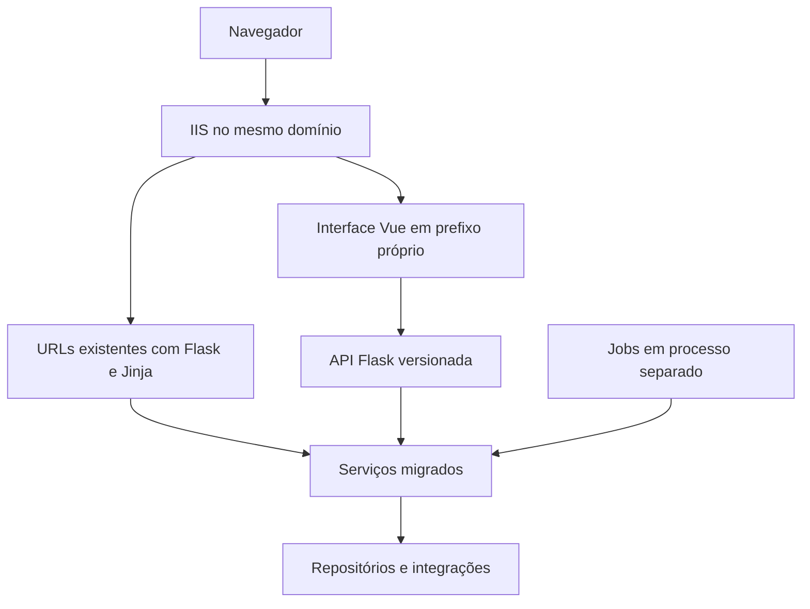

# Arquitetura e modernização do Digital JOST

**Data:** 15 de setembro de 2026

**Situação:** proposta para orientar a implementação progressiva

**Público:** desenvolvimento e manutenção do Digital JOST

A arquitetura principal será um **monólito modular organizado em fatias verticais, com complexidade progressiva e uma pequena camada de plataforma**. Flask permanece no backend, enquanto o frontend novo usa Vue 3, Tailwind CSS 4 e Volt sobre o PrimeVue em modo unstyled. Contratos de API explícitos e recursos compartilhados reduzem as tarefas repetitivas. A modernização deve facilitar a criação de funcionalidades e permitir que as existentes sejam migradas por partes, preservando suas regras e os processos industriais atendidos pelo sistema.

A primeira entrega funcional será a nova home em Vue. Ela será construída como parte permanente do Digital JOST e ficará disponível inicialmente por uma URL própria, enquanto a home atual permanece oficial. Essa entrega pode anteceder a criação de um banco separado porque não terá gravações, mudanças de schema nem consultas adicionais: o frontend começa com dados simulados e depois consome apenas a identidade e um catálogo de acessos versionado no backend.

Hoje, conforme informado pelo responsável, o desenvolvimento usa o banco de produção. Isso continua sendo um risco prioritário. O isolamento completo de desenvolvimento e homologação deve ocorrer antes das primeiras funcionalidades que gravem dados. A execução local do backend também depende de remover ou controlar os efeitos externos da inicialização; desenvolver primeiro a home não autoriza usar produção como ambiente de teste.

Este documento consolida a direção discutida, as ferramentas recomendadas, as regras de organização e o roteiro de adoção. As escolhas de ferramentas ainda precisam ser confirmadas em um piloto isolado. A proposta não autoriza execução do sistema, alterações de banco, publicação ou acesso a serviços corporativos.

## Navegação

- [1 Objetivos e critérios de sucesso](#1-objetivos-e-critérios-de-sucesso)
- [2 Contexto atual e evidências](#2-contexto-atual-e-evidências)
- [3 Decisões e pressupostos](#3-decisões-e-pressupostos)
- [4 Organização do backend](#4-organização-do-backend)
- [5 Ferramentas do backend](#5-ferramentas-do-backend)
- [6 Contratos e padrões da API](#6-contratos-e-padrões-da-api)
- [7 Persistência e consistência](#7-persistência-e-consistência)
- [8 Segurança como recurso compartilhado](#8-segurança-como-recurso-compartilhado)
- [9 Ambientes isolados](#9-ambientes-isolados)
- [10 Jobs e integrações](#10-jobs-e-integrações)
- [11 Frontend Vue e convivência com Jinja](#11-frontend-vue-e-convivência-com-jinja)
- [12 Recursos prontos e geração de funcionalidades](#12-recursos-prontos-e-geração-de-funcionalidades)
- [13 Desenvolvimento e verificação](#13-desenvolvimento-e-verificação)
- [14 Migração progressiva](#14-migração-progressiva)
- [15 Decisões pendentes e riscos de adoção](#15-decisões-pendentes-e-riscos-de-adoção)
- [16 Referências técnicas](#16-referências-técnicas)
- [17 Guia para iniciar a arquitetura com a nova home](#17-guia-para-iniciar-a-arquitetura-com-a-nova-home)

## 1 Objetivos e critérios de sucesso

A arquitetura deve tornar previsível onde colocar cada responsabilidade e reduzir a quantidade de código repetitivo escrito por funcionalidade. A meta é que o desenvolvedor concentre seu trabalho nos campos, nas regras, nas consultas específicas e na composição da interface.

### 1.1 Princípios de desenvolvimento

1. Preferir o caminho mais simples que preserve segurança, clareza e consistência.
2. Código novo não deve aumentar a dívida nem ampliar padrões inseguros do legado.
3. Uma abstração só deve existir quando reduzir duplicação ou decisões recorrentes.
4. A regra de negócio pertence à feature que controla seu comportamento e seus dados.
5. A plataforma oferece mecanismos compartilhados; os módulos definem as políticas do negócio.
6. Remover código substituído faz parte da modernização, depois de mapear referências e confirmar que seus caminhos e dependências deixaram de ser necessários.

Os resultados esperados são:

- Criar funcionalidades com uma estrutura conhecida e exemplos completos.
- Reutilizar autenticação, autorização, erros, paginação, anexos e auditoria.
- Declarar contratos de dados que apoiem validação, documentação e tipagem do frontend.
- Compartilhar regras entre APIs, páginas antigas e jobs.
- Desenvolver com dados fictícios ou anonimizados, sem depender de produção.
- Refatorar módulos antigos gradualmente, com critérios de equivalência funcional.
- Publicar mudanças de forma reproduzível, com compatibilidade de dados e possibilidade de retorno.

A quantidade total de linhas pode aumentar durante a convivência com o legado. A avaliação deve considerar o trabalho necessário para uma nova feature, a clareza das regras, a redução de duplicação e a facilidade de diagnosticar e corrigir problemas. Não há uma estimativa de redução de código comprovada neste momento.

## 2 Contexto atual e evidências

O projeto já contém tecnologias capazes de sustentar a modernização: Flask, SQLAlchemy, SQL Server, Jinja, integrações corporativas e processamento agendado. A dificuldade principal está na concentração de responsabilidades e na aplicação desigual dos padrões.

O levantamento estático examinou a estrutura e os registros em `main.py`, a inicialização, autenticação, permissões, acesso a dados, os módulos novos de demandas e trechos representativos do legado, frontend e schedulers. Não equivale a uma auditoria completa de todos os endpoints, regras ou objetos de banco.

| Evidência no código | Implicação para a arquitetura |
| --- | --- |
| `app/routes/request/laboratory.py` possui 3.368 linhas e `processDeviation.py` possui 3.724 no estado examinado. | Separar HTTP, regras, consultas, arquivos e notificações nos módulos mais complexos. |
| `app/routes/demandManagement/` e `app/routes/demandRequests/` já separam rotas, serviços, repositório e domínio. | Aproveitar essa experiência como ponto de partida, sem copiar suas limitações. |
| JavaScript aparece em templates, includes Jinja e arquivos estáticos; parte da interface é montada manualmente com HTML em strings. | Migrar a interação para componentes Vue e explicitar os contratos com o backend. |
| `app/templates/home.html` apresenta oito setores fixos e seus agrupamentos atuais. | Usar esses oito setores como escopo inicial da nova home, sem acrescentar uma consulta organizacional nesta entrega. |
| `app/config.py` chama `db.create_all()` na criação do app. | Desacoplar a inicialização da evolução do schema. |
| `dynamic_constants.py` e `azure_utils.py` instanciam gerenciadores que iniciam threads durante o import. | Eliminar efeitos externos implícitos e tornar integrações configuráveis. |
| Jobs de laboratório, desvios e demandas operam sobre dados usados pelas telas. | Incluir jobs no levantamento e na migração das regras de cada domínio. |
| O novo gerenciador e as melhorias antigas compartilham dados e sincronizações. | Definir qual módulo controla cada escrita e preservar compatibilidade durante a transição. |

Foram observados SQL com entrada interpolada, uso de `eval`, verificações de permissão com strings tratadas como booleanos, configurações sensíveis embutidas e caminhos de arquivos montados sem validação suficiente. A proteção CSRF aparece nos módulos novos, mas não foi identificado um mecanismo global equivalente nos fluxos antigos examinados.

O impacto efetivo depende também da configuração do IIS, das permissões do banco e do filesystem. Esses aspectos não foram verificados em execução. Os arquivos de uploads e dados operacionais não devem ser usados como fixtures.

## 3 Decisões e pressupostos

| Tema | Direção | Situação |
| --- | --- | --- |
| Backend | Manter Flask e organizar o código em módulos verticais por funcionalidade. | Decisão consolidada. |
| Frontend | Vue 3 com TypeScript, Vite e Tailwind CSS 4 para novas funcionalidades. | Decisão consolidada. |
| Modelo de aplicação | Monólito modular com fatias verticais, uma camada pequena de plataforma e processos de jobs separados. | Decisão consolidada. |
| Complexidade | Começar cada feature com o menor desenho seguro e acrescentar camadas quando a responsabilidade existir. | Decisão consolidada. |
| Migração | Aplicar Strangler Fig e reescrita orientada por mudanças relevantes, classificando módulos como `LEGACY`, `HYBRID` ou `MODERN`. | Decisão consolidada. |
| APIs novas | APIFlask com Pydantic. | Preferência técnica a validar no piloto. |
| Banco | SQLAlchemy 2, ORM onde simplificar e SQL parametrizado para consultas específicas. | Recomendação técnica. |
| Ambientes | Desenvolvimento, homologação e produção isolados. | Necessidade confirmada; infraestrutura a definir. |
| Hospedagem | Planejar inicialmente a convivência no Windows/IIS e no mesmo domínio. | Pressuposto a confirmar. |
| Estilização | Tailwind CSS 4, design tokens e componentes Vue reutilizáveis. | Decisão consolidada; integração a validar no piloto. |
| Biblioteca de interface | Volt sobre PrimeVue em modo unstyled; componentes adicionados sob demanda ao código do frontend. | Decisão consolidada; manutenção e integração a validar na feature de referência. |
| Ícones | PrimeIcons importado localmente; o backend fornece identificadores semânticos permitidos e o Vue resolve a representação visual. | Decisão consolidada para o piloto. |
| Implantação | Mudanças graduais e publicações explícitas. | Direção recomendada. |

Flask-Smorest com Marshmallow foi considerado como alternativa para validação e documentação. A preferência consolidada é APIFlask com Pydantic, pela combinação de funções de rota pequenas e contratos baseados em tipos Python. Não há motivo para adotar os dois mecanismos de API simultaneamente na base nova.

Não está proposta uma reescrita integral, mudança imediata de banco ou introdução de serviços distribuídos. Novas ferramentas devem resolver uma necessidade concreta que justifique sua operação e manutenção.

## 4 Organização do backend

A direção arquitetural é um **monólito modular com fatias verticais e uma camada pequena de plataforma**. Cada funcionalidade deve ter uma pasta que permita localizar suas entradas HTTP, contratos, regras, consultas e integrações específicas. A organização deve aproximar o código que muda pelo mesmo motivo, sem obrigar toda operação a atravessar camadas artificiais.

Recursos comuns ficam em `platform/` somente quando forem fundamentos da aplicação ou tiverem reutilização comprovada. Pastas genéricas como `core`, `utils` e `helpers` não devem receber código apenas porque ele não encontrou outro lugar.

### 4.1 MVC como referência de responsabilidades

MVC é uma referência secundária para separar responsabilidades dentro de uma feature. As rotas exercem o papel de controller, os modelos e repositórios representam a persistência, e o Vue ou o Jinja legado formam a view. Uma camada de serviços concentra os casos de uso e as transações que não pertencem às entradas HTTP nem aos modelos.

```text
View                 Controller          Aplicação        Persistência
Vue ou Jinja    →    routes.py      →    services.py  →   repository.py e models.py
                       ↓
                   schemas.py
```

O diagrama representa o caminho completo de um caso de uso. Leituras triviais podem omitir o serviço conforme os critérios da seção 4.4.

O termo MVC não identifica a arquitetura nem determina três pastas globais chamadas `models`, `views` e `controllers`. Esse formato espalharia uma funcionalidade por todo o projeto e faria as pastas crescerem sem um limite claro. A unidade principal de organização e raciocínio será o módulo de negócio, como demandas, laboratório ou desvios.

### 4.2 Estrutura de referência

```text
DigitalJost/
├── main.py                         # ponto de entrada do IIS e composição do legado durante a transição
├── web.config                      # configuração de hospedagem no IIS
├── requirements.txt                # dependências Python de produção
├── requirements-dev.txt            # ferramentas locais, quando criado
├── app/
│   ├── __init__.py                 # factory configurável
│   ├── config.py                   # configuração por ambiente
│   ├── extensions.py               # extensões sem efeitos externos no import
│   ├── platform/
│   │   ├── __init__.py             # inicialização explícita do que já existe
│   │   ├── auth/                   # identidade e autenticação
│   │   ├── permissions/            # mecanismos comuns de autorização
│   │   ├── database/               # conexões e sessões configuráveis
│   │   ├── errors/                 # tradução de erros
│   │   ├── pagination/             # contrato comum de listagens
│   │   ├── files/                  # armazenamento e acesso seguro
│   │   ├── audit/                  # registro padronizado de alterações
│   │   ├── notifications/          # mecanismo comum de notificações
│   │   └── integrations/           # adaptadores corporativos compartilhados
│   ├── modules/
│   │   ├── __init__.py             # registro explícito dos módulos modernos
│   │   └── <feature>/
│   │       ├── __init__.py
│   │       ├── routes.py
│   │       ├── schemas.py
│   │       ├── services.py         # quando houver escrita, regras ou transações
│   │       ├── repository.py       # quando o acesso a dados justificar
│   │       ├── models.py           # somente quando houver entidades ORM
│   │       ├── domain.py           # estados e regras complexas, quando existirem
│   │       └── integrations.py     # integrações específicas da feature
│   ├── jobs/
│   ├── templates/                  # páginas legadas e e-mails
│   └── static/                     # assets públicos
├── frontend/
├── tests/
├── migrations/
└── docs/
```

A árvore representa uma estrutura de chegada. Não determina movimentações imediatas nem exige criar todos os arquivos antecipadamente. Os schedulers atuais permanecem em `app/services/` até sua migração explícita. O legado também permanece fisicamente em suas pastas atuais: criar uma grande pasta `legacy/` e mover tudo de uma vez aumentaria o risco sem melhorar o comportamento. Cada arquivo só deve ser movido quando sua fatia for migrada e suas referências forem conhecidas.

### 4.3 Responsabilidades

| Parte | Responsabilidade | Limite |
| --- | --- | --- |
| Rotas | Interpretar HTTP, aplicar validação e autorização, chamar o caso de uso ou executar uma leitura trivial e devolver respostas. | Não conter mutações, transações, SQL complexo ou regras de negócio. |
| Schemas | Declarar entradas, saídas, tipos, limites e campos permitidos. | Não substituir regras de negócio ou autorização. |
| Serviços | Executar casos de uso e controlar transações e dependências. | Não depender diretamente de `request`, sessão HTTP ou renderização de páginas. |
| Repositório | Encapsular consultas e persistência. | Não conhecer Flask nem realizar commits ocultos. |
| Modelos | Representar entidades ORM controladas pela funcionalidade. | Não expor automaticamente todos os campos na API nem acumular regras de fluxo. |
| Integrações | Adaptar e-mail, SAP, Plex, Teams e outros serviços. | Não iniciar conexões, threads ou envios durante import. |
| Jobs | Agendar e invocar operações de negócio. | Evitar uma implementação paralela das regras das telas. |

`models.py` entra quando houver entidades ORM próprias. `domain.py` pode concentrar estados, transições e regras mais complexas. `policies.py` é útil quando a autorização por registro cresce. Esses arquivos surgem conforme a responsabilidade existir.

Serviço e repositório são uma boa base para o legado com SQL extenso. Uma funcionalidade pequena pode usar funções simples. Não são necessárias hierarquias de classes ou métodos que apenas repassam os mesmos argumentos por várias camadas.

### 4.4 Complexidade progressiva

Cada feature começa pelo menor caminho que preserve segurança, clareza e consistência. Existem dois caminhos oficiais:

| Caminho | Quando usar | Fluxo típico |
| --- | --- | --- |
| Leitura simples | Endpoint somente de leitura, sem regra relevante, efeito colateral, transação ou autorização por registro. | `route → schema → query/repository → response` |
| Caso de uso | Qualquer criação, alteração, exclusão, transição, transação, auditoria, autorização por registro ou integração. | `route → schema → service/use case → repository/integration` |

O caminho simples não autoriza SQL interpolado, acesso sem limite, retorno de colunas indiscriminadas ou decisão de negócio na rota. Se uma leitura crescer, ela ganha repositório ou serviço sem exigir a reestruturação do restante do módulo.

Toda mutação passa por uma função de serviço ou caso de uso, mesmo quando ela for curta. Isso fornece um ponto estável para autorização, transação, auditoria e reaproveitamento por API, página legada ou job. `services.py` e `repository.py` continuam opcionais quando essas responsabilidades realmente não existem; arquivos vazios e classes cerimoniais não devem ser criados.

### 4.5 Regras da plataforma

Um recurso entra em `platform/` quando for infraestrutura fundamental, como identidade, configuração, banco e erros, ou quando possuir pelo menos dois consumidores reais com a mesma necessidade. Antes disso, permanece dentro da feature que o criou.

A plataforma oferece mecanismos, não políticas de negócio. Ela pode verificar uma permissão, registrar auditoria, paginar uma consulta ou armazenar um arquivo. A decisão de quem pode aprovar uma demanda, quais estados um desvio aceita ou quais anexos um laboratório exige pertence ao módulo correspondente.

Cada pacote da plataforma deve possuir responsabilidade, API e dependências claras. Não usar arquivos genéricos `utils.py` ou `helpers.py` como destino padrão. Uma abstração compartilhada deve reduzir código e decisões nos consumidores; se exigir várias exceções específicas por feature, deve ser dividida ou devolvida ao domínio.

### 4.6 Regras de dependência

Uma operação de negócio deve ter um responsável. API nova, página antiga e job convergem para essa operação. Um módulo não deve importar os handlers HTTP de outro nem espalhar alterações diretas nas tabelas controladas por ele.

Os serviços recebem explicitamente as dependências de que precisam, como repositório, armazenamento e notificações. A composição ocorre perto da inicialização ou da entrada da aplicação, de forma legível. Não é necessário começar com um framework de injeção de dependências.

O módulo de permissões fornece o mecanismo comum; as regras específicas, como quem pode aprovar uma solicitação de determinada área, permanecem junto da funcionalidade.

Código novo não deve importar diretamente handlers, variáveis globais ou detalhes internos do legado. Quando uma funcionalidade moderna precisar de um comportamento ainda antigo, usar um adaptador explícito e temporário. O adaptador registra a dependência, limita seu alcance e pode ser removido quando a fatia correspondente for migrada.

### 4.7 Composição da aplicação e registro de módulos

A primeira fatia moderna deve estabelecer um ponto único e explícito para registrar os módulos novos. `app/modules/__init__.py` exporta uma função como `register_modules(app)`, que conhece os blueprints modernos autorizados. Cada módulo exporta seu blueprint ou uma função pequena de registro. Não usar descoberta automática de pacotes, imports dinâmicos ou efeitos colaterais no import.

O fluxo conceitual da factory será:

```text
create_app(config_name)
    → carregar configuração
    → inicializar extensões
    → inicializar recursos de plataforma implementados
    → registrar módulos modernos
    → devolver a aplicação
```

O registro atual dos blueprints legados em `main.py` permanece como está durante o primeiro piloto. Movê-lo integralmente para uma função `register_legacy()` produziria uma alteração ampla sem benefício necessário para a home. A migração futura pode trazer esse registro para a composição da factory por etapas, depois de mapear imports e efeitos externos.

`main.py` permanece na raiz de `DigitalJost/`, ao lado de `app/`, `frontend/` e `web.config`, preservando o ponto de entrada esperado pelo IIS. Com a migração progressiva, ele pode se tornar um arquivo fino que apenas obtém a aplicação da factory, mas essa simplificação só deve acontecer depois que o registro dos blueprints legados for transferido e validado por partes. A criação da nova home não move nem renomeia esse arquivo.

A lista dos módulos modernos deve ser explícita e revisável. Acrescentar uma feature significa criar sua pasta e adicioná-la nesse registro, sem espalhar novos imports e chamadas por vários arquivos.

## 5 Ferramentas do backend

| Ferramenta | Uso proposto | Benefício e cuidado |
| --- | --- | --- |
| APIFlask | APIs novas, serialização e OpenAPI. | Reduz tratamento HTTP repetitivo; preservar os erros HTML e redirects do legado. |
| Pydantic | Schemas de entrada e saída. | Contratos tipados e validação declarativa; definir campos explicitamente. |
| SQLAlchemy 2 | ORM, consultas e transações. | Aproveita a base existente; manter clareza sobre engine, sessão e transação utilizadas. |
| Pydantic Settings | Carregamento e validação de configurações. | Detecta campos obrigatórios ausentes; não substitui isolamento de rede ou gestão de segredos. |
| Alembic | Alterações de schema versionadas. | Mudanças revisadas e limitadas aos objetos sob responsabilidade do sistema. |
| `venv` e `pip` | Ambiente virtual e instalação das dependências Python. | Compatíveis com o processo atual; usar arquivos versionados com versões fixadas e nunca instalar no Python global. |
| Ruff | Formatação e verificações de código. | Convenções comuns; evitar reformatação ampla do legado junto de mudanças funcionais. |
| Copier | Geração da estrutura de módulos. | Código inicial consistente e editável; o template deve nascer de exemplos validados. |

APIFlask estende Flask. A documentação consultada registra suporte a Pydantic desde a versão 3.0. A versão concreta de cada dependência será fixada após verificar compatibilidade com Python, Windows, drivers de banco e extensões utilizadas.

O ganho esperado vem da integração entre ferramentas: o schema orienta a validação e a documentação; o OpenAPI permite gerar tipos para o Vue; o template de feature reutiliza esses padrões.

## 6 Contratos e padrões da API

As APIs novas devem usar um prefixo próprio, como `/api/v1/`, preservando as URLs existentes enquanto forem necessárias. As respostas devem seguir convenções comuns para dados, erros, paginação e conflitos.

| Tema | Convenção proposta |
| --- | --- |
| Entrada | Schemas explícitos; rejeitar campos inesperados nas operações novas. |
| Saída | Schemas próprios, sem serializar automaticamente todos os atributos do banco. |
| Criação | Resposta `201` com a representação definida pelo contrato. |
| Autenticação | `401` JSON para APIs sem sessão válida. |
| Autorização | `403` quando a ação é proibida; `404` quando necessário para não revelar registros inacessíveis. |
| Validação | `422` para campos semanticamente inválidos; `400` para requisições malformadas. |
| Concorrência | `409` para conflito de edição ou transição. |
| Erros inesperados | Mensagem pública genérica e identificador para diagnóstico; detalhes apenas nos registros internos adequados. |
| Listagens | Paginação e limite máximo; filtros e ordenações em listas permitidas. |
| Datas | ISO 8601 no contrato; distinguir data sem horário de instante com fuso. |
| Valores decimais | Representação explícita quando precisão importa, evitando conversão indiscriminada para ponto flutuante. |

Essas convenções devem ser aplicadas à API nova e adaptadas gradualmente no legado. Não é necessário alterar todos os formatos de resposta existentes de uma vez.

### 6.1 Exemplo conceitual

O exemplo mostra o formato desejado de uma operação. Não é código pronto para execução no projeto.

```python
class DemandCreate(BaseModel):
    model_config = ConfigDict(extra="forbid")

    title: str = Field(min_length=3, max_length=160)
    description: str = Field(min_length=10)
    priority: Literal["low", "normal", "high"] = "normal"


@bp.post("/demands")
@require_permission("demands.create")
@bp.input(DemandCreate)
@bp.output(DemandDetail, status_code=201)
def create_demand(json_data: DemandCreate):
    return get_service().create(
        data=json_data,
        actor=current_actor(),
    )
```

`require_permission`, `current_actor` e `get_service` representam recursos a implementar na base. A autenticação e a proteção CSRF precisam estar configuradas. O serviço verifica as regras por área e registro, executa a transação e produz a saída apropriada.

O schema valida o formato e os limites dos campos. A existência de um responsável, seu vínculo com a área e a permissão para uma transição são regras do serviço e de suas políticas.

## 7 Persistência e consistência

### 7.1 ORM e SQL textual

Usar ORM em cadastros e entidades controladas pelo Digital JOST quando reduzir a escrita manual e tornar relacionamentos claros. Manter SQL parametrizado nos repositórios para relatórios, consultas complexas, tabelas legadas e fontes corporativas.

Pandas permanece útil para análise, transformação tabular e exportação. A obtenção de um registro ou uma atualização simples não precisa passar obrigatoriamente por um DataFrame.

O modelo ORM e o contrato da API têm responsabilidades diferentes. Campos como autor, área efetiva, permissões e metadados de auditoria devem ser definidos pelo servidor. A entrada do cliente não pode escolher livremente colunas a alterar.

### 7.2 Transações e concorrência

O serviço define o limite da transação. Todas as gravações que precisam ocorrer juntas usam a mesma conexão ou sessão. O repositório não executa commits independentes que possam deixar uma operação parcialmente concluída.

Em aplicações que carregam a identidade usando uma sessão ORM, é necessário considerar a transação já iniciada antes de abrir outra. O padrão de sessão e transação deve ser demonstrado no piloto, evitando misturar inadvertidamente Flask-SQLAlchemy, conexões Core e pyodbc na mesma operação lógica.

Preservar o controle de concorrência existente, como `rowVersion`, e adotá-lo onde duas pessoas possam editar o mesmo registro. Uma atualização deve conferir a versão recebida antes de sobrescrever dados. Geração de identificadores e transições também precisam considerar requisições simultâneas; `MAX(id) + 1` sem coordenação não é uma solução segura.

Uma transação SQL não torna atômicos e-mail, filesystem e sistemas externos. Operações entre bancos ou integrações devem ter limites explícitos, tratamento de falha e estratégia de recuperação.

### 7.3 Migrations

Remover a criação de tabelas da inicialização normal e adotar mudanças de schema versionadas, revisadas e executadas de forma explícita. O usuário da aplicação não deve precisar de permissão para alterar schema em operação normal.

O ponto de partida do banco existente precisa ser conhecido. Não gerar nem aplicar alterações automaticamente sobre todos os bancos corporativos. A documentação do Alembic destaca que migrations autogeradas exigem revisão manual.

Durante a migração de funcionalidades, preferir mudanças aditivas e compatíveis com os dois caminhos. A remoção de colunas ou estruturas antigas depende da retirada de todos os leitores e escritores, incluindo jobs.

## 8 Segurança como recurso compartilhado

### 8.1 Autenticação e autorização

Reaproveitar inicialmente a identidade Windows/IIS e a sessão, corrigindo os comportamentos inseguros. A confiança na identidade encaminhada pelo IIS depende de impedir acesso que contorne essa camada. Não aceitar um identificador arbitrário enviado pelo navegador como identidade autenticada.

Normalizar `admin`, `active` e outros indicadores ao carregar a identidade. A string `"0"` é verdadeira em uma condição booleana Python; as verificações não devem depender dessa conversão implícita.

Cada operação verifica a ação e o registro: área, solicitante, responsável, aprovador e estado atual. Esconder um botão no Vue é uma conveniência de interface, não uma autorização.

Manter cookies apropriados ao HTTPS e ao fluxo de sessão, proteção CSRF para operações mutáveis e destinos de redirecionamento validados. As configurações concretas devem ser compatíveis com o SSO e verificadas em homologação.

### 8.2 Entradas e arquivos

SQL novo deve usar parâmetros. Nomes de colunas, ordenações e outros identificadores dinâmicos exigem listas permitidas. Substituir o uso de `eval` para dados por formatos e parsers adequados.

Anexos privados devem ser armazenados fora do diretório público de assets. A API autoriza o acesso ao registro, resolve um identificador de anexo e verifica que o caminho final está contido no diretório permitido. Nome seguro, extensão, conteúdo quando aplicável, quantidade e tamanho fazem parte da validação.

Exportações devem evitar nomes de arquivo compartilhados entre requisições concorrentes e possuir política de expiração. A migração dos anexos existentes exige plano próprio e autorização, sem movimentação automática de dados operacionais.

### 8.3 Segredos e registros

Configurações sensíveis ficam fora do código, com credenciais distintas por ambiente. Remover um segredo versionado não substitui sua rotação ou revogação e o tratamento do histórico quando necessário.

Separar logs técnicos de auditoria de negócio. Registrar dados necessários ao diagnóstico, com identificadores de correlação, sem copiar indiscriminadamente payloads, tokens ou informações pessoais. Definir campos excluídos, acesso e retenção.

As correções graves do legado têm uma frente própria e não devem aguardar sua migração visual para Vue.

## 9 Ambientes isolados

| Recurso | Desenvolvimento | Homologação | Produção |
| --- | --- | --- | --- |
| Banco | Instância ou ambiente separado com dados de exemplo. | Banco separado e dados representativos anonimizados. | Dados operacionais. |
| Credenciais | Sem acesso aos recursos de produção. | Acesso limitado aos recursos de homologação. | Privilégios mínimos para operação. |
| Arquivos | Diretórios próprios e arquivos fictícios. | Diretórios próprios e dados controlados. | Armazenamento operacional. |
| E-mail e Teams | Captura local ou implementação simulada. | Destinos de teste explicitamente permitidos. | Destinos reais. |
| SAP e Plex | Respostas simuladas ou ambiente de teste aprovado. | Integração controlada quando disponível. | Integração real. |
| Identidade | Perfis fictícios exclusivos do ambiente isolado. | Validação do fluxo de identidade autorizado. | Autenticação corporativa. |
| Jobs | Desligados por padrão e executáveis apenas no escopo isolado. | Agendamento controlado. | Agendamento operacional. |

Usar SQL Server no desenvolvimento para preservar compatibilidade com o SQL existente. A versão, edição e nível de compatibilidade devem representar o uso em produção. A edição Developer é uma opção destinada a desenvolvimento e testes, conforme a documentação da Microsoft.

Trocar apenas a string de conexão é insuficiente. Verificar referências entre bancos, views, procedures, triggers, caminhos de rede e eventuais servidores vinculados antes de reaproveitar a estrutura. Os outros bancos usados pelo sistema também precisam de substitutos ou acessos de teste explicitamente definidos.

Começar com um conjunto pequeno de dados fictícios para o piloto. Quando forem necessários dados reais representativos, preparar um processo de anonimização que preserve relacionamentos e remova identificadores, destinos de notificação e conteúdo confidencial.

A configuração deve falhar quando faltar um valor obrigatório, sem recorrer a produção como padrão. A proteção principal combina credenciais, permissões e restrições de acesso; verificações no código são uma camada adicional.

## 10 Jobs e integrações

Os schedulers devem rodar em processos separados da aplicação web. A evolução pode aproveitar a infraestrutura Windows existente, desde que as dependências sejam explícitas e o agendamento não aconteça no import da aplicação.

Cada job chama serviços de negócio, informa a identidade de sistema adequada e registra seu resultado. Deve ser possível reconhecer execução em andamento, falha, duração e necessidade de intervenção. Retentativas exigem operações que possam ser repetidas sem duplicar seus efeitos.

Para notificações relevantes, recomenda-se uma outbox: um registro de envio pendente gravado na mesma transação do evento de negócio. Um processo separado lê esse registro, envia e registra o resultado. Sua adoção exige uma mudança de banco planejada.

Esse mecanismo evita enviar antes de saber se a operação foi confirmada, mas não garante entrega exatamente uma vez. Uma falha após o envio e antes da confirmação pode gerar repetição. O projeto deve definir identificadores, deduplicação quando possível, retentativas limitadas e visibilidade de falhas.

As implementações reais e simuladas de integrações devem atender aos mesmos contratos. Configurar timeouts e tratar respostas indisponíveis de maneira explícita. Não introduzir uma nova infraestrutura de filas antes de existir demanda operacional que justifique esse custo.

## 11 Frontend Vue e convivência com Jinja

O frontend novo deve usar Vue 3, TypeScript, Vite, Vue Router e Tailwind CSS 4, organizado por funcionalidade. Os componentes `.vue` concentram estrutura, interação e estilos relacionados à interface. O backend continua responsável pelas regras e pelo acesso aos dados.

```text
frontend/src/
├── app/
│   ├── router/
│   └── layouts/
├── volt/                           # componentes Volt copiados sob demanda e mantidos pelo projeto
├── shared/
│   ├── api/
│   │   ├── client.ts
│   │   └── errors.ts
│   ├── components/
│   ├── composables/
│   ├── icons/
│   └── styles/
│       ├── main.css                # importação do Tailwind
│       └── tokens.css              # identidade visual do Digital JOST
└── features/
    └── demands/
        ├── pages/
        ├── components/
        ├── api.ts
        └── queries.ts
```

Tailwind será responsável por layout, espaçamento, responsividade, tipografia, estados visuais e componentes próprios. A configuração deve usar a integração oficial com Vite e produzir CSS estático para publicação. Não depender de CDN ou processamento de estilos no navegador em produção.

As cores, tipografia, espaçamentos, bordas e demais decisões visuais recorrentes devem ser representadas por tokens do Digital JOST. Classes utilitárias podem permanecer diretamente nos componentes quando forem curtas e locais. Padrões repetidos ou trechos extensos devem virar componentes Vue ou estilos compartilhados, evitando templates difíceis de ler.

Volt será a base dos controles de interface novos. Ele usa o PrimeVue em modo unstyled e aplica Tailwind aos elementos internos por meio da API Pass Through. Cada componente necessário será copiado sob demanda para `frontend/src/volt/`, tornando-se parte do código mantido pelo projeto. Não importar um catálogo inteiro antecipadamente nem combinar essa configuração inicial com os temas prontos de `@primeuix/themes`.

Tailwind cuida da composição das páginas, dos componentes próprios e da identidade visual. Os tokens do Digital JOST devem alimentar também as variáveis consumidas por `tailwindcss-primeui`, mantendo uma única linguagem visual. Alterações nos componentes Volt devem resolver uma necessidade compartilhada de apresentação ou acessibilidade; regras de negócio e variações específicas de uma feature permanecem em `features/<feature>/`. A origem e a versão usadas para adicionar cada componente devem ser registradas para apoiar manutenção futura.

Os componentes compartilhados devem permanecer pequenos e combináveis. Um componente como `AppUserSelect`, que concentra uma convenção real do sistema, tende a ser útil. Uma tabela universal que tenta absorver filtros, exportação, permissões, formulários e exceções de todos os módulos tende a esconder comportamento e aumentar a complexidade. Nesses casos, compor os componentes Volt ou, quando ainda não houver equivalente, usar o PrimeVue unstyled com Pass Through e extrair apenas os padrões comprovadamente repetidos.

PrimeIcons será a biblioteca inicial para ícones visíveis da aplicação. Seu CSS é empacotado pelo Vite e servido pelo mesmo domínio; não usar CDN. O catálogo e as APIs não enviam classes como `pi pi-cog`. Eles enviam identificadores semânticos estáveis, como `settings` ou `maintenance`, e o frontend mantém em `shared/icons/` um mapa fechado para as classes correspondentes. Identificadores desconhecidos usam um ícone neutro ou deixam o espaço vazio, sem interpretar HTML ou classes arbitrárias.

Ícones decorativos devem ser ignorados por tecnologias assistivas. Toda ação representada apenas por um ícone recebe nome acessível, como `aria-label`, e mantém foco visível. Cor e ícone não podem ser os únicos meios de comunicar estado, setor ou ação.

TanStack Vue Query é o candidato para carregamento, cache e atualização de dados da API. Pinia entra para estado compartilhado de interface quando necessário, evitando manter cópias dos mesmos dados em mecanismos diferentes.

`shared/api/client.ts` concentra URL base, credenciais da mesma origem, interpretação do tipo de conteúdo e tradução das respostas comuns. `shared/api/errors.ts` representa pelo menos sessão ausente ou expirada, acesso negado, recurso inexistente, falha inesperada e HTML recebido quando JSON era esperado. Cada feature mantém seu contrato em `features/<feature>/api.ts` e reutiliza o cliente compartilhado; chamadas `fetch` não devem ser reimplementadas de maneiras diferentes em cada módulo.

O kit de frontend deve oferecer layout, botões e campos básicos, listagem, formulário, seletor de usuário e área, anexos, histórico, confirmação de ações e estados de carregamento ou erro. Permissões recebidas ajudam a apresentar as ações disponíveis; o servidor verifica novamente toda operação.

### 11.1 Distribuição de rotas



Uma opção inicial é reservar `/app/` para a interface nova e `/api/v1/` para suas APIs. As páginas antigas permanecem em suas URLs durante a transição. A regra de fallback do Vue Router deve ficar restrita ao prefixo da interface, sem capturar erros da API ou URLs antigas.

Vite produz os assets para publicação. O frontend pode ser entregue como arquivos estáticos, sem um servidor Node permanente em produção para essa proposta. Se Flask renderizar o HTML de entrada, pode usar o manifesto de assets do Vite.

As APIs devem retornar erros JSON previsíveis. Um redirect silencioso para uma página HTML de login não pode ser interpretado como uma resposta de dados válida. Preservar separadamente o comportamento necessário às páginas Jinja.

JavaScript existente dentro de templates pode depender de Jinja. Sua migração exige identificar os valores dinâmicos e convertê-los em contratos ou configuração explícita, sem simples movimentação de arquivos.

## 12 Recursos prontos e geração de funcionalidades

| Recurso da base | O que a feature define | O que é reaproveitado |
| --- | --- | --- |
| Autorização | Ações e regras por registro. | Identidade, verificação comum e tratamento de acesso negado. |
| Listagem | Filtros e ordenações permitidos. | Paginação, limites e formato de resposta. |
| Anexos | Tipos, limites e regra de acesso. | Armazenamento, nomes internos e download autorizado. |
| Auditoria | Eventos e campos relevantes. | Identidade, data, correlação e exclusão de dados sensíveis. |
| Notificação | Evento, conteúdo e destinatários autorizados. | Templates, envio, registro e tratamento de falhas. |
| Contrato | Schemas de entrada e saída. | Validação e documentação OpenAPI. |
| Testes | Cenários da regra específica. | Perfis fictícios, dados de exemplo e substitutos das integrações. |

O template de feature deve ser criado somente depois de duas ou três funcionalidades de referência confirmarem o desenho. Antes disso, copiar um esqueleto ainda instável apenas multiplicaria decisões que poderão mudar. O gerador pode começar com Copier e, se fizer sentido para a rotina, receber depois uma interface curta como `jost create feature`.

O gerador produz código normal, legível e editável. Ele deve permitir escolher entre leitura simples e caso de uso, criando apenas rotas, schemas, serviços, repositório e exemplos de testes correspondentes às responsabilidades selecionadas. Não gerar arquivos vazios para simular uma arquitetura completa.

Cadastros simples podem receber operações iniciais de listar, consultar, criar e editar. Fluxos de aprovação, pausa ou conclusão recebem a estrutura necessária, mas suas regras são implementadas explicitamente.

Evitar uma grande classe base ou um CRUD universal que aceite qualquer campo e acumule exceções. Geração de código facilita começar; compartilhamento de comportamento evita corrigir o mesmo problema em vários lugares. Essas duas técnicas devem ser usadas com propósitos distintos.

Manter um catálogo curto com exemplos de listagem, formulário, permissão por registro, anexo, transação e integração simulada. Esse catálogo também orienta revisões e futuras contribuições.

## 13 Desenvolvimento e verificação

Preparar configurações e comandos documentados para dependências, verificações, testes, dados fictícios e geração de contratos. Esses comandos só devem ser habilitados após o isolamento e a remoção dos efeitos externos indevidos.

A geração de OpenAPI pode importar ou criar a aplicação. Ela também precisa funcionar sem recursos de produção. A partir da especificação, gerar tipos TypeScript para apoiar o cliente Vue, mantendo a validação obrigatória no backend.

### 13.1 Estratégia de testes futura

- Testes de regras puras para validações e transições.
- Testes de serviços com repositórios e integrações substituíveis.
- Testes de persistência no SQL Server isolado para SQL específico, transações e concorrência.
- Testes de API para sessão, CSRF, autorização e contratos de erro.
- Testes de componentes Vue e dos fluxos completos mais importantes.

Pytest é o candidato para o backend; Vitest e Playwright para componentes e fluxos do frontend, respectivamente. Os cenários devem verificar comportamento relevante, e não apenas reproduzir a implementação.

A automação de verificações deve operar sem credenciais de produção. Mudanças de schema e publicação permanecem ações separadas e controladas. As regras de execução do `AGENTS.md` continuam válidas: um pedido genérico para implementar ou testar não autoriza executar o Digital JOST.

### 13.2 Critério para concluir uma feature

- Contratos de entrada e saída definidos.
- Permissões verificadas por ação e registro.
- SQL parametrizado e limites de transação explícitos.
- Tratamento de conflito quando houver edição concorrente.
- Arquivos e integrações tratados conforme os recursos da base.
- Cenários relevantes verificados em ambiente autorizado.
- Jobs e caminhos legados relacionados considerados.
- Documentação, configuração e estratégia de publicação atualizadas.

## 14 Migração progressiva

A migração seguirá o padrão Strangler Fig: a arquitetura nova cresce ao lado do sistema atual e substitui fatias completas por etapas. A convivência é temporária e controlada. O objetivo de chegada é que todas as funcionalidades ativas estejam no padrão moderno e que o código legado deixe de existir, sem estabelecer uma data artificial ou migrar módulos estáveis apenas por estética.

### 14.1 Política de migração

Cada módulo deve constar em um inventário arquitetural simples:

| Situação | Significado |
| --- | --- |
| `LEGACY` | Continua no desenho antigo e ainda não compartilha seus casos de uso com a base nova. |
| `HYBRID` | Parte da interface ou das entradas ainda é antiga, mas regras ou recursos já convergem para a arquitetura nova. |
| `MODERN` | Segue os contratos, limites de dependência e organização definidos neste documento. |

A classificação registra também responsáveis, rotas, tabelas, jobs, integrações, principais riscos e próxima oportunidade de migração. Ela acompanha o estado real do código; não serve como selo obtido apenas pela movimentação de arquivos.

Aplicar a política de reescrita orientada por mudança:

- Correção pequena e localizada pode permanecer no legado, desde que não amplie seu desenho inseguro.
- Funcionalidade nova deve nascer em `app/modules/` e no frontend Vue.
- Alteração relevante em um fluxo antigo deve avaliar a migração daquela fatia completa.
- Módulos com risco de segurança, mudanças frequentes ou alto custo de manutenção recebem prioridade.
- Após os pilotos validarem a base, funcionalidades grandes não devem começar no padrão antigo.

Migrar uma fatia significa simplificar responsabilidades e remover duplicação. Dividir um arquivo grande em vários arquivos sem esclarecer regras, dependências e transações não caracteriza modernização.

### 14.2 Sequência de entregas

| Etapa | Entrega | Critério de passagem |
| --- | --- | --- |
| 1 | Mapeamento e base mínima segura. | Home, acessos, autenticação, inicialização e publicação atual compreendidos; nenhum comando dinâmico necessário para concluir o desenho. |
| 2 | Nova home em Vue com dados simulados. | Navegação por OP Meeting e os oito setores atuais, componentes e estados da interface funcionam sem depender do banco de produção. |
| 3 | API de leitura e integração com Flask. | Identidade, catálogo versionado, autorização, contratos, erros e assets integrados sem criar consultas, tabelas ou operações de negócio mutáveis. |
| 4 | Piloto controlado no IIS. | Home antiga preservada; nova URL validada para o grupo piloto, com ativação e retorno documentados. |
| 5 | Desenvolvimento e homologação isolados. | Banco, arquivos, identidade e integrações separados; inicialização sem efeitos externos inesperados. |
| 6 | Cadastro simples de referência. | Fluxo completo de escrita com Vue e API, autorização, CSRF, persistência e verificações no ambiente isolado. |
| 7 | Fluxo com regras mais complexas. | Aprovação, transação, anexos ou mudança de status demonstram que a estrutura permanece clara. |
| 8 | Consolidação da plataforma. | Recursos extraídos das entregas têm consumidores e responsabilidades comprovados. |
| 9 | Gerador e catálogo de desenvolvimento. | Nova feature pode ser iniciada sem copiar código de módulos antigos nem gerar camadas vazias. |
| 10 | Migração contínua do legado. | Cada funcionalidade migra com seus leitores, escritores, jobs e integrações conhecidos. |

As correções de segurança prioritárias seguem em paralelo ao planejamento de migração, por mudanças pequenas e específicas. Não há cronograma em semanas definido; capacidade de desenvolvimento e infraestrutura ainda precisam ser confirmadas.

Demandas é um candidato para aproveitar a separação já existente, mas não deve ser tratado como um módulo isolado de melhorias e das demais tabelas. Laboratório e Desvios exigem atenção adicional pelo tamanho e pelas rotinas agendadas.

### 14.3 Procedimento por funcionalidade

1. Mapear URLs, menus, métodos HTTP, permissões, templates, JavaScript, tabelas, arquivos, integrações e jobs.
2. Registrar exemplos de comportamento esperado e casos de acesso permitido e negado.
3. Identificar o responsável pelas regras e pelas gravações.
4. Escolher o caminho de leitura simples ou caso de uso conforme os critérios da seção 4.4.
5. Extrair ou adaptar serviços, repositórios e adaptadores do legado, preservando o comportamento necessário.
6. Fazer a página antiga, a API nova e os jobs convergirem para os mesmos casos de uso quando coexistirem.
7. Construir a interface Vue e verificar contratos, regras e fluxos relacionados.
8. Liberar o novo caminho de forma controlada, com observação de falhas e plano de retorno.
9. Atualizar o inventário arquitetural e registrar dependências temporárias.
10. Retirar o caminho antigo e seus adaptadores quando todas as dependências forem migradas.

O retorno à versão anterior precisa considerar dados, jobs e integrações, além do código. Durante a coexistência, alterações incompatíveis podem impedir um retorno simples. Arquivos históricos ou backups não devem ser confundidos com módulos ativos. O custo de migração deve permanecer proporcional ao valor e ao risco da mudança; o objetivo final não justifica reescritas sem benefício operacional.

## 15 Decisões pendentes e riscos de adoção

| Ponto a confirmar | Motivo |
| --- | --- |
| Disponibilidade de SQL Server separado para desenvolvimento e homologação. | Define como começar o isolamento. |
| Quantidade de desenvolvedores e experiência com Vue, tipagem e ORM. | Ajusta documentação, exemplos e ritmo de adoção. |
| Permanência de Windows/IIS e detalhes da configuração atual. | Afeta autenticação, roteamento, assets e processos de jobs. |
| Versões de Python, SQL Server e drivers usados em produção. | Define a matriz real de compatibilidade. |
| Responsabilidade sobre schemas e objetos corporativos. | Delimita o alcance de migrations e dados de teste. |
| Disponibilidade de ambientes de teste para integrações. | Define quais dependências precisam de simulação. |
| Primeiras duas funcionalidades de referência. | Permite validar simplicidade em um cadastro e em um fluxo de negócio. |
| Regras de retenção, auditoria e armazenamento. | Orienta logs, anexos, exportações e notificações. |

Os principais riscos de adoção são criar abstrações antes de conhecer sua utilidade, manter regras duplicadas durante a coexistência, migrar apenas a tela sem considerar jobs e confiar em configuração local sem isolamento real de acesso.

O piloto deve avaliar quanto código específico foi necessário, quais recursos foram reaproveitados, se uma alteração de regra é localizada e se os erros são diagnosticáveis. A escolha final de ferramentas deve considerar esses resultados, além de compatibilidade e manutenção.

## 16 Referências técnicas

As referências abaixo apoiam as escolhas propostas. A disponibilidade de uma capacidade na documentação não comprova compatibilidade com o Digital JOST sem verificação no ambiente isolado.

- [Flask Application Factories](https://flask.palletsprojects.com/en/stable/patterns/appfactories/) — composição da aplicação e extensões.
- [Flask Security Considerations](https://flask.palletsprojects.com/en/stable/web-security/) — aspectos de segurança da aplicação web.
- [APIFlask](https://apiflask.com/) e [schemas](https://apiflask.com/schema/) — APIs, validação, serialização e OpenAPI.
- [APIFlask Changelog](https://apiflask.com/changelog/) — suporte a Pydantic e evolução de versões.
- [SQLAlchemy ORM Quick Start](https://docs.sqlalchemy.org/en/20/orm/quickstart.html) — modelos e persistência com ORM.
- [SQLAlchemy Engines and Connections](https://docs.sqlalchemy.org/en/20/core/connections.html) — conexões e transações.
- [Alembic Autogeneration](https://alembic.sqlalchemy.org/en/latest/autogenerate.html) — geração e revisão de migrations.
- [Pydantic Settings](https://docs.pydantic.dev/latest/concepts/pydantic_settings/) — configuração tipada.
- [Flask WTF CSRF](https://flask-wtf.readthedocs.io/en/1.2.x/csrf/) — mecanismo de proteção CSRF.
- [Python `venv`](https://docs.python.org/3/library/venv.html), [pip](https://pip.pypa.io/en/stable/) e [requirements files](https://pip.pypa.io/en/stable/user_guide/#requirements-files) — ambiente virtual e dependências Python.
- [Ruff](https://docs.astral.sh/ruff/) e [Copier](https://copier.readthedocs.io/en/stable/) — ferramentas de desenvolvimento.
- [SQL Server Editions](https://learn.microsoft.com/en-us/sql/sql-server/editions-and-components-of-sql-server-2022?view=sql-server-ver16) — contexto das edições para desenvolvimento e testes.
- [Vue Quick Start](https://vuejs.org/guide/quick-start.html) — criação oficial do projeto Vue com Vite e opções de ferramentas.
- [Vue Ways of Using Vue](https://vuejs.org/guide/extras/ways-of-using-vue.html) — formas de adoção do frontend.
- [Vue Single File Components](https://vuejs.org/guide/scaling-up/sfc) — organização de template, lógica e estilos por componente.
- [Vite Backend Integration](https://vite.dev/guide/backend-integration) — integração com backend tradicional e assets compilados.
- [Vue Router History Modes](https://router.vuejs.org/guide/essentials/history-mode.html) — navegação e fallback no servidor.
- [Tailwind CSS with Vite](https://tailwindcss.com/docs/installation/using-vite) — integração do Tailwind CSS 4 com o build do frontend.
- [Volt Overview](https://volt.primevue.org/overview) — modelo de propriedade do código e integração entre PrimeVue unstyled e Tailwind.
- [Volt with Vite](https://volt.primevue.org/vite/) — instalação do Volt, `tailwindcss-primeui` e configuração do PrimeVue em modo unstyled.
- [Volt Icons](https://volt.primevue.org/icons/) e [PrimeIcons](https://primevue.org/icons/) — alternativas de ícones e instalação do pacote adotado no piloto.
- [Volt DataTable](https://volt.primevue.org/datatable/) — referência de componente complexo mantido no código do frontend.
- [TanStack Vue Query](https://tanstack.com/query/latest/docs/framework/vue/overview) e [Pinia](https://pinia.vuejs.org/introduction) — dados da API e estado compartilhado.
- [OpenAPI TypeScript](https://openapi-ts.dev/introduction) — geração de tipos a partir dos contratos.
- [Vue Testing](https://vuejs.org/guide/scaling-up/testing.html) — estratégia e ferramentas para testes do frontend.
- [Microsoft IIS URL Rewrite](https://learn.microsoft.com/en-us/iis/extensions/url-rewrite-module/using-the-url-rewrite-module) — configuração e limites de regras de reescrita no IIS.

**Limite desta consolidação:** o sistema não foi executado; a validação foi somente estática. A arquitetura proposta ainda precisa de confirmação de infraestrutura e de avaliação prática nos pilotos autorizados.

## 17 Guia para iniciar a arquitetura com a nova home

A nova home será a primeira funcionalidade real da modernização. Ela deve ser construída para permanecer no Digital JOST e, depois de aprovada, poderá se tornar a entrada oficial. Durante a implantação inicial, a home atual continua sendo a entrada padrão e a nova versão fica disponível em uma URL própria para avaliação controlada.

Esta é a primeira fatia da arquitetura nova, construída com intenção de permanência e validada inicialmente como piloto. Ela avalia o fluxo de desenvolvimento, Vue, Tailwind, Volt sobre PrimeVue unstyled, os contratos da API e a publicação no IIS. A interface não deve parecer descartável nem depender de dados fictícios em produção. O uso de dados simulados existe apenas para permitir o desenvolvimento do frontend antes do isolamento completo do banco.

### 17.1 Resultado esperado

Ao terminar esta primeira entrega, o projeto deve possuir:

- Uma nova home responsiva em Vue 3 e TypeScript.
- Navegação organizada por `OP Meeting` e pelos oito setores apresentados na home atual: Engenharia da Qualidade, Engenharia de Processos, Excelência Operacional, Logística, Manutenção, Produção, Segurança e Transformação Digital.
- Catálogo de módulos filtrado no backend conforme a identidade e as permissões reais do usuário.
- Busca por setor, sistema ou funcionalidade.
- Factory capaz de inicializar os recursos modernos e um registro explícito para módulos novos.
- Cliente HTTP compartilhado e tratamento uniforme dos erros da API.
- Componentes visuais e padrões de API que possam ser reutilizados nas próximas features.
- Assets compilados pelo Vite e servidos pelo mesmo IIS da aplicação, sem processo Node em produção.
- Uma URL inicial própria, preferencialmente `/app/`, protegida por configuração e grupo piloto.
- Home antiga, rota `/` e destino atual após o login preservados.
- Procedimento documentado de ativação, validação e retorno.

Esta etapa não cria tabelas, migrations, endpoints de escrita, notificações ou jobs. Também não depende de indicadores operacionais, relatórios ou consultas pesadas.

### 17.2 Como a home será organizada

A navegação deve refletir a forma como as pessoas encontram o trabalho no Digital JOST. O primeiro nível apresenta:

1. **OP Meeting:** acessos e ferramentas ligados à rotina da reunião operacional.
2. **Setores:** uma área para cada um dos oito setores já apresentados na home atual.

Os oito setores devem aparecer na nova home. Dentro de cada área, aparecem apenas funcionalidades ativas, com nome, descrição curta, ícone padronizado e link real. Quando um setor não tiver módulos disponíveis para o usuário, a interface apresenta um estado vazio claro em vez de remover o setor da navegação. Cópias históricas, módulos desativados, templates ausentes ou URLs sem destino confirmado não entram no catálogo de funcionalidades.

O catálogo inicial será versionado em `app/modules/home/catalog.py` com identificadores estáveis:

| Identificador | Nome exibido |
| --- | --- |
| `engenharia-qualidade` | Engenharia da Qualidade |
| `engenharia-processos` | Engenharia de Processos |
| `excelencia-operacional` | Excelência Operacional |
| `logistica` | Logística |
| `manutencao` | Manutenção |
| `producao` | Produção |
| `seguranca` | Segurança |
| `transformacao-digital` | Transformação Digital |

`app/templates/home.html` é a referência para esse recorte, e `main.py` continua sendo a fonte de verdade para confirmar quais funcionalidades internas estão ativas. Outros nomes encontrados em telas específicas não ampliam automaticamente o escopo desta primeira home. A inclusão futura de um novo setor será uma alteração explícita e revisável no catálogo.

A estrutura visual inicial deve conter:

- Cabeçalho com identidade do Digital JOST e informações mínimas do usuário.
- Destaque para OP Meeting.
- Grade ou lista de setores.
- Cards de funcionalidades dentro de cada setor.
- Busca que filtre os dados já carregados.
- Estados de carregamento, ausência de acessos, falha de API e sessão expirada.
- Navegação por teclado, foco visível e adaptação para celular.
- Link claro para retornar à home atual.

Favoritos, acessos recentes, ordenação personalizada e edição administrativa do catálogo ficam fora da primeira entrega, pois exigiriam persistência e regras adicionais.

### 17.3 Etapa 0 — mapear antes de instalar

Antes de alterar dependências ou criar pastas:

1. Ler `AGENTS.md`, `README.md`, `main.py`, `app/config.py`, a rota e o template da home atual, o menu, os arquivos JavaScript relacionados e `web.config`.
2. Registrar como o IIS inicia o Flask, serve arquivos estáticos e encaminha URLs hoje.
3. Mapear os blueprints realmente registrados em `main.py` e os links ativos exibidos pela home atual.
4. Registrar no catálogo os oito setores da home atual com os identificadores definidos na seção 17.2.
5. Relacionar cada link ativo a OP Meeting ou a um desses setores, registrando título, descrição, URL, permissão e responsável.
6. Mapear como a identidade, a área e as roles são obtidas. Tratar `current_user.admin` conforme seu tipo textual real.
7. Identificar os efeitos transitivos da inicialização, incluindo `db.create_all()`, threads, tokens, logs e conexões externas.
8. Confirmar as versões instaladas de Python e Node aceitas no ambiente de build e no servidor, sem atualizar dependências automaticamente.
9. Verificar se `/app/`, `/api/v1/home` e o diretório planejado para assets não conflitam com rotas existentes.

A saída desta etapa é uma tabela do catálogo e um diagrama curto do caminho navegador → IIS → Flask → Vue/API. Nenhuma funcionalidade deve ser inventada para preencher a interface.

### 17.4 Etapa 1 — preparar ferramentas e dependências

Os comandos abaixo representam o fluxo pretendido. Eles só podem ser executados durante a implementação com a autorização exigida pelo `AGENTS.md`, depois de confirmar versões e impacto no projeto.

#### Frontend

Usar uma versão LTS do Node compatível com a versão atual do `create-vue` e do Vite. Registrar a versão escolhida em `.nvmrc` ou mecanismo equivalente e em `package.json`.

Criar o projeto oficial Vue:

```powershell
npm create vue@latest frontend
```

Selecionar inicialmente:

| Opção | Escolha inicial |
| --- | --- |
| TypeScript | Sim |
| JSX | Não |
| Vue Router | Sim |
| Pinia | Não; adicionar quando houver estado global real |
| Vitest | Sim |
| Teste de ponta a ponta | Playwright, quando começar a validação navegável |
| ESLint | Sim |
| Prettier | Sim |

Instalar as dependências aprovadas e gerar um lockfile:

```powershell
Set-Location frontend
npm install
npm install tailwindcss @tailwindcss/vite
npm install primevue primeicons tailwindcss-primeui tailwind-merge
npm install @tanstack/vue-query
npx volt-vue add Button
npx volt-vue add InputText
```

O Tailwind deve usar o plugin oficial `@tailwindcss/vite`. O CSS principal importa `tailwindcss` e `tailwindcss-primeui`:

```css
@import "tailwindcss";
@import "tailwindcss-primeui";
```

O bootstrap do Vue configura o PrimeVue uma única vez com `{ unstyled: true }`. Os componentes Volt ficam em `frontend/src/volt/` e são adicionados com `npx volt-vue add <Componente>` somente quando usados. `Button` e `InputText` formam o ponto de partida da home; diálogo, drawer, tooltip, badge, avatar ou skeleton entram quando o desenho comprovar a necessidade. O projeto não instala `@primeuix/themes`, pois a aparência será controlada por Tailwind, pelas variáveis do `tailwindcss-primeui` e pelos componentes Volt mantidos no repositório.

```ts
import PrimeVue from 'primevue/config'
import 'primeicons/primeicons.css'

app.use(PrimeVue, {
  unstyled: true,
})
```

Confirmar também o alias `@` apontando para `frontend/src`, pois os componentes serão importados como `@/volt/Button.vue` e equivalentes.

Criar o mapa inicial em `shared/icons/home.ts` sem montar nomes de classe dinamicamente:

```ts
export const homeIcons = {
  home: 'pi pi-home',
  search: 'pi pi-search',
  settings: 'pi pi-cog',
  maintenance: 'pi pi-wrench',
} as const

export type HomeIcon = keyof typeof homeIcons
```

O tipo consumido pela Home deve usar `HomeIcon`. O schema do backend valida o mesmo conjunto conceitual, e novos ícones entram por alteração explícita nos dois contratos.

O TanStack Vue Query é justificado nesta entrega para controlar carregamento, cache, erro e renovação do endpoint da home. Pinia continua fora enquanto o estado puder permanecer na URL, na query ou dentro dos componentes.

#### Backend

Usar `pip` exclusivamente dentro da `.venv` criada na raiz do repositório. Adicionar `.venv/` ao `.gitignore`; o ambiente virtual não entra no Git. Antes da instalação, preservar `requirements.txt`, levantar a versão de Python aceita pelo IIS e registrar as novas dependências de produção com versões compatíveis e fixadas. Quando as ferramentas de desenvolvimento forem introduzidas, registrá-las em `requirements-dev.txt`, que pode incluir `-r requirements.txt` para reutilizar a base.

O fluxo pretendido no PowerShell é:

```powershell
Set-Location <raiz-do-repositorio>
py -m venv .venv
.\.venv\Scripts\python.exe -m pip install -r requirements.txt
.\.venv\Scripts\python.exe -m pip install -r requirements-dev.txt
```

Usar o executável da `.venv` diretamente evita instalar pacotes no Python global mesmo quando o ambiente não estiver ativado no terminal. A ativação com `.\.venv\Scripts\Activate.ps1` continua opcional para os comandos interativos seguintes.

As dependências de produção propostas para a API nova são APIFlask, Pydantic e Pydantic Settings. Ruff e pytest ficam nas dependências de desenvolvimento. Os nomes acima devem ser acrescentados aos respectivos arquivos antes dos comandos de instalação; não usar instalações avulsas sem refletir a mudança nos arquivos versionados.

APIFlask e Pydantic devem entrar primeiro por uma integração pequena e reversível. Antes de trocar a classe usada pela factory, verificar estaticamente o impacto sobre blueprints, Flask-Login, Flask-Principal, error handlers, redirects e páginas Jinja. Caso a integração exija uma mudança global na criação da aplicação, separar essa mudança e demonstrar como o comportamento antigo será preservado.

Não instalar Alembic ou criar migrations apenas para a home, pois essa entrega não altera schema. As ferramentas de teste, lint e build podem ser configuradas, mas sua execução continua condicionada ao ambiente seguro e às autorizações do repositório.

### 17.5 Etapa 2 — estabelecer a estrutura-base definitiva

Criar a casa definitiva do código moderno, implementando somente os elementos usados pela home. Um diretório planejado para o futuro permanece representado na arquitetura deste documento, mas só deve ser criado fisicamente quando contiver documentação ou código real; o Git não preserva diretórios vazios e arquivos fictícios apenas criariam ruído.

```text
DigitalJost/
├── main.py                         # entrada do IIS e registro do legado durante o piloto
├── web.config
├── requirements.txt
├── requirements-dev.txt
├── app/
│   ├── modules/
│   │   ├── __init__.py             # registro explícito dos módulos modernos
│   │   └── home/
│   │       ├── __init__.py
│   │       ├── routes.py
│   │       ├── schemas.py
│   │       ├── services.py
│   │       └── catalog.py
│   └── platform/
│       ├── __init__.py             # inicializa somente os recursos existentes
│       ├── auth/
│       ├── permissions/
│       └── errors/
├── frontend/
│   ├── package.json
│   ├── vite.config.ts
│   ├── src/
│   │   ├── app/
│   │   │   ├── router/
│   │   │   └── layouts/
│   │   ├── volt/                   # componentes adicionados pelo CLI do Volt
│   │   ├── features/
│   │   │   └── home/
│   │   │       ├── pages/
│   │   │       ├── components/
│   │   │       ├── __tests__/
│   │   │       ├── api.ts
│   │   │       └── types.ts
│   │   └── shared/
│   │       ├── api/
│   │       │   ├── client.ts
│   │       │   └── errors.ts
│   │       ├── components/
│   │       ├── icons/
│   │       │   └── home.ts         # mapa de identificadores semânticos para PrimeIcons
│   │       └── styles/
│   │           ├── main.css
│   │           └── tokens.css
│   └── e2e/
│       └── home.spec.ts
└── tests/
    └── backend/
        └── modules/
            └── home/               # somente testes reais da home
```

`catalog.py` descreve OP Meeting, os oito setores e suas funcionalidades ativas usando identificadores estáveis. `services.py` combina o catálogo com a identidade e as permissões. Não criar `repository.py` ou `models.py`, pois a home não possui persistência nem precisa consultar a lista de setores. Se for necessário acessar outro mecanismo legado, usar um adaptador explícito em vez de importar handlers antigos.

Em `platform/`, implementar apenas o mínimo necessário para identidade, autorização e respostas de erro da nova API. Não mover o código atual inteiro para essas pastas nesta etapa.

`app/modules/__init__.py` deve registrar a home de maneira explícita e será o ponto de inclusão das próximas features modernas. A factory chama esse registro depois de carregar a configuração e inicializar as extensões. `main.py` continua registrando os blueprints legados durante esta etapa; não mover todos esses imports como parte da home.

No frontend, aplicar estas regras desde o início:

```text
configuração e bootstrap global → app/
funcionalidade específica       → features/
recurso usado por várias telas  → shared/
```

`shared/api/client.ts` executa as requisições e interpreta as respostas comuns. `shared/api/errors.ts` diferencia `401`, `403`, `404`, `500`, falha de rede e HTML inesperado. `features/home/api.ts` conhece somente o endpoint e os tipos da home. Essa separação já é justificada pela primeira entrega e passa a ser reutilizada pelas próximas features.

As pastas de banco, migrations, auditoria, arquivos, notificações, integrações e jobs continuam com lugar definido na estrutura de referência, mas não recebem implementação ou arquivos de reserva nesta etapa. Elas serão materializadas quando um cadastro ou workflow comprovar o padrão necessário.

### 17.6 Etapa 3 — construir primeiro com dados simulados

O frontend deve conseguir evoluir sem conexão com o backend ou com o banco de produção. Criar um contrato de exemplo sem nomes, acessos ou dados reais de funcionários. A amostra deve conter os mesmos oito setores do catálogo versionado. A simulação deve ser ativada apenas por configuração de desenvolvimento incluída no build local e não pode ser ligada por query string ou parâmetro recebido do navegador.

Construir nesta ordem:

1. Tokens de cor, tipografia, espaçamento, borda, sombra e foco.
2. `AppShell`, cabeçalho e navegação responsiva.
3. Seção de OP Meeting.
4. Grade dos oito setores e componentes de card, incluindo o estado sem ferramentas disponíveis.
5. Busca local pelo catálogo carregado.
6. Estados vazio, carregando, erro e sessão expirada.
7. Página de rota não encontrada dentro do prefixo Vue.
8. Testes dos componentes e da filtragem, quando sua execução estiver autorizada.

Os componentes devem representar conceitos reais. Evitar um `AppDataTable` universal ou componentes que recebam dezenas de opções para atender casos ainda inexistentes.

### 17.7 Etapa 4 — criar a API real da home

Criar `GET /api/v1/home` com schema de saída explícito. A resposta conceitual deve ter este formato:

```text
HomeResponse
├── user
│   ├── displayName
│   └── area
├── opMeeting
│   └── modules[]
└── sectors[]
    ├── id
    ├── name
    └── modules[]
        ├── id
        ├── title
        ├── description
        ├── icon
        └── url
```

O backend deve:

1. Resolver a identidade a partir da sessão autenticada no servidor.
2. Carregar de `catalog.py` os oito setores e as associações de funcionalidades, sem consultar o banco.
3. Manter os oito setores na resposta e filtrar apenas os módulos internos conforme as permissões do usuário.
4. Associar funcionalidades aos identificadores estáveis do catálogo, evitando depender de variações textuais como `Engenharia de Processo` e `Engenharia de Processos`.
5. Retornar somente os campos necessários à home.
6. Usar identificadores semânticos de ícones presentes em uma lista permitida, como `maintenance` ou `settings`; não retornar HTML nem classes `pi` pelo backend.
7. Validar que cada URL pertence ao próprio sistema e corresponde a uma rota ativa.
8. Retornar erros JSON previsíveis para sessão ausente, acesso negado e falha inesperada.
9. Não aceitar usuário, área, role, administrador ou permissões enviados pelo frontend.
10. Não consultar indicadores ou dados operacionais para preencher a home.

O catálogo filtrado controla apenas a navegação. Cada rota de destino continua responsável por autorizar seu próprio acesso. A ausência de módulos em um dos oito setores não elimina esse setor da resposta.

### 17.8 Etapa 5 — integrar Vite, Flask e assets

Durante desenvolvimento autorizado, o Vite pode servir os assets e encaminhar `/api/` para o Flask isolado. Em produção, o Vite gera arquivos estáticos; Node não deve permanecer executando no servidor.

Configurar o build com nomes versionados e `manifest: true`. O Flask usa o manifesto do Vite para incluir os arquivos JavaScript e CSS corretos no template de entrada. O pacote publicado deve conter apenas os assets gerados e as dependências necessárias à aplicação.

A integração deve preservar estes limites:

- Vue vive sob `/app/`.
- A API nova vive sob `/api/v1/`.
- Assets possuem um prefixo próprio, como `/static/app/`.
- O fallback da SPA atende somente URLs de `/app/`.
- `/api/`, páginas antigas e arquivos inexistentes não podem ser convertidos silenciosamente na home Vue.
- O HTML de entrada e o manifesto não devem receber cache longo; assets com hash podem receber cache longo.

Preferir que o próprio Flask entregue o shell autenticado para `/app/` e para as subrotas conhecidas. Se o IIS precisar de URL Rewrite, criar uma regra limitada ao prefixo `/app/` depois de confirmar que o módulo existe. Não copiar uma regra global de SPA que capture todo o Digital JOST.

### 17.9 Etapa 6 — ativação controlada

Adicionar uma configuração explícita, desabilitada por padrão, como `NEW_HOME_ENABLED`. Acrescentar uma permissão ou lista de grupo piloto resolvida pelo servidor. A configuração apenas controla disponibilidade; ela não substitui autenticação e autorização.

Na primeira publicação:

1. Manter `/` e o destino atual após login apontando para a home antiga.
2. Não incluir o link da nova home no menu geral para todos os usuários.
3. Disponibilizar `/app/` somente ao grupo piloto autorizado.
4. Exibir dentro da nova home um retorno claro para a versão atual.
5. Registrar falhas técnicas sem armazenar dados desnecessários do usuário.
6. Permitir desligar a nova entrada sem interromper as páginas antigas.

Depois da aprovação funcional e técnica, uma entrega posterior pode tornar a nova home o destino padrão. A home antiga deve receber uma URL explícita antes dessa troca e permanecer disponível durante o período de transição definido pelo responsável.

### 17.10 Etapa 7 — validar em camadas

Cada camada possui verificações próprias e não deve ser marcada como concluída com evidência de outra camada.

| Camada | Verificações principais |
| --- | --- |
| Estática | Estrutura, imports, rotas, contratos, permissões, referências do catálogo, diff e ausência de segredos. |
| Frontend isolado | Layout, busca, estados, teclado, responsividade e tipos usando dados simulados. |
| Backend isolado | Sessão, autorização, schemas, erros, ausência de efeitos externos e contrato consumido pelo Vue. |
| Homologação | Integração real permitida, caminhos, cache, logs e comportamento próximo ao IIS de produção. |
| IIS do Digital JOST | Autenticação Windows, `/app/`, recarga de subrotas, assets, MIME types, cache, permissões e convivência com URLs antigas. |

Para validar no IIS do Digital JOST, preparar uma publicação controlada e reversível. A autorização deve identificar o pacote, a configuração, o grupo piloto, a janela de implantação e o responsável pelo retorno. Verificar pelo menos:

- Home antiga, login e menus continuam funcionando.
- Usuário fora do piloto não acessa a nova home nem sua API.
- OP Meeting e os oito setores do catálogo são exibidos; cada setor contém somente os módulos permitidos.
- Links levam às rotas existentes corretas.
- Recarregar `/app/` e suas subrotas não produz 404.
- JavaScript, CSS, fontes e ícones carregam pelo mesmo domínio.
- Respostas da API não são confundidas com redirects HTML de login.
- Desligar a configuração remove a nova entrada sem afetar o legado.
- Nenhuma nova escrita, migration, notificação ou consulta operacional foi introduzida.

A presença da home no servidor comprova compatibilidade apenas com o escopo verificado. Ela não valida ainda a arquitetura de persistência, transações ou jobs.

### 17.11 Etapa 8 — aprovar ou corrigir o padrão

Ao final da primeira fatia, classificar a arquitetura com evidências:

| Situação | Significado |
| --- | --- |
| Implementado | Possui código real usado pela home, como registro de módulos, identidade, permissões, erros, cliente HTTP, estrutura Vue, tokens, roteamento e feature flag. |
| Validado | Foi exercitado na camada declarada: frontend isolado, backend isolado, homologação ou IIS. Implementado não significa automaticamente validado. |
| Lugar definido | A responsabilidade tem destino na estrutura de referência, mas ainda não possui implementação, como database, migrations, auditoria, arquivos, notificações, integrações e jobs. |
| Padrão ainda não comprovado | Depende de uma feature posterior para confirmar o desenho, como transações, concorrência, outbox e autorização por registro. |

Registrar também:

- Quantidade e finalidade dos arquivos criados.
- Código repetido que merece virar recurso compartilhado.
- Abstrações que não reduziram trabalho e devem ser removidas.
- Dificuldades de build, autenticação, API, Tailwind, Volt, PrimeVue unstyled e IIS.
- Comportamentos que ficaram acoplados ao legado.
- Resultado das verificações e riscos ainda pendentes.
- Classificação `LEGACY`, `HYBRID` ou `MODERN` da nova home e dos módulos afetados.

A home só define o padrão das próximas features depois dessa revisão. O gerador de módulos continua adiado até existirem duas ou três funcionalidades modernas que confirmem a mesma estrutura.

### 17.12 Próximo passo após a home

Com a nova home aprovada no IIS, a próxima prioridade é concluir o ambiente de desenvolvimento e homologação isolado. Somente depois disso iniciar um cadastro simples com operações de escrita. Esse cadastro validará CSRF, autorização por registro, SQLAlchemy, transações, migrations e auditoria sem usar o banco de produção como ambiente de desenvolvimento.

A sequência de longo prazo continua sendo: home nova → isolamento completo → cadastro simples → workflow real → consolidação da plataforma → gerador de features → migração contínua do legado.
