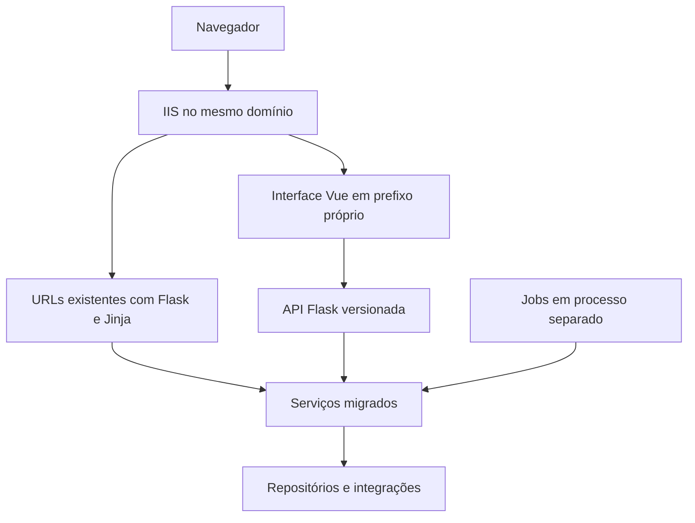

# Arquitetura e modernização do Digital JOST

**Data:** 8 de setembro de 2026

**Situação:** proposta para orientar a implementação progressiva

**Público:** desenvolvimento e manutenção do Digital JOST

O Digital JOST deve evoluir para um monólito modular em Flask, com frontend Vue 3, contratos de API explícitos e recursos compartilhados para as tarefas repetitivas. A modernização deve facilitar a criação de funcionalidades e permitir que as existentes sejam migradas por partes, preservando suas regras e os processos industriais atendidos pelo sistema.

A primeira entrega é um ambiente de desenvolvimento isolado. Hoje, conforme informado pelo responsável, o desenvolvimento usa o banco de produção. A nova base precisa permitir desenvolver, testar e inspecionar o sistema sem alterar dados operacionais nem acionar integrações reais.

Este documento consolida a direção discutida, as ferramentas recomendadas, as regras de organização e o roteiro de adoção. As escolhas de ferramentas ainda precisam ser confirmadas em um piloto isolado. A proposta não autoriza execução do sistema, alterações de banco, publicação ou acesso a serviços corporativos.

## Navegação

- [1 Objetivos e critérios de sucesso](#1-objetivos-e-critérios-de-sucesso)
- [2 Contexto atual e evidências](#2-contexto-atual-e-evidências)
- [3 Decisões e pressupostos](#3-decisões-e-pressupostos)
- [4 Organização do backend](#4-organização-do-backend)
- [5 Ferramentas do backend](#5-ferramentas-do-backend)
- [6 Contratos e padrões da API](#6-contratos-e-padrões-da-api)
- [7 Persistência e consistência](#7-persistência-e-consistência)
- [8 Segurança como recurso compartilhado](#8-segurança-como-recurso-compartilhado)
- [9 Ambientes isolados](#9-ambientes-isolados)
- [10 Jobs e integrações](#10-jobs-e-integrações)
- [11 Frontend Vue e convivência com Jinja](#11-frontend-vue-e-convivência-com-jinja)
- [12 Recursos prontos e geração de funcionalidades](#12-recursos-prontos-e-geração-de-funcionalidades)
- [13 Desenvolvimento e verificação](#13-desenvolvimento-e-verificação)
- [14 Migração progressiva](#14-migração-progressiva)
- [15 Decisões pendentes e riscos de adoção](#15-decisões-pendentes-e-riscos-de-adoção)
- [16 Referências técnicas](#16-referências-técnicas)
- [17 Prompt para iniciar a arquitetura com uma nova home](#17-prompt-para-iniciar-a-arquitetura-com-uma-nova-home)

## 1 Objetivos e critérios de sucesso

A arquitetura deve tornar previsível onde colocar cada responsabilidade e reduzir a quantidade de código repetitivo escrito por funcionalidade. A meta é que o desenvolvedor concentre seu trabalho nos campos, nas regras, nas consultas específicas e na composição da interface.

Os resultados esperados são:

- Criar funcionalidades com uma estrutura conhecida e exemplos completos.
- Reutilizar autenticação, autorização, erros, paginação, anexos e auditoria.
- Declarar contratos de dados que apoiem validação, documentação e tipagem do frontend.
- Compartilhar regras entre APIs, páginas antigas e jobs.
- Desenvolver com dados fictícios ou anonimizados, sem depender de produção.
- Refatorar módulos antigos gradualmente, com critérios de equivalência funcional.
- Publicar mudanças de forma reproduzível, com compatibilidade de dados e possibilidade de retorno.

A quantidade total de linhas pode aumentar durante a convivência com o legado. A avaliação deve considerar o trabalho necessário para uma nova feature, a clareza das regras, a redução de duplicação e a facilidade de diagnosticar e corrigir problemas. Não há uma estimativa de redução de código comprovada neste momento.

## 2 Contexto atual e evidências

O projeto já contém tecnologias capazes de sustentar a modernização: Flask, SQLAlchemy, SQL Server, Jinja, integrações corporativas e processamento agendado. A dificuldade principal está na concentração de responsabilidades e na aplicação desigual dos padrões.

O levantamento estático examinou a estrutura e os registros em `main.py`, a inicialização, autenticação, permissões, acesso a dados, os módulos novos de demandas e trechos representativos do legado, frontend e schedulers. Não equivale a uma auditoria completa de todos os endpoints, regras ou objetos de banco.

| Evidência no código | Implicação para a arquitetura |
| --- | --- |
| `app/routes/request/laboratory.py` possui 3.368 linhas e `processDeviation.py` possui 3.724 no estado examinado. | Separar HTTP, regras, consultas, arquivos e notificações nos módulos mais complexos. |
| `app/routes/demandManagement/` e `app/routes/demandRequests/` já separam rotas, serviços, repositório e domínio. | Aproveitar essa experiência como ponto de partida, sem copiar suas limitações. |
| JavaScript aparece em templates, includes Jinja e arquivos estáticos; parte da interface é montada manualmente com HTML em strings. | Migrar a interação para componentes Vue e explicitar os contratos com o backend. |
| `app/config.py` chama `db.create_all()` na criação do app. | Desacoplar a inicialização da evolução do schema. |
| `dynamic_constants.py` e `azure_utils.py` instanciam gerenciadores que iniciam threads durante o import. | Eliminar efeitos externos implícitos e tornar integrações configuráveis. |
| Jobs de laboratório, desvios e demandas operam sobre dados usados pelas telas. | Incluir jobs no levantamento e na migração das regras de cada domínio. |
| O novo gerenciador e as melhorias antigas compartilham dados e sincronizações. | Definir qual módulo controla cada escrita e preservar compatibilidade durante a transição. |

Foram observados SQL com entrada interpolada, uso de `eval`, verificações de permissão com strings tratadas como booleanos, configurações sensíveis embutidas e caminhos de arquivos montados sem validação suficiente. A proteção CSRF aparece nos módulos novos, mas não foi identificado um mecanismo global equivalente nos fluxos antigos examinados.

O impacto efetivo depende também da configuração do IIS, das permissões do banco e do filesystem. Esses aspectos não foram verificados em execução. Os arquivos de uploads e dados operacionais não devem ser usados como fixtures.

## 3 Decisões e pressupostos

| Tema | Direção | Situação |
| --- | --- | --- |
| Backend | Manter Flask e organizar por funcionalidade. | Objetivo estabelecido na conversa. |
| Frontend | Vue 3 para novas funcionalidades e migração gradual. | Objetivo estabelecido na conversa. |
| Modelo de aplicação | Monólito modular, com processos de jobs separados. | Recomendação arquitetural. |
| APIs novas | APIFlask com Pydantic. | Preferência técnica a validar no piloto. |
| Banco | SQLAlchemy 2, ORM onde simplificar e SQL parametrizado para consultas específicas. | Recomendação técnica. |
| Ambientes | Desenvolvimento, homologação e produção isolados. | Necessidade confirmada; infraestrutura a definir. |
| Hospedagem | Planejar inicialmente a convivência no Windows/IIS e no mesmo domínio. | Pressuposto a confirmar. |
| Interface pronta | PrimeVue e componentes específicos do Digital JOST. | Candidatos a validar na feature de referência. |
| Implantação | Mudanças graduais e publicações explícitas. | Direção recomendada. |

Flask-Smorest com Marshmallow foi considerado como alternativa para validação e documentação. A preferência consolidada é APIFlask com Pydantic, pela combinação de funções de rota pequenas e contratos baseados em tipos Python. Não há motivo para adotar os dois mecanismos de API simultaneamente na base nova.

Não está proposta uma reescrita integral, mudança imediata de banco ou introdução de serviços distribuídos. Novas ferramentas devem resolver uma necessidade concreta que justifique sua operação e manutenção.

## 4 Organização do backend

Cada funcionalidade deve ter uma pasta que permita localizar suas entradas HTTP, contratos, regras e consultas. Recursos comuns devem ter responsabilidades específicas, evitando que `core` ou `utils` se tornem depósitos de código sem relação.

### 4.1 Estrutura de referência

```text
DigitalJost/
├── app/
│   ├── __init__.py                 # factory configurável
│   ├── config.py                   # configuração por ambiente
│   ├── extensions.py               # extensões sem efeitos externos no import
│   ├── core/
│   │   ├── auth.py                 # identidade e autenticação
│   │   ├── permissions.py          # mecanismos comuns de autorização
│   │   ├── database.py             # conexões e sessões configuráveis
│   │   ├── errors.py               # tradução de erros
│   │   ├── files.py                # armazenamento e acesso seguro
│   │   └── audit.py                # registro padronizado de alterações
│   ├── integrations/
│   │   ├── mail.py
│   │   ├── plex.py
│   │   └── teams.py
│   ├── routes/
│   │   └── <feature>/
│   │       ├── __init__.py
│   │       ├── routes.py
│   │       ├── schemas.py
│   │       ├── services.py
│   │       └── repository.py
│   ├── jobs/
│   ├── templates/                  # páginas legadas e e-mails
│   └── static/                     # assets públicos
├── frontend/
├── tests/
├── migrations/
└── docs/
```

A árvore representa uma estrutura de chegada. Não determina movimentações imediatas nem exige criar todos os arquivos antecipadamente. Os schedulers atuais permanecem em `app/services/` até sua migração explícita. Os nomes de módulos existentes não devem ser alterados apenas para uniformização estética.

### 4.2 Responsabilidades

| Parte | Responsabilidade | Limite |
| --- | --- | --- |
| Rotas | Interpretar HTTP, aplicar validação e autorização, chamar serviços e devolver respostas. | Evitar SQL e regras extensas. |
| Schemas | Declarar entradas, saídas, tipos, limites e campos permitidos. | Não substituir regras de negócio ou autorização. |
| Serviços | Executar casos de uso e controlar transações e dependências. | Não depender diretamente de `request`, sessão HTTP ou renderização de páginas. |
| Repositório | Encapsular consultas e persistência. | Não conhecer Flask nem realizar commits ocultos. |
| Integrações | Adaptar e-mail, SAP, Plex, Teams e outros serviços. | Não iniciar conexões, threads ou envios durante import. |
| Jobs | Agendar e invocar operações de negócio. | Evitar uma implementação paralela das regras das telas. |

`models.py` entra quando houver entidades ORM próprias. `domain.py` pode concentrar estados, transições e regras mais complexas. `policies.py` é útil quando a autorização por registro cresce. Esses arquivos surgem conforme a responsabilidade existir.

Serviço e repositório são uma boa base para o legado com SQL extenso. Uma funcionalidade pequena pode usar funções simples. Não são necessárias hierarquias de classes ou métodos que apenas repassam os mesmos argumentos por várias camadas.

### 4.3 Regras de dependência

Uma operação de negócio deve ter um responsável. API nova, página antiga e job convergem para essa operação. Um módulo não deve importar os handlers HTTP de outro nem espalhar alterações diretas nas tabelas controladas por ele.

Os serviços recebem explicitamente as dependências de que precisam, como repositório, armazenamento e notificações. A composição ocorre perto da inicialização ou da entrada da aplicação, de forma legível. Não é necessário começar com um framework de injeção de dependências.

O módulo de permissões fornece o mecanismo comum; as regras específicas, como quem pode aprovar uma solicitação de determinada área, permanecem junto da funcionalidade.

## 5 Ferramentas do backend

| Ferramenta | Uso proposto | Benefício e cuidado |
| --- | --- | --- |
| APIFlask | APIs novas, serialização e OpenAPI. | Reduz tratamento HTTP repetitivo; preservar os erros HTML e redirects do legado. |
| Pydantic | Schemas de entrada e saída. | Contratos tipados e validação declarativa; definir campos explicitamente. |
| SQLAlchemy 2 | ORM, consultas e transações. | Aproveita a base existente; manter clareza sobre engine, sessão e transação utilizadas. |
| Pydantic Settings | Carregamento e validação de configurações. | Detecta campos obrigatórios ausentes; não substitui isolamento de rede ou gestão de segredos. |
| Alembic | Alterações de schema versionadas. | Mudanças revisadas e limitadas aos objetos sob responsabilidade do sistema. |
| uv | Dependências e ambientes Python. | Lockfile e reprodução do ambiente; adoção gradual a partir das dependências atuais. |
| Ruff | Formatação e verificações de código. | Convenções comuns; evitar reformatação ampla do legado junto de mudanças funcionais. |
| Copier | Geração da estrutura de módulos. | Código inicial consistente e editável; o template deve nascer de exemplos validados. |

APIFlask estende Flask. A documentação consultada registra suporte a Pydantic desde a versão 3.0. A versão concreta de cada dependência será fixada após verificar compatibilidade com Python, Windows, drivers de banco e extensões utilizadas.

O ganho esperado vem da integração entre ferramentas: o schema orienta a validação e a documentação; o OpenAPI permite gerar tipos para o Vue; o template de feature reutiliza esses padrões.

## 6 Contratos e padrões da API

As APIs novas devem usar um prefixo próprio, como `/api/v1/`, preservando as URLs existentes enquanto forem necessárias. As respostas devem seguir convenções comuns para dados, erros, paginação e conflitos.

| Tema | Convenção proposta |
| --- | --- |
| Entrada | Schemas explícitos; rejeitar campos inesperados nas operações novas. |
| Saída | Schemas próprios, sem serializar automaticamente todos os atributos do banco. |
| Criação | Resposta `201` com a representação definida pelo contrato. |
| Autenticação | `401` JSON para APIs sem sessão válida. |
| Autorização | `403` quando a ação é proibida; `404` quando necessário para não revelar registros inacessíveis. |
| Validação | `422` para campos semanticamente inválidos; `400` para requisições malformadas. |
| Concorrência | `409` para conflito de edição ou transição. |
| Erros inesperados | Mensagem pública genérica e identificador para diagnóstico; detalhes apenas nos registros internos adequados. |
| Listagens | Paginação e limite máximo; filtros e ordenações em listas permitidas. |
| Datas | ISO 8601 no contrato; distinguir data sem horário de instante com fuso. |
| Valores decimais | Representação explícita quando precisão importa, evitando conversão indiscriminada para ponto flutuante. |

Essas convenções devem ser aplicadas à API nova e adaptadas gradualmente no legado. Não é necessário alterar todos os formatos de resposta existentes de uma vez.

### 6.1 Exemplo conceitual

O exemplo mostra o formato desejado de uma operação. Não é código pronto para execução no projeto.

```python
class DemandCreate(BaseModel):
    model_config = ConfigDict(extra="forbid")

    title: str = Field(min_length=3, max_length=160)
    description: str = Field(min_length=10)
    priority: Literal["low", "normal", "high"] = "normal"


@bp.post("/demands")
@require_permission("demands.create")
@bp.input(DemandCreate)
@bp.output(DemandDetail, status_code=201)
def create_demand(json_data: DemandCreate):
    return get_service().create(
        data=json_data,
        actor=current_actor(),
    )
```

`require_permission`, `current_actor` e `get_service` representam recursos a implementar na base. A autenticação e a proteção CSRF precisam estar configuradas. O serviço verifica as regras por área e registro, executa a transação e produz a saída apropriada.

O schema valida o formato e os limites dos campos. A existência de um responsável, seu vínculo com a área e a permissão para uma transição são regras do serviço e de suas políticas.

## 7 Persistência e consistência

### 7.1 ORM e SQL textual

Usar ORM em cadastros e entidades controladas pelo Digital JOST quando reduzir a escrita manual e tornar relacionamentos claros. Manter SQL parametrizado nos repositórios para relatórios, consultas complexas, tabelas legadas e fontes corporativas.

Pandas permanece útil para análise, transformação tabular e exportação. A obtenção de um registro ou uma atualização simples não precisa passar obrigatoriamente por um DataFrame.

O modelo ORM e o contrato da API têm responsabilidades diferentes. Campos como autor, área efetiva, permissões e metadados de auditoria devem ser definidos pelo servidor. A entrada do cliente não pode escolher livremente colunas a alterar.

### 7.2 Transações e concorrência

O serviço define o limite da transação. Todas as gravações que precisam ocorrer juntas usam a mesma conexão ou sessão. O repositório não executa commits independentes que possam deixar uma operação parcialmente concluída.

Em aplicações que carregam a identidade usando uma sessão ORM, é necessário considerar a transação já iniciada antes de abrir outra. O padrão de sessão e transação deve ser demonstrado no piloto, evitando misturar inadvertidamente Flask-SQLAlchemy, conexões Core e pyodbc na mesma operação lógica.

Preservar o controle de concorrência existente, como `rowVersion`, e adotá-lo onde duas pessoas possam editar o mesmo registro. Uma atualização deve conferir a versão recebida antes de sobrescrever dados. Geração de identificadores e transições também precisam considerar requisições simultâneas; `MAX(id) + 1` sem coordenação não é uma solução segura.

Uma transação SQL não torna atômicos e-mail, filesystem e sistemas externos. Operações entre bancos ou integrações devem ter limites explícitos, tratamento de falha e estratégia de recuperação.

### 7.3 Migrations

Remover a criação de tabelas da inicialização normal e adotar mudanças de schema versionadas, revisadas e executadas de forma explícita. O usuário da aplicação não deve precisar de permissão para alterar schema em operação normal.

O ponto de partida do banco existente precisa ser conhecido. Não gerar nem aplicar alterações automaticamente sobre todos os bancos corporativos. A documentação do Alembic destaca que migrations autogeradas exigem revisão manual.

Durante a migração de funcionalidades, preferir mudanças aditivas e compatíveis com os dois caminhos. A remoção de colunas ou estruturas antigas depende da retirada de todos os leitores e escritores, incluindo jobs.

## 8 Segurança como recurso compartilhado

### 8.1 Autenticação e autorização

Reaproveitar inicialmente a identidade Windows/IIS e a sessão, corrigindo os comportamentos inseguros. A confiança na identidade encaminhada pelo IIS depende de impedir acesso que contorne essa camada. Não aceitar um identificador arbitrário enviado pelo navegador como identidade autenticada.

Normalizar `admin`, `active` e outros indicadores ao carregar a identidade. A string `"0"` é verdadeira em uma condição booleana Python; as verificações não devem depender dessa conversão implícita.

Cada operação verifica a ação e o registro: área, solicitante, responsável, aprovador e estado atual. Esconder um botão no Vue é uma conveniência de interface, não uma autorização.

Manter cookies apropriados ao HTTPS e ao fluxo de sessão, proteção CSRF para operações mutáveis e destinos de redirecionamento validados. As configurações concretas devem ser compatíveis com o SSO e verificadas em homologação.

### 8.2 Entradas e arquivos

SQL novo deve usar parâmetros. Nomes de colunas, ordenações e outros identificadores dinâmicos exigem listas permitidas. Substituir o uso de `eval` para dados por formatos e parsers adequados.

Anexos privados devem ser armazenados fora do diretório público de assets. A API autoriza o acesso ao registro, resolve um identificador de anexo e verifica que o caminho final está contido no diretório permitido. Nome seguro, extensão, conteúdo quando aplicável, quantidade e tamanho fazem parte da validação.

Exportações devem evitar nomes de arquivo compartilhados entre requisições concorrentes e possuir política de expiração. A migração dos anexos existentes exige plano próprio e autorização, sem movimentação automática de dados operacionais.

### 8.3 Segredos e registros

Configurações sensíveis ficam fora do código, com credenciais distintas por ambiente. Remover um segredo versionado não substitui sua rotação ou revogação e o tratamento do histórico quando necessário.

Separar logs técnicos de auditoria de negócio. Registrar dados necessários ao diagnóstico, com identificadores de correlação, sem copiar indiscriminadamente payloads, tokens ou informações pessoais. Definir campos excluídos, acesso e retenção.

As correções graves do legado têm uma frente própria e não devem aguardar sua migração visual para Vue.

## 9 Ambientes isolados

| Recurso | Desenvolvimento | Homologação | Produção |
| --- | --- | --- | --- |
| Banco | Instância ou ambiente separado com dados de exemplo. | Banco separado e dados representativos anonimizados. | Dados operacionais. |
| Credenciais | Sem acesso aos recursos de produção. | Acesso limitado aos recursos de homologação. | Privilégios mínimos para operação. |
| Arquivos | Diretórios próprios e arquivos fictícios. | Diretórios próprios e dados controlados. | Armazenamento operacional. |
| E-mail e Teams | Captura local ou implementação simulada. | Destinos de teste explicitamente permitidos. | Destinos reais. |
| SAP e Plex | Respostas simuladas ou ambiente de teste aprovado. | Integração controlada quando disponível. | Integração real. |
| Identidade | Perfis fictícios exclusivos do ambiente isolado. | Validação do fluxo de identidade autorizado. | Autenticação corporativa. |
| Jobs | Desligados por padrão e executáveis apenas no escopo isolado. | Agendamento controlado. | Agendamento operacional. |

Usar SQL Server no desenvolvimento para preservar compatibilidade com o SQL existente. A versão, edição e nível de compatibilidade devem representar o uso em produção. A edição Developer é uma opção destinada a desenvolvimento e testes, conforme a documentação da Microsoft.

Trocar apenas a string de conexão é insuficiente. Verificar referências entre bancos, views, procedures, triggers, caminhos de rede e eventuais servidores vinculados antes de reaproveitar a estrutura. Os outros bancos usados pelo sistema também precisam de substitutos ou acessos de teste explicitamente definidos.

Começar com um conjunto pequeno de dados fictícios para o piloto. Quando forem necessários dados reais representativos, preparar um processo de anonimização que preserve relacionamentos e remova identificadores, destinos de notificação e conteúdo confidencial.

A configuração deve falhar quando faltar um valor obrigatório, sem recorrer a produção como padrão. A proteção principal combina credenciais, permissões e restrições de acesso; verificações no código são uma camada adicional.

## 10 Jobs e integrações

Os schedulers devem rodar em processos separados da aplicação web. A evolução pode aproveitar a infraestrutura Windows existente, desde que as dependências sejam explícitas e o agendamento não aconteça no import da aplicação.

Cada job chama serviços de negócio, informa a identidade de sistema adequada e registra seu resultado. Deve ser possível reconhecer execução em andamento, falha, duração e necessidade de intervenção. Retentativas exigem operações que possam ser repetidas sem duplicar seus efeitos.

Para notificações relevantes, recomenda-se uma outbox: um registro de envio pendente gravado na mesma transação do evento de negócio. Um processo separado lê esse registro, envia e registra o resultado. Sua adoção exige uma mudança de banco planejada.

Esse mecanismo evita enviar antes de saber se a operação foi confirmada, mas não garante entrega exatamente uma vez. Uma falha após o envio e antes da confirmação pode gerar repetição. O projeto deve definir identificadores, deduplicação quando possível, retentativas limitadas e visibilidade de falhas.

As implementações reais e simuladas de integrações devem atender aos mesmos contratos. Configurar timeouts e tratar respostas indisponíveis de maneira explícita. Não introduzir uma nova infraestrutura de filas antes de existir demanda operacional que justifique esse custo.

## 11 Frontend Vue e convivência com Jinja

O frontend novo deve usar Vue 3, TypeScript, Vite e Vue Router, organizado por funcionalidade. Os componentes `.vue` concentram estrutura, interação e estilos locais da interface. O backend continua responsável pelas regras e pelo acesso aos dados.

```text
frontend/src/
├── app/
│   ├── router/
│   └── layouts/
├── shared/
│   ├── api/
│   ├── components/
│   ├── composables/
│   └── styles/
└── features/
    └── demands/
        ├── pages/
        ├── components/
        ├── api.ts
        └── queries.ts
```

PrimeVue é o candidato para controles de interface, tabelas, seletores e diálogos. Os componentes específicos do Digital JOST devem acrescentar convenções de uso e aparência onde houver valor, sem encapsular toda a biblioteca por obrigação.

TanStack Vue Query é o candidato para carregamento, cache e atualização de dados da API. Pinia entra para estado compartilhado de interface quando necessário, evitando manter cópias dos mesmos dados em mecanismos diferentes.

O kit de frontend deve oferecer layout, listagem, formulário, seletor de usuário e área, anexos, histórico, confirmação de ações e estados de carregamento ou erro. Permissões recebidas ajudam a apresentar as ações disponíveis; o servidor verifica novamente toda operação.

### 11.1 Distribuição de rotas



Uma opção inicial é reservar `/app/` para a interface nova e `/api/v1/` para suas APIs. As páginas antigas permanecem em suas URLs durante a transição. A regra de fallback do Vue Router deve ficar restrita ao prefixo da interface, sem capturar erros da API ou URLs antigas.

Vite produz os assets para publicação. O frontend pode ser entregue como arquivos estáticos, sem um servidor Node permanente em produção para essa proposta. Se Flask renderizar o HTML de entrada, pode usar o manifesto de assets do Vite.

As APIs devem retornar erros JSON previsíveis. Um redirect silencioso para uma página HTML de login não pode ser interpretado como uma resposta de dados válida. Preservar separadamente o comportamento necessário às páginas Jinja.

JavaScript existente dentro de templates pode depender de Jinja. Sua migração exige identificar os valores dinâmicos e convertê-los em contratos ou configuração explícita, sem simples movimentação de arquivos.

## 12 Recursos prontos e geração de funcionalidades

| Recurso da base | O que a feature define | O que é reaproveitado |
| --- | --- | --- |
| Autorização | Ações e regras por registro. | Identidade, verificação comum e tratamento de acesso negado. |
| Listagem | Filtros e ordenações permitidos. | Paginação, limites e formato de resposta. |
| Anexos | Tipos, limites e regra de acesso. | Armazenamento, nomes internos e download autorizado. |
| Auditoria | Eventos e campos relevantes. | Identidade, data, correlação e exclusão de dados sensíveis. |
| Notificação | Evento, conteúdo e destinatários autorizados. | Templates, envio, registro e tratamento de falhas. |
| Contrato | Schemas de entrada e saída. | Validação e documentação OpenAPI. |
| Testes | Cenários da regra específica. | Perfis fictícios, dados de exemplo e substitutos das integrações. |

O template de feature deve ser criado depois das funcionalidades de referência. Ele gera código normal, legível e editável, com rotas, schemas, serviços, repositório e exemplos de testes conforme as opções escolhidas.

Cadastros simples podem receber operações iniciais de listar, consultar, criar e editar. Fluxos de aprovação, pausa ou conclusão recebem a estrutura necessária, mas suas regras são implementadas explicitamente.

Evitar uma grande classe base ou um CRUD universal que aceite qualquer campo e acumule exceções. Geração de código facilita começar; compartilhamento de comportamento evita corrigir o mesmo problema em vários lugares. Essas duas técnicas devem ser usadas com propósitos distintos.

Manter um catálogo curto com exemplos de listagem, formulário, permissão por registro, anexo, transação e integração simulada. Esse catálogo também orienta revisões e futuras contribuições.

## 13 Desenvolvimento e verificação

Preparar configurações e comandos documentados para dependências, verificações, testes, dados fictícios e geração de contratos. Esses comandos só devem ser habilitados após o isolamento e a remoção dos efeitos externos indevidos.

A geração de OpenAPI pode importar ou criar a aplicação. Ela também precisa funcionar sem recursos de produção. A partir da especificação, gerar tipos TypeScript para apoiar o cliente Vue, mantendo a validação obrigatória no backend.

### 13.1 Estratégia de testes futura

- Testes de regras puras para validações e transições.
- Testes de serviços com repositórios e integrações substituíveis.
- Testes de persistência no SQL Server isolado para SQL específico, transações e concorrência.
- Testes de API para sessão, CSRF, autorização e contratos de erro.
- Testes de componentes Vue e dos fluxos completos mais importantes.

Pytest é o candidato para o backend; Vitest e Playwright para componentes e fluxos do frontend, respectivamente. Os cenários devem verificar comportamento relevante, e não apenas reproduzir a implementação.

A automação de verificações deve operar sem credenciais de produção. Mudanças de schema e publicação permanecem ações separadas e controladas. As regras de execução do `AGENTS.md` continuam válidas: um pedido genérico para implementar ou testar não autoriza executar o Digital JOST.

### 13.2 Critério para concluir uma feature

- Contratos de entrada e saída definidos.
- Permissões verificadas por ação e registro.
- SQL parametrizado e limites de transação explícitos.
- Tratamento de conflito quando houver edição concorrente.
- Arquivos e integrações tratados conforme os recursos da base.
- Cenários relevantes verificados em ambiente autorizado.
- Jobs e caminhos legados relacionados considerados.
- Documentação, configuração e estratégia de publicação atualizadas.

## 14 Migração progressiva

### 14.1 Sequência de entregas

| Etapa | Entrega | Critério de passagem |
| --- | --- | --- |
| 1 | Desenvolvimento isolado. | Banco, arquivos, identidade e integrações separados; inicialização sem efeitos externos inesperados. |
| 2 | Base de API e recursos essenciais. | Contratos, erros, autenticação, autorização, CSRF e persistência demonstrados em uma operação. |
| 3 | Cadastro simples de referência. | Fluxo completo com Vue e API, documentação e verificações no ambiente isolado. |
| 4 | Fluxo com regras mais complexas. | Aprovação, transação, anexos ou mudança de status demonstram que a estrutura permanece clara. |
| 5 | Template e catálogo de desenvolvimento. | Nova feature pode ser iniciada sem copiar código de módulos antigos. |
| 6 | Migração contínua do legado. | Cada funcionalidade migra com seus leitores, escritores, jobs e integrações conhecidos. |

As correções de segurança prioritárias seguem em paralelo ao planejamento de migração, por mudanças pequenas e específicas. Não há cronograma em semanas definido; capacidade de desenvolvimento e infraestrutura ainda precisam ser confirmadas.

Demandas é um candidato para aproveitar a separação já existente, mas não deve ser tratado como um módulo isolado de melhorias e das demais tabelas. Laboratório e Desvios exigem atenção adicional pelo tamanho e pelas rotinas agendadas.

### 14.2 Procedimento por funcionalidade

1. Mapear URLs, menus, métodos HTTP, permissões, templates, JavaScript, tabelas, arquivos, integrações e jobs.
2. Registrar exemplos de comportamento esperado e casos de acesso permitido e negado.
3. Identificar o responsável pelas regras e pelas gravações.
4. Extrair ou adaptar serviços e repositórios, preservando o comportamento necessário.
5. Fazer a página antiga e a API nova convergirem para os mesmos serviços.
6. Construir a interface Vue e verificar contratos, regras e fluxos relacionados.
7. Liberar o novo caminho de forma controlada, com observação de falhas e plano de retorno.
8. Retirar o caminho antigo quando todas as dependências forem migradas.

O retorno à versão anterior precisa considerar dados, jobs e integrações, além do código. Durante a coexistência, alterações incompatíveis podem impedir um retorno simples. Arquivos históricos ou backups não devem ser confundidos com módulos ativos.

## 15 Decisões pendentes e riscos de adoção

| Ponto a confirmar | Motivo |
| --- | --- |
| Disponibilidade de SQL Server separado para desenvolvimento e homologação. | Define como começar o isolamento. |
| Quantidade de desenvolvedores e experiência com Vue, tipagem e ORM. | Ajusta documentação, exemplos e ritmo de adoção. |
| Permanência de Windows/IIS e detalhes da configuração atual. | Afeta autenticação, roteamento, assets e processos de jobs. |
| Versões de Python, SQL Server e drivers usados em produção. | Define a matriz real de compatibilidade. |
| Responsabilidade sobre schemas e objetos corporativos. | Delimita o alcance de migrations e dados de teste. |
| Disponibilidade de ambientes de teste para integrações. | Define quais dependências precisam de simulação. |
| Primeiras duas funcionalidades de referência. | Permite validar simplicidade em um cadastro e em um fluxo de negócio. |
| Regras de retenção, auditoria e armazenamento. | Orienta logs, anexos, exportações e notificações. |

Os principais riscos de adoção são criar abstrações antes de conhecer sua utilidade, manter regras duplicadas durante a coexistência, migrar apenas a tela sem considerar jobs e confiar em configuração local sem isolamento real de acesso.

O piloto deve avaliar quanto código específico foi necessário, quais recursos foram reaproveitados, se uma alteração de regra é localizada e se os erros são diagnosticáveis. A escolha final de ferramentas deve considerar esses resultados, além de compatibilidade e manutenção.

## 16 Referências técnicas

As referências abaixo apoiam as escolhas propostas. A disponibilidade de uma capacidade na documentação não comprova compatibilidade com o Digital JOST sem verificação no ambiente isolado.

- [Flask Application Factories](https://flask.palletsprojects.com/en/stable/patterns/appfactories/) — composição da aplicação e extensões.
- [Flask Security Considerations](https://flask.palletsprojects.com/en/stable/web-security/) — aspectos de segurança da aplicação web.
- [APIFlask](https://apiflask.com/) e [schemas](https://apiflask.com/schema/) — APIs, validação, serialização e OpenAPI.
- [APIFlask Changelog](https://apiflask.com/changelog/) — suporte a Pydantic e evolução de versões.
- [SQLAlchemy ORM Quick Start](https://docs.sqlalchemy.org/en/20/orm/quickstart.html) — modelos e persistência com ORM.
- [SQLAlchemy Engines and Connections](https://docs.sqlalchemy.org/en/20/core/connections.html) — conexões e transações.
- [Alembic Autogeneration](https://alembic.sqlalchemy.org/en/latest/autogenerate.html) — geração e revisão de migrations.
- [Pydantic Settings](https://docs.pydantic.dev/latest/concepts/pydantic_settings/) — configuração tipada.
- [Flask WTF CSRF](https://flask-wtf.readthedocs.io/en/1.2.x/csrf/) — mecanismo de proteção CSRF.
- [uv](https://docs.astral.sh/uv/), [Ruff](https://docs.astral.sh/ruff/) e [Copier](https://copier.readthedocs.io/en/stable/) — ferramentas de desenvolvimento.
- [SQL Server Editions](https://learn.microsoft.com/en-us/sql/sql-server/editions-and-components-of-sql-server-2022?view=sql-server-ver16) — contexto das edições para desenvolvimento e testes.
- [Vue Ways of Using Vue](https://vuejs.org/guide/extras/ways-of-using-vue.html) — formas de adoção do frontend.
- [Vite Backend Integration](https://vite.dev/guide/backend-integration) — integração com backend tradicional e assets compilados.
- [Vue Router History Modes](https://router.vuejs.org/guide/essentials/history-mode.html) — navegação e fallback no servidor.
- [PrimeVue DataTable](https://primevue.org/datatable/) — referência de componentes para interfaces de dados.
- [TanStack Vue Query](https://tanstack.com/query/latest/docs/framework/vue/overview) e [Pinia](https://pinia.vuejs.org/introduction) — dados da API e estado compartilhado.
- [OpenAPI TypeScript](https://openapi-ts.dev/introduction) — geração de tipos a partir dos contratos.
- [Vue Testing](https://vuejs.org/guide/scaling-up/testing.html) — estratégia e ferramentas para testes do frontend.

**Limite desta consolidação:** o sistema não foi executado; a validação foi somente estática. A arquitetura proposta ainda precisa de confirmação de infraestrutura e de avaliação prática nos pilotos autorizados.

## 17 Prompt para iniciar a arquitetura com uma nova home

O primeiro piloto será uma nova home em Vue, acessível por uma URL própria e mantendo a home atual como entrada padrão. O objetivo é avaliar a estrutura, a integração com Flask e a operação no IIS antes de migrar funcionalidades com gravações e regras mais complexas.

Este piloto antecede os cadastros e fluxos de referência da seção 14. Ele verifica a base de interface, contratos, identidade e entrega de assets. Não comprova a segurança ou a correção de operações de escrita, transações, anexos ou jobs que ainda não foram migrados.

O texto abaixo pode ser copiado para uma tarefa de implementação. Ele autoriza a preparação do código dentro das regras do repositório. Instalações, execução, testes dinâmicos, builds, acesso corporativo e publicação dependem das autorizações específicas previstas no `AGENTS.md`.

```text
Quero iniciar a nova arquitetura do Digital JOST com um piloto pequeno e completo: uma nova home em Vue 3, integrada ao Flask, mantendo a home antiga funcionando como entrada padrão.

Use docs/arquitetura-modernizacao.md como referência. A entrega deve demonstrar como criaremos as próximas funcionalidades, sem implementar antecipadamente toda a arquitetura descrita no documento.

OBJETIVO

Preparar a base inicial do frontend Vue e das APIs novas do backend. A nova home deve apresentar a identidade do usuário e os acessos disponíveis aos módulos existentes. Quero avaliar organização, facilidade de desenvolvimento, compatibilidade e o que falta para uma publicação segura em produção.

Não considerar a implementação estática suficiente para afirmar que está pronto para produção. A avaliação deve distinguir o que foi implementado, o que foi efetivamente verificado e o que ainda depende de um ambiente autorizado.

REGRAS DE TRABALHO

1. Leia AGENTS.md, README.md, main.py e o documento de arquitetura. Inspecione a factory, autenticação, permissões, home, menu, JavaScript relacionado e web.config como texto.
2. Siga o fluxo de Git aplicável do AGENTS.md. Preserve alterações anteriores; não faça stash, descarte, troca de branch ou mistura automática. Não faça push nem publicação sem instrução explícita nesta tarefa.
3. Trabalhe inicialmente por análise estática. Este prompt não autoriza executar ou importar o Digital JOST, instalar dependências, iniciar servidores ou navegadores, rodar testes, linters ou builds, nem acessar bancos e integrações corporativas.
4. Quando for necessário verificar dinamicamente, prepare antes a lista exata de comandos, ambiente, recursos usados e escopo. Solicite a autorização específica exigida pelo AGENTS.md. Continue o trabalho independente que estiver autorizado.
5. Não use o banco de produção como ambiente de desenvolvimento. Não copie credenciais, dados pessoais, logs ou uploads para exemplos ou fixtures.

ESCOPO DA NOVA HOME

1. Preserve a rota /, o template da home antiga e o comportamento atual de login e navegação. Não altere o destino padrão após login nesta etapa.
2. Reserve uma URL própria para o piloto, preferencialmente /app/, após confirmar que não há conflito. A nova home deve oferecer um link claro de retorno à home antiga.
3. Apresente uma interface responsiva e coerente com a identidade do Digital JOST: cabeçalho, identificação mínima do usuário, navegação, busca ou filtro de acessos e cards ou grupos de módulos.
4. Derive o catálogo de acessos do código ativo. Preserve as URLs reais dos módulos existentes e respeite áreas e permissões. Não transforme links históricos, desativados ou sem destino confirmado em funcionalidades disponíveis.
5. Faça a busca ou o filtro da home no frontend quando os dados já estiverem carregados. Não crie consultas de banco apenas para esse recurso.
6. Inclua estados de carregamento, falha de comunicação, sessão expirada e ausência de acessos, além de navegação por teclado e comportamento em telas pequenas.
7. Não acrescente indicadores operacionais, consultas pesadas, gráficos fictícios ou integrações novas. Dados de demonstração devem existir somente no modo isolado e ser identificados como exemplos.

BASE DO FRONTEND

1. Crie frontend/ com Vue 3, TypeScript, Vite e Vue Router. Organize a inicialização e o layout em app/, os recursos comuns em shared/ e a home em features/home/.
2. Prepare somente os componentes necessários ao piloto, como layout, navegação, card de acesso e estado de erro. Use PrimeVue nos controles em que trouxer benefício, sem carregar componentes desnecessários.
3. Centralize as chamadas da API e o tratamento de respostas inválidas, erros e sessão expirada. Um redirect para HTML de login não deve parecer uma resposta de dados bem-sucedida.
4. Adote TanStack Vue Query se ele for usado de fato no carregamento da home. Acrescente Pinia apenas se existir estado compartilhado que justifique sua presença. Não mantenha cópias desnecessárias dos mesmos dados.
5. Planeje o build como assets estáticos servidos no mesmo domínio da aplicação. Não dependa de um servidor Vite em produção nem de downloads de bibliotecas ou fontes por CDN em tempo de uso.
6. Prepare a base de caminhos dos assets e do router para o prefixo escolhido. O fallback de navegação não pode capturar /api/, as rotas antigas ou arquivos inexistentes indiscriminadamente.

BASE DO BACKEND

1. Crie um módulo autocontido para a nova home, com rotas, schemas e serviço. Acrescente repositório somente se houver uma consulta real a encapsular. Não crie arquivos vazios ou um modelo ORM sem necessidade.
2. Use a direção APIFlask com Pydantic para os contratos novos. Antes de adaptar a factory, descreva como preservar blueprints, extensões, error handlers, respostas HTML e redirects do legado. Uma mudança global só entra quando for necessária e tiver impacto delimitado.
3. Proponha um endpoint GET, como /api/v1/home, com schema de saída explícito. Ele deve retornar apenas a identidade mínima e o catálogo de acessos autorizados para a interface, com identificadores estáveis e URLs internas verificadas.
4. Resolva a identidade no servidor. Não aceite usuário, role, área efetiva ou indicador de administrador enviados pelo frontend como autorização. Normalize os indicadores textuais usados nas verificações.
5. Aplique autorização na API. O catálogo filtrado é uma ajuda de navegação; os destinos continuam responsáveis por autorizar cada operação. Caso encontre um acesso inseguro no destino, registre o achado e não o apresente como corrigido por esconder seu link.
6. Preserve a autenticação corporativa prevista para produção, sem recorrer à identidade fixa de fallback. Identidades fictícias só podem existir em configuração isolada, sem possibilidade de ativação por parâmetro HTTP.
7. Não crie endpoints de escrita, tabelas, migrations, anexos, notificações ou jobs neste piloto. O usuário deve conseguir navegar para as funcionalidades existentes sem migrá-las.
8. Prepare respostas JSON previsíveis para autenticação, autorização e erros da API nova. Mantenha o comportamento HTML necessário às páginas antigas. Documente o padrão de CSRF para futuras operações mutáveis, sem anunciar proteção global do legado se ela não tiver sido implementada.
9. Documente o contrato da home e como ele apoiará a tipagem do frontend. Se a geração automática exigir execução não autorizada, prepare sua configuração e registre a etapa pendente. Não invente um lockfile ou um resultado de geração.

ISOLAMENTO E INICIALIZAÇÃO

1. Mapeie as dependências transitivas que o piloto carrega. Considere db.create_all(), threads de Plex e Azure, autenticação e gravação global de logs. Um endpoint GET pode acionar efeitos externos por esses caminhos.
2. Prepare uma forma isolada de desenvolver a home com dados fictícios e integrações substituíveis. Esse modo não deve importar a factory legada de forma que dispare conexões, DDL, threads ou notificações.
3. Use configuração explícita e falhe quando faltar uma configuração obrigatória. Não tenha produção como destino padrão. Variáveis de ambiente não substituem a separação de credenciais e acesso.
4. Faça somente as mudanças de inicialização necessárias ao isolamento e à integração do piloto. Preserve o comportamento operacional que ainda for necessário e documente as consequências das alterações compartilhadas.
5. Se o isolamento depender de uma alteração ampla no ciclo de vida do legado, identifique a dependência antes de expandir o escopo. Prepare o que for independente e apresente uma proposta delimitada para resolver o impedimento.

ATIVAÇÃO E CONVIVÊNCIA

1. Prepare uma configuração explícita para habilitar o piloto, desativada por padrão em produção. Quando desativado, tanto a nova entrada quanto suas APIs devem ficar indisponíveis pelo comportamento documentado.
2. A configuração de ativação não substitui autenticação ou autorização. A ativação inicial deve permitir restringir o acesso ao grupo piloto definido pelo responsável.
3. Não exponha um novo link na home antiga ou altere o menu global por padrão. O acesso inicial pode ocorrer pela URL própria e autorizada.
4. Garanta que a indisponibilidade do piloto ou de seus assets não quebre a home antiga. Diferencie o que a configuração de ativação desliga do que continua compartilhado na factory e nas dependências.
5. Não crie uma exigência de novas tabelas ou de serviços de infraestrutura para exibir esta home. Se uma dependência desse tipo aparecer, explique sua necessidade antes de ampliar o piloto.

AVALIAÇÃO PARA HOMOLOGAÇÃO E PRODUÇÃO

Prepare uma matriz de verificações com procedimento, ambiente necessário, resultado esperado e situação: verificado, pendente ou impedido. Não marque uma verificação dinâmica como concluída apenas por inspeção de código.

Inclua pelo menos:
- Home antiga, menu e fluxo de login preservados.
- Nova home acessível apenas quando habilitada e para os usuários permitidos.
- Sessão válida, ausente, expirada, usuário inativo e diferentes perfis de acesso.
- API sem exposição de dados desnecessários e com erros coerentes.
- Retorno da nova home aos módulos antigos e à home padrão.
- Acesso direto, recarga de página e URLs inválidas no prefixo Vue.
- Assets, caminhos base, cache e fallback corretos no IIS.
- Configurações e dependências ausentes tratadas sem derrubar o caminho legado por causa do piloto.
- Ausência de operações de escrita de negócio novas; identificação dos efeitos globais existentes e de suas alterações.
- Ausência de contatos com produção no ambiente de desenvolvimento.
- Inicialização, logs, uso de recursos e regressões observáveis em homologação autorizada.
- Desativação do piloto e retorno ao pacote anterior.

Não execute essa matriz sem autorização para os comandos, ambiente e escopo correspondentes. A análise estática deve ser entregue mesmo quando essas verificações estiverem pendentes.

PLANO DE PUBLICAÇÃO A PREPARAR

Documente as dependências, a geração dos assets, o pacote de entrega, as configurações necessárias, as mudanças mínimas no IIS e a sequência de ativação para o grupo piloto. Identifique os passos que exigem reinício ou afetam componentes compartilhados.

Prepare o plano de retorno: como desativar o piloto, restaurar código e dependências anteriores quando necessário e confirmar que a home antiga continua disponível. Desligar uma configuração não desfaz alterações na factory ou nas dependências; trate esses casos no plano.

Este pedido não autoriza publicar, habilitar o piloto em produção ou executar verificações contra produção. Não afirme que está seguro para subir enquanto faltarem verificações relevantes. Apresente evidências e pendências para a decisão do responsável.

ENTREGÁVEIS

1. Código do piloto da home Vue e da base mínima do backend, dentro do escopo autorizado.
2. Estrutura de configuração e dados fictícios necessários ao desenvolvimento isolado.
3. Contrato da API e exemplos de uso que orientem a próxima funcionalidade.
4. Explicação dos componentes reutilizáveis criados e das escolhas que foram adiadas.
5. Matriz de verificações com resultados reais e pendências explícitas.
6. Guia de desenvolvimento, homologação, publicação e retorno, com comandos propostos claramente separados dos que foram autorizados e executados.
7. Resumo dos arquivos alterados e do impacto sobre o legado; commit somente conforme o fluxo aplicável do AGENTS.md, sem push automático.

Ao finalizar, informe uma situação sustentada pelas evidências: implementação preparada, validada em ambiente isolado ou validada em homologação. A autorização de publicação é uma decisão separada. Declare explicitamente se o sistema foi executado e quais verificações foram possíveis.
```
