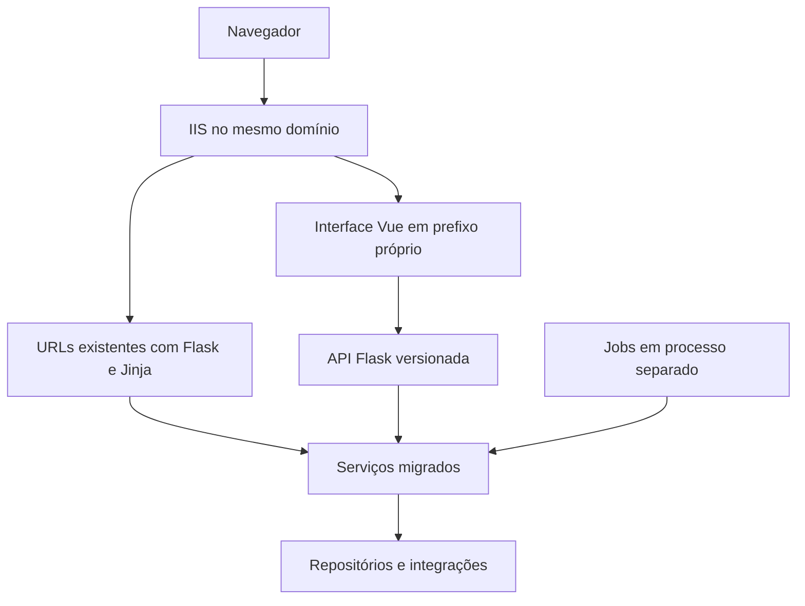

> **Registro histórico.** Pode conter decisões, caminhos e comandos superados. Consulte o [manual atual](../../README.md); este arquivo não define o padrão vigente.

# Arquitetura e modernização do Digital JOST

**Data:** 15 de setembro de 2026

**Situação:** proposta para orientar a implementação progressiva

**Atualização da simplificação:** o padrão atual usa `backend/modules/`, Services funcionais e acesso direto ao Repository para operações simples, inclusive gravações que atendam à seção 4.4. Eventos e Demandas foram adaptados por análise estática. O [plano consolidado](plano-simplificacao-arquitetura.md) registra a adaptação e a [base compartilhada](base-compartilhada-novas-features.md) contém os exemplos atuais. Roteiros de pilotos anteriores, especialmente a seção 17, são históricos e não determinam a composição vigente.

**Público:** desenvolvimento e manutenção do Digital JOST

A arquitetura principal será um **monólito modular organizado em fatias verticais, com complexidade progressiva e uma pequena camada de plataforma**. Flask permanece no backend, enquanto o frontend novo usa Vue 3, Tailwind CSS 4 e Volt sobre o PrimeVue em modo unstyled. Contratos de API explícitos e recursos compartilhados reduzem as tarefas repetitivas. A modernização deve facilitar a criação de funcionalidades e permitir que as existentes sejam migradas por partes, preservando suas regras e os processos industriais atendidos pelo sistema.

A primeira entrega funcional será a tela de **Eventos**, início do futuro módulo de chamada. Ela terá uma listagem em cards e um formulário para cadastrar nome e descrição, disponível inicialmente em `/app/eventos`, enquanto a home atual permanece oficial. O frontend começa com dados simulados; a API real e o cadastro persistente dependem de ambiente isolado, pois essa entrega introduz gravações e um objeto de banco próprio. O passo a passo está em [Guia da primeira feature: Eventos](guia-primeira-feature-eventos.md).

Hoje, conforme informado pelo responsável, o desenvolvimento usa o banco de produção. Isso continua sendo um risco prioritário. O isolamento completo de desenvolvimento e homologação deve ocorrer antes das primeiras funcionalidades que gravem dados. A execução local do backend também depende de remover ou controlar os efeitos externos da inicialização; desenvolver primeiro a interface de eventos não autoriza usar produção como ambiente de teste.

Este documento consolida a direção discutida, as ferramentas recomendadas, as regras de organização e o roteiro de adoção. As escolhas de ferramentas ainda precisam ser confirmadas em um piloto isolado. A proposta não autoriza execução do sistema, alterações de banco, publicação ou acesso a serviços corporativos.

## Navegação

- [1 Objetivos e critérios de sucesso](#1-objetivos-e-critérios-de-sucesso)
- [2 Contexto atual e evidências](#2-contexto-atual-e-evidências)
- [3 Decisões e pressupostos](#3-decisões-e-pressupostos)
- [4 Organização do backend](#4-organização-do-backend)
- [5 Ferramentas do backend](#5-ferramentas-do-backend)
- [6 Contratos e padrões da API](#6-contratos-e-padrões-da-api)
- [7 Persistência e consistência](#7-persistência-e-consistência)
- [8 Segurança como recurso compartilhado](#8-segurança-como-recurso-compartilhado)
- [9 Ambientes isolados](#9-ambientes-isolados)
- [10 Jobs e integrações](#10-jobs-e-integrações)
- [11 Frontend Vue e convivência com Jinja](#11-frontend-vue-e-convivência-com-jinja)
- [11.2 Componentes recomendados e comandos de download](#112-componentes-recomendados-para-as-próximas-features)
- [12 Recursos prontos e geração de funcionalidades](#12-recursos-prontos-e-geração-de-funcionalidades)
- [13 Desenvolvimento e verificação](#13-desenvolvimento-e-verificação)
- [14 Migração progressiva](#14-migração-progressiva)
- [15 Decisões pendentes e riscos de adoção](#15-decisões-pendentes-e-riscos-de-adoção)
- [16 Referências técnicas](#16-referências-técnicas)
- [17 Guia para iniciar a arquitetura com eventos](#17-guia-para-iniciar-a-arquitetura-com-eventos)

## 1 Objetivos e critérios de sucesso

A arquitetura deve tornar previsível onde colocar cada responsabilidade e reduzir a quantidade de código repetitivo escrito por funcionalidade. A meta é que o desenvolvedor concentre seu trabalho nos campos, nas regras, nas consultas específicas e na composição da interface.

### 1.1 Princípios de desenvolvimento

1. Preferir o caminho mais simples que preserve segurança, clareza e consistência.
2. Código novo não deve aumentar a dívida nem ampliar padrões inseguros do legado.
3. Uma abstração só deve existir quando reduzir duplicação ou decisões recorrentes.
4. A regra de negócio pertence à feature que controla seu comportamento e seus dados.
5. A plataforma oferece mecanismos compartilhados; os módulos definem as políticas do negócio.
6. Remover código substituído faz parte da modernização, depois de mapear referências e confirmar que seus caminhos e dependências deixaram de ser necessários.

Os resultados esperados são:

- Criar funcionalidades com uma estrutura conhecida e exemplos completos.
- Reutilizar autenticação, autorização, erros, paginação, anexos e auditoria.
- Declarar contratos de dados que apoiem validação, documentação e tipagem do frontend.
- Compartilhar regras entre APIs, páginas antigas e jobs.
- Desenvolver com dados fictícios ou anonimizados, sem depender de produção.
- Refatorar módulos antigos gradualmente, com critérios de equivalência funcional.
- Publicar mudanças de forma reproduzível, com compatibilidade de dados e possibilidade de retorno.

A quantidade total de linhas pode aumentar durante a convivência com o legado. A avaliação deve considerar o trabalho necessário para uma nova feature, a clareza das regras, a redução de duplicação e a facilidade de diagnosticar e corrigir problemas. Não há uma estimativa de redução de código comprovada neste momento.

## 2 Contexto atual e evidências

O projeto já contém tecnologias capazes de sustentar a modernização: Flask, SQLAlchemy, SQL Server, Jinja, integrações corporativas e processamento agendado. A dificuldade principal está na concentração de responsabilidades e na aplicação desigual dos padrões.

O levantamento estático examinou a estrutura e os registros em `main.py`, a inicialização, autenticação, permissões, acesso a dados, os módulos novos de demandas e trechos representativos do legado, frontend e schedulers. Não equivale a uma auditoria completa de todos os endpoints, regras ou objetos de banco.

| Evidência no código | Implicação para a arquitetura |
| --- | --- |
| `app/routes/request/laboratory.py` possui 3.368 linhas e `processDeviation.py` possui 3.724 no estado examinado. | Separar HTTP, regras, consultas, arquivos e notificações nos módulos mais complexos. |
| `app/routes/demandManagement/` e `app/routes/demandRequests/` já separam rotas, serviços, repositório e domínio. | Aproveitar essa experiência como ponto de partida, sem copiar suas limitações. |
| JavaScript aparece em templates, includes Jinja e arquivos estáticos; parte da interface é montada manualmente com HTML em strings. | Migrar a interação para componentes Vue e explicitar os contratos com o backend. |
| `app/templates/home.html` apresenta oito setores fixos e seus agrupamentos atuais. | Preservar a navegação existente; uma futura modernização da home pode usar esse recorte, sem ampliar o escopo da primeira tela de eventos. |
| `app/config.py` chama `db.create_all()` na criação do app. | Desacoplar a inicialização da evolução do schema. |
| `dynamic_constants.py` e `azure_utils.py` instanciam gerenciadores que iniciam threads durante o import. | Eliminar efeitos externos implícitos e tornar integrações configuráveis. |
| Jobs de laboratório, desvios e demandas operam sobre dados usados pelas telas. | Incluir jobs no levantamento e na migração das regras de cada domínio. |
| O novo gerenciador e as melhorias antigas compartilham dados e sincronizações. | Definir qual módulo controla cada escrita e preservar compatibilidade durante a transição. |

Foram observados SQL com entrada interpolada, uso de `eval`, verificações de permissão com strings tratadas como booleanos, configurações sensíveis embutidas e caminhos de arquivos montados sem validação suficiente. A proteção CSRF aparece nos módulos novos, mas não foi identificado um mecanismo global equivalente nos fluxos antigos examinados.

O impacto efetivo depende também da configuração do IIS, das permissões do banco e do filesystem. Esses aspectos não foram verificados em execução. Os arquivos de uploads e dados operacionais não devem ser usados como fixtures.

## 3 Decisões e pressupostos

| Tema | Direção | Situação |
| --- | --- | --- |
| Backend | Manter Flask e organizar o código em módulos verticais por funcionalidade. | Decisão consolidada. |
| Frontend | Vue 3 com TypeScript, Vite e Tailwind CSS 4 para novas funcionalidades. | Decisão consolidada. |
| Modelo de aplicação | Monólito modular com fatias verticais, uma camada pequena de plataforma e processos de jobs separados. | Decisão consolidada. |
| Complexidade | Começar cada feature com o menor desenho seguro e acrescentar camadas quando a responsabilidade existir. | Decisão consolidada. |
| Migração | Aplicar Strangler Fig e reescrita orientada por mudanças relevantes, classificando módulos como `LEGACY`, `HYBRID` ou `MODERN`. | Decisão consolidada. |
| APIs novas | APIFlask com Pydantic. | Preferência técnica a validar no piloto. |
| Banco | SQLAlchemy 2, ORM onde simplificar e SQL parametrizado para consultas específicas. | Recomendação técnica. |
| Ambientes | Desenvolvimento, homologação e produção isolados. | Necessidade confirmada; infraestrutura a definir. |
| Hospedagem | Planejar inicialmente a convivência no Windows/IIS e no mesmo domínio. | Pressuposto a confirmar. |
| Estilização | Tailwind CSS 4, design tokens e componentes Vue reutilizáveis. | Decisão consolidada; integração a validar no piloto. |
| Biblioteca de interface | Volt sobre PrimeVue em modo unstyled; componentes adicionados sob demanda ao código do frontend. | Decisão consolidada; manutenção e integração a validar na feature de referência. |
| Ícones | PrimeIcons importado localmente; o backend fornece identificadores semânticos permitidos e o Vue resolve a representação visual. | Decisão consolidada para o piloto. |
| Implantação | Mudanças graduais e publicações explícitas. | Direção recomendada. |

Flask-Smorest com Marshmallow foi considerado como alternativa para validação e documentação. A preferência consolidada é APIFlask com Pydantic, pela combinação de funções de rota pequenas e contratos baseados em tipos Python. Não há motivo para adotar os dois mecanismos de API simultaneamente na base nova.

Não está proposta uma reescrita integral, mudança imediata de banco ou introdução de serviços distribuídos. Novas ferramentas devem resolver uma necessidade concreta que justifique sua operação e manutenção.

## 4 Organização do backend

A direção arquitetural é um **monólito modular com fatias verticais e uma camada pequena de plataforma**. Cada funcionalidade deve ter uma pasta que permita localizar suas entradas HTTP, contratos, regras, consultas e integrações específicas. A organização deve aproximar o código que muda pelo mesmo motivo, sem obrigar toda operação a atravessar camadas artificiais.

Recursos comuns ficam em `platform/` somente quando forem fundamentos da aplicação ou tiverem reutilização comprovada. Pastas genéricas como `core`, `utils` e `helpers` não devem receber código apenas porque ele não encontrou outro lugar.

### 4.1 MVC como referência de responsabilidades

MVC é uma referência secundária para separar responsabilidades dentro de uma feature. As rotas exercem o papel de controller, os modelos e repositórios representam a persistência, e o Vue ou o Jinja legado formam a view. Uma camada de serviços concentra os casos de uso e as transações que não pertencem às entradas HTTP nem aos modelos.

```text
View                 Controller          Aplicação        Persistência
Vue ou Jinja    →    routes.py      →    services.py  →   repository.py e models.py
                       ↓
                   schemas.py
```

O diagrama representa o caminho completo de um caso de uso. Consultas e gravações simples podem omitir o serviço conforme os critérios da seção 4.4. Schemas validam os contratos de entrada e saída; não são uma etapa linear entre rota e serviço.

O termo MVC não identifica a arquitetura nem determina três pastas globais chamadas `models`, `views` e `controllers`. Esse formato espalharia uma funcionalidade por todo o projeto e faria as pastas crescerem sem um limite claro. A unidade principal de organização e raciocínio será o módulo de negócio, como demandas, laboratório ou desvios.

### 4.2 Estrutura de referência

```text
DigitalJost/
├── main.py                         # ponto de entrada do IIS e composição do legado durante a transição
├── web.config                      # configuração de hospedagem no IIS
├── requirements.txt                # dependências Python de produção
├── requirements-dev.txt            # ferramentas locais, quando criado
├── app/                            # legado e factory atual, preservados durante a transição
├── backend/
│   ├── __init__.py
│   ├── bootstrap.py                # engine, adaptadores, shell e registro dos módulos
│   ├── config.py                   # configuração moderna pelo ambiente
│   ├── compatibility/              # ponte explícita com o legado
│   ├── integrations/               # adaptadores corporativos modernos
│   ├── platform/
│   │   ├── database.py            # engine geral e get_td_engine para a entrada HTTP
│   │   ├── identity.py            # Actor e mecanismo de permissões
│   │   ├── http.py                # guardas e erros JSON
│   │   ├── csrf.py
│   │   ├── schemas.py             # contratos comuns de paginação
│   │   ├── environment.py
│   │   └── vue_shell.py
│   ├── modules/
│   │   ├── __init__.py             # registro explícito dos módulos modernos
│   │   └── <feature>/
│   │       ├── __init__.py
│   │       ├── routes.py
│   │       ├── schemas.py
│   │       ├── services.py         # funções de caso de uso, quando necessárias
│   │       ├── repository.py       # quando o acesso a dados justificar
│   │       ├── models.py           # somente quando houver entidades ORM
│   │       ├── domain.py           # estados e regras complexas, quando existirem
│   │       └── integrations.py     # integrações específicas da feature
│   ├── templates/app/              # shell Vue
│   └── static/app/                 # build gerado do Vue
├── frontend/
├── tests/
├── migrations/
└── docs/
```

A árvore representa responsabilidades de chegada, não uma lista de pastas a criar. A factory atual permanece em `app/config.py`; configuração, plataforma e módulos modernos ficam em `backend/`, cuja estrutura efetiva está no plano consolidado. Os schedulers atuais permanecem em `app/services/` até sua migração explícita. O legado permanece em suas pastas atuais: criar uma grande pasta `legacy/` e mover tudo de uma vez aumentaria o risco sem melhorar o comportamento. Cada arquivo só deve ser movido quando sua fatia for migrada e suas referências forem conhecidas.

### 4.3 Responsabilidades

| Parte | Responsabilidade | Limite |
| --- | --- | --- |
| Rotas | Interpretar HTTP, aplicar schemas e autorização, chamar o caso de uso ou executar operação simples; controlar a transação das gravações simples. | Não conter SQL, regras extensas, coordenação de integrações ou autorização por registro. |
| Schemas | Declarar entradas, saídas, tipos, limites e campos permitidos. | Não substituir regras de negócio ou autorização. |
| Serviços | Funções que executam casos de uso e controlam transações e dependências explícitas. | Não depender diretamente de `request`, sessão HTTP ou renderização de páginas. |
| Repositório | Encapsular consultas e persistência. | Não conhecer Flask nem realizar commits ocultos. |
| Modelos | Representar entidades ORM controladas pela funcionalidade. | Não expor automaticamente todos os campos na API nem acumular regras de fluxo. |
| Integrações | Adaptar e-mail, SAP, Plex, Teams e outros serviços. | Não iniciar conexões, threads ou envios durante import. |
| Jobs | Agendar e invocar operações de negócio. | Evitar uma implementação paralela das regras das telas. |

`models.py` entra quando houver entidades ORM próprias. `domain.py` pode concentrar estados, transições e regras mais complexas. `policies.py` é útil quando a autorização por registro cresce. Esses arquivos surgem conforme a responsabilidade existir.

Serviço e repositório são uma boa base para o legado com SQL extenso. Uma funcionalidade pequena pode usar funções simples. Não são necessárias hierarquias de classes ou métodos que apenas repassam os mesmos argumentos por várias camadas.

### 4.4 Complexidade progressiva

Cada feature começa pelo menor caminho que preserve segurança, clareza e consistência. A classificação é por operação, não por módulo ou verbo HTTP:

| Caminho | Quando usar | Fluxo típico |
| --- | --- | --- |
| Consulta simples | Sem regra relevante, integração, coordenação especial de concorrência ou autorização por registro. | `route → repository → response` |
| Gravação simples | Atende a todos os critérios abaixo; a rota autoriza e abre a transação. | `route → repository → commit → response` |
| Caso de uso | Regras, múltiplas gravações coordenadas, auditoria transacional, autorização por registro, integração, concorrência especial ou reutilização. | `route → service funcional → repository/integration` |

Uma gravação pode dispensar Service somente se não coordenar várias gravações; não envolver arquivos ou integrações; não decidir regras de negócio ou transições além da validação declarativa dos campos e da permissão da ação; não exigir autorização por registro, idempotência ou concorrência especial; e não precisar ser reutilizada por outra entrada. A sequência deve permanecer clara na rota. Se algum critério não for atendido, usar Service funcional, inclusive em GET.

O caminho simples preserva autenticação, autorização, CSRF, schemas de entrada e saída, SQL parametrizado, transação e tratamento de erros. Não autoriza acesso sem limite, retorno indiscriminado de colunas ou regras escondidas no Repository. Se crescer, a operação ganha Service sem duplicar a implementação. `services.py` é opcional; arquivos vazios e classes cerimoniais não devem ser criados.

### 4.5 Regras da plataforma

Um recurso entra em `platform/` quando for infraestrutura fundamental, como identidade, configuração, banco e erros, ou quando possuir pelo menos dois consumidores reais com a mesma necessidade. Antes disso, permanece dentro da feature que o criou.

A plataforma oferece mecanismos, não políticas de negócio. Ela pode verificar uma permissão, registrar auditoria, paginar uma consulta ou armazenar um arquivo. A decisão de quem pode aprovar uma demanda, quais estados um desvio aceita ou quais anexos um laboratório exige pertence ao módulo correspondente.

Cada pacote da plataforma deve possuir responsabilidade, API e dependências claras. Não usar arquivos genéricos `utils.py` ou `helpers.py` como destino padrão. Uma abstração compartilhada deve reduzir código e decisões nos consumidores; se exigir várias exceções específicas por feature, deve ser dividida ou devolvida ao domínio.

### 4.6 Regras de dependência

Uma operação de negócio deve ter um responsável. API nova, página antiga e job convergem para essa operação. Um módulo não deve importar os handlers HTTP de outro nem espalhar alterações diretas nas tabelas controladas por ele.

Os Services são funções que recebem explicitamente identidade e dependências, como engine, permissões, diretório e armazenamento, somente quando necessários. As rotas usam `get_td_engine()` e os adaptadores inicializados pela aplicação. Não registrar objetos de Service por funcionalidade nem introduzir um framework de injeção de dependências.

O módulo de permissões fornece o mecanismo comum; as regras específicas, como quem pode aprovar uma solicitação de determinada área, permanecem junto da funcionalidade.

Código novo não deve importar diretamente handlers, variáveis globais ou detalhes internos do legado. Quando uma funcionalidade moderna precisar de um comportamento ainda antigo, usar um adaptador explícito e temporário. O adaptador registra a dependência, limita seu alcance e pode ser removido quando a fatia correspondente for migrada.

### 4.7 Composição da aplicação e registro de módulos

O registro moderno é explícito em `backend/modules/__init__.py`, por `register_modules(app)`. O bootstrap inicializa engine, adaptadores e shell e chama esse registro. Os mapas de ações ficam junto da funcionalidade. Cada módulo exporta seus blueprints; não usar descoberta automática de pacotes, imports dinâmicos ou efeitos colaterais no import.

O fluxo conceitual da factory será:

```text
create_app(config_name)
    → carregar configuração
    → inicializar extensões
    → inicializar recursos de plataforma implementados
    → registrar módulos modernos
    → devolver a aplicação
```

O registro atual dos blueprints legados em `main.py` permanece como está durante o primeiro piloto. Movê-lo integralmente para uma função `register_legacy()` produziria uma alteração ampla sem benefício necessário para a tela de eventos. A migração futura pode trazer esse registro para a composição da factory por etapas, depois de mapear imports e efeitos externos.

`main.py` permanece na raiz de `DigitalJost/`, ao lado de `app/`, `frontend/` e `web.config`, preservando o ponto de entrada esperado pelo IIS. Com a migração progressiva, ele pode se tornar um arquivo fino que apenas obtém a aplicação da factory, mas essa simplificação só deve acontecer depois que o registro dos blueprints legados for transferido e validado por partes. A criação da tela de eventos não move nem renomeia esse arquivo.

A lista dos módulos modernos deve ser explícita e revisável. Acrescentar uma feature significa criar sua pasta e adicioná-la nesse registro, sem espalhar novos imports e chamadas por vários arquivos.

## 5 Ferramentas do backend

| Ferramenta | Uso proposto | Benefício e cuidado |
| --- | --- | --- |
| APIFlask | APIs novas, serialização e OpenAPI. | Reduz tratamento HTTP repetitivo; preservar os erros HTML e redirects do legado. |
| Pydantic | Schemas de entrada e saída. | Contratos tipados e validação declarativa; definir campos explicitamente. |
| SQLAlchemy 2 | ORM, consultas e transações. | Aproveita a base existente; manter clareza sobre engine, sessão e transação utilizadas. |
| Pydantic Settings | Carregamento e validação de configurações. | Detecta campos obrigatórios ausentes; não substitui isolamento de rede ou gestão de segredos. |
| Alembic | Alterações de schema versionadas. | Mudanças revisadas e limitadas aos objetos sob responsabilidade do sistema. |
| `venv` e `pip` | Ambiente virtual e instalação das dependências Python. | Compatíveis com o processo atual; usar arquivos versionados com versões fixadas e nunca instalar no Python global. |
| Ruff | Formatação e verificações de código. | Convenções comuns; evitar reformatação ampla do legado junto de mudanças funcionais. |
| Copier | Geração da estrutura de módulos. | Código inicial consistente e editável; o template deve nascer de exemplos validados. |

APIFlask estende Flask. A documentação consultada registra suporte a Pydantic desde a versão 3.0. A versão concreta de cada dependência será fixada após verificar compatibilidade com Python, Windows, drivers de banco e extensões utilizadas.

O ganho esperado vem da integração entre ferramentas: o schema orienta a validação e a documentação; o OpenAPI permite gerar tipos para o Vue; o template de feature reutiliza esses padrões.

## 6 Contratos e padrões da API

As APIs novas devem usar um prefixo próprio, como `/api/v1/`, preservando as URLs existentes enquanto forem necessárias. As respostas devem seguir convenções comuns para dados, erros, paginação e conflitos.

| Tema | Convenção proposta |
| --- | --- |
| Entrada | Schemas explícitos; rejeitar campos inesperados nas operações novas. |
| Saída | Schemas próprios, sem serializar automaticamente todos os atributos do banco. |
| Criação | Resposta `201` com a representação definida pelo contrato. |
| Autenticação | `401` JSON para APIs sem sessão válida. |
| Autorização | `403` quando a ação é proibida; `404` quando necessário para não revelar registros inacessíveis. |
| Validação | `422` para campos semanticamente inválidos; `400` para requisições malformadas. |
| Concorrência | `409` para conflito de edição ou transição. |
| Erros inesperados | Mensagem pública genérica e identificador para diagnóstico; detalhes apenas nos registros internos adequados. |
| Listagens | Paginação e limite máximo; filtros e ordenações em listas permitidas. |
| Datas | ISO 8601 no contrato; distinguir data sem horário de instante com fuso. |
| Valores decimais | Representação explícita quando precisão importa, evitando conversão indiscriminada para ponto flutuante. |

Essas convenções devem ser aplicadas à API nova e adaptadas gradualmente no legado. Não é necessário alterar todos os formatos de resposta existentes de uma vez.

### 6.1 Exemplo conceitual

O exemplo mostra o formato desejado de uma operação. Não é código pronto para execução no projeto.

```python
class DemandCreate(BaseModel):
    model_config = ConfigDict(extra="forbid")

    title: str = Field(min_length=3, max_length=160)
    description: str = Field(min_length=10)
    priority: Literal["low", "normal", "high"] = "normal"


@bp.post("/demands")
@require_permission("demands.create")
@bp.input(DemandCreate)
@bp.output(DemandDetail, status_code=201)
def create_demand(json_data: DemandCreate):
    return services.create_demand(
        data=json_data,
        actor=identity.current_actor(),
        engine=get_td_engine(),
        permissions=_permissions(),
    )
```

`require_permission` representa a guarda ilustrativa desse exemplo conceitual. No código atual, `configure_api` aplica autenticação, perfil e CSRF; `_permissions()` compõe `RolePermissions` com o mapa do módulo, e o Service exige a ação e as regras por área/registro. Consulte a base compartilhada para exemplos completos com os recursos existentes.

O schema valida o formato e os limites dos campos. A existência de um responsável, seu vínculo com a área e a permissão para uma transição são regras do serviço e de suas políticas.

## 7 Persistência e consistência

### 7.1 ORM e SQL textual

Usar ORM em cadastros e entidades controladas pelo Digital JOST quando reduzir a escrita manual e tornar relacionamentos claros. Manter SQL parametrizado nos repositórios para relatórios, consultas complexas, tabelas legadas e fontes corporativas.

Pandas permanece útil para análise, transformação tabular e exportação. A obtenção de um registro ou uma atualização simples não precisa passar obrigatoriamente por um DataFrame.

O modelo ORM e o contrato da API têm responsabilidades diferentes. Campos como autor, área efetiva, permissões e metadados de auditoria devem ser definidos pelo servidor. A entrada do cliente não pode escolher livremente colunas a alterar.

#### 7.1.1 Procedures e processamento no banco

Para consultas complexas em fontes corporativas, como o Jost Integration PRD, preferir processamento relacional no banco e procedures parametrizadas quando houver benefício de encapsulamento, reutilização ou controle de acesso. Aplicar filtros, joins, agrupamentos, cálculos sobre conjuntos e paginação no SQL, retornando para o Python somente as colunas e os registros necessários ao caso de uso. Evitar carregar dados brutos em pandas apenas para reproduzir operações que a consulta pode resolver diretamente.

O repositório encapsula a chamada à procedure, fornece parâmetros e mapeia o resultado. Os serviços continuam responsáveis pela autorização por registro, coordenação do caso de uso, limites de transação e integrações. Schemas definem o contrato público da API; o resultado da procedure não deve ser exposto automaticamente ao frontend.

Cálculos de negócio sobre conjuntos podem ser implementados em SQL, mantendo um responsável explícito no módulo e uma única definição da regra. Políticas de aprovação, transições de estado e decisões de notificação permanecem nos serviços ou no domínio da feature. API, páginas legadas e jobs devem reutilizar a mesma operação, evitando duplicação entre SQL e Python.

Procedures de consulta devem ser somente de leitura, sem gravações ou efeitos externos ocultos. Documentar seus parâmetros, colunas retornadas, tipos e comportamento para resultados vazios. Usar parâmetros também no SQL interno; SQL dinâmico exige parametrização de valores e listas permitidas para identificadores.

Manter os scripts de criação e alteração versionados e revisados, com implantação explícita coordenada com o responsável pelo banco corporativo. Preservar compatibilidade com os consumidores existentes e disponibilizar os objetos necessários no ambiente isolado. A aplicação não cria ou altera procedures durante sua inicialização.

Consultas simples podem permanecer como SQL parametrizado no repositório. Uma procedure não garante desempenho melhor por si só; índices, plano de execução e volume de dados precisam ser avaliados em ambiente autorizado.

### 7.2 Transações e concorrência

O Service define o limite da transação nos casos de uso; a rota o define nas gravações simples da seção 4.4. Todas as gravações que precisam ocorrer juntas usam a mesma conexão ou sessão. O repositório não executa commits independentes que possam deixar uma operação parcialmente concluída.

Em aplicações que carregam a identidade usando uma sessão ORM, é necessário considerar a transação já iniciada antes de abrir outra. O padrão de sessão e transação deve ser demonstrado no piloto, evitando misturar inadvertidamente Flask-SQLAlchemy, conexões Core e pyodbc na mesma operação lógica.

Preservar o controle de concorrência existente, como `rowVersion`, e adotá-lo onde duas pessoas possam editar o mesmo registro. Uma atualização deve conferir a versão recebida antes de sobrescrever dados. Geração de identificadores e transições também precisam considerar requisições simultâneas; `MAX(id) + 1` sem coordenação não é uma solução segura.

Uma transação SQL não torna atômicos e-mail, filesystem e sistemas externos. Operações entre bancos ou integrações devem ter limites explícitos, tratamento de falha e estratégia de recuperação.

### 7.3 Migrations

Remover a criação de tabelas da inicialização normal e adotar mudanças de schema versionadas, revisadas e executadas de forma explícita. O usuário da aplicação não deve precisar de permissão para alterar schema em operação normal.

O ponto de partida do banco existente precisa ser conhecido. Não gerar nem aplicar alterações automaticamente sobre todos os bancos corporativos. A documentação do Alembic destaca que migrations autogeradas exigem revisão manual.

Durante a migração de funcionalidades, preferir mudanças aditivas e compatíveis com os dois caminhos. A remoção de colunas ou estruturas antigas depende da retirada de todos os leitores e escritores, incluindo jobs.

## 8 Segurança como recurso compartilhado

### 8.1 Autenticação e autorização

Reaproveitar inicialmente a identidade Windows/IIS e a sessão, corrigindo os comportamentos inseguros. A confiança na identidade encaminhada pelo IIS depende de impedir acesso que contorne essa camada. Não aceitar um identificador arbitrário enviado pelo navegador como identidade autenticada.

Normalizar `admin`, `active` e outros indicadores ao carregar a identidade. A string `"0"` é verdadeira em uma condição booleana Python; as verificações não devem depender dessa conversão implícita.

Cada operação verifica a ação e o registro: área, solicitante, responsável, aprovador e estado atual. Esconder um botão no Vue é uma conveniência de interface, não uma autorização.

Manter cookies apropriados ao HTTPS e ao fluxo de sessão, proteção CSRF para operações mutáveis e destinos de redirecionamento validados. As configurações concretas devem ser compatíveis com o SSO e verificadas em homologação.

### 8.2 Entradas e arquivos

SQL novo deve usar parâmetros. Nomes de colunas, ordenações e outros identificadores dinâmicos exigem listas permitidas. Substituir o uso de `eval` para dados por formatos e parsers adequados.

Anexos privados devem ser armazenados fora do diretório público de assets. A API autoriza o acesso ao registro, resolve um identificador de anexo e verifica que o caminho final está contido no diretório permitido. Nome seguro, extensão, conteúdo quando aplicável, quantidade e tamanho fazem parte da validação.

Exportações devem evitar nomes de arquivo compartilhados entre requisições concorrentes e possuir política de expiração. A migração dos anexos existentes exige plano próprio e autorização, sem movimentação automática de dados operacionais.

### 8.3 Segredos e registros

Configurações sensíveis ficam fora do código, com credenciais distintas por ambiente. Remover um segredo versionado não substitui sua rotação ou revogação e o tratamento do histórico quando necessário.

Separar logs técnicos de auditoria de negócio. Registrar dados necessários ao diagnóstico, com identificadores de correlação, sem copiar indiscriminadamente payloads, tokens ou informações pessoais. Definir campos excluídos, acesso e retenção.

As correções graves do legado têm uma frente própria e não devem aguardar sua migração visual para Vue.

## 9 Ambientes isolados

| Recurso | Desenvolvimento | Homologação | Produção |
| --- | --- | --- | --- |
| Banco | Instância ou ambiente separado com dados de exemplo. | Banco separado e dados representativos anonimizados. | Dados operacionais. |
| Credenciais | Sem acesso aos recursos de produção. | Acesso limitado aos recursos de homologação. | Privilégios mínimos para operação. |
| Arquivos | Diretórios próprios e arquivos fictícios. | Diretórios próprios e dados controlados. | Armazenamento operacional. |
| E-mail e Teams | Captura local ou implementação simulada. | Destinos de teste explicitamente permitidos. | Destinos reais. |
| SAP e Plex | Respostas simuladas ou ambiente de teste aprovado. | Integração controlada quando disponível. | Integração real. |
| Identidade | Perfis fictícios exclusivos do ambiente isolado. | Validação do fluxo de identidade autorizado. | Autenticação corporativa. |
| Jobs | Desligados por padrão e executáveis apenas no escopo isolado. | Agendamento controlado. | Agendamento operacional. |

Usar SQL Server no desenvolvimento para preservar compatibilidade com o SQL existente. A versão, edição e nível de compatibilidade devem representar o uso em produção. A edição Developer é uma opção destinada a desenvolvimento e testes, conforme a documentação da Microsoft.

Trocar apenas a string de conexão é insuficiente. Verificar referências entre bancos, views, procedures, triggers, caminhos de rede e eventuais servidores vinculados antes de reaproveitar a estrutura. Os outros bancos usados pelo sistema também precisam de substitutos ou acessos de teste explicitamente definidos.

Começar com um conjunto pequeno de dados fictícios para o piloto. Quando forem necessários dados reais representativos, preparar um processo de anonimização que preserve relacionamentos e remova identificadores, destinos de notificação e conteúdo confidencial.

A configuração deve falhar quando faltar um valor obrigatório, sem recorrer a produção como padrão. A proteção principal combina credenciais, permissões e restrições de acesso; verificações no código são uma camada adicional.

## 10 Jobs e integrações

Os schedulers devem rodar em processos separados da aplicação web. A evolução pode aproveitar a infraestrutura Windows existente, desde que as dependências sejam explícitas e o agendamento não aconteça no import da aplicação.

Cada job chama serviços de negócio, informa a identidade de sistema adequada e registra seu resultado. Deve ser possível reconhecer execução em andamento, falha, duração e necessidade de intervenção. Retentativas exigem operações que possam ser repetidas sem duplicar seus efeitos.

Para notificações relevantes, recomenda-se uma outbox: um registro de envio pendente gravado na mesma transação do evento de negócio. Um processo separado lê esse registro, envia e registra o resultado. Sua adoção exige uma mudança de banco planejada.

Esse mecanismo evita enviar antes de saber se a operação foi confirmada, mas não garante entrega exatamente uma vez. Uma falha após o envio e antes da confirmação pode gerar repetição. O projeto deve definir identificadores, deduplicação quando possível, retentativas limitadas e visibilidade de falhas.

As implementações reais e simuladas de integrações devem atender aos mesmos contratos. Configurar timeouts e tratar respostas indisponíveis de maneira explícita. Não introduzir uma nova infraestrutura de filas antes de existir demanda operacional que justifique esse custo.

## 11 Frontend Vue e convivência com Jinja

O frontend novo deve usar Vue 3, TypeScript, Vite, Vue Router e Tailwind CSS 4, organizado por funcionalidade. Os componentes `.vue` concentram estrutura, interação e estilos relacionados à interface. O backend continua responsável pelas regras e pelo acesso aos dados.

```text
frontend/src/
├── app/
│   ├── router/
│   └── layouts/
├── volt/                           # componentes Volt copiados sob demanda e mantidos pelo projeto
├── shared/
│   ├── api/
│   │   ├── client.ts
│   │   └── errors.ts
│   ├── components/
│   ├── composables/
│   ├── icons/
│   └── styles/
│       ├── main.css                # importação do Tailwind
│       └── tokens.css              # identidade visual do Digital JOST
└── features/
    └── demands/
        ├── pages/
        ├── components/
        ├── api.ts
        └── queries.ts
```

Tailwind será responsável por layout, espaçamento, responsividade, tipografia, estados visuais e componentes próprios. A configuração deve usar a integração oficial com Vite e produzir CSS estático para publicação. Não depender de CDN ou processamento de estilos no navegador em produção.

As cores, tipografia, espaçamentos, bordas e demais decisões visuais recorrentes devem ser representadas por tokens do Digital JOST. Classes utilitárias podem permanecer diretamente nos componentes quando forem curtas e locais. Padrões repetidos ou trechos extensos devem virar componentes Vue ou estilos compartilhados, evitando templates difíceis de ler.

Volt será a base dos controles de interface novos. Ele usa o PrimeVue em modo unstyled e aplica Tailwind aos elementos internos por meio da API Pass Through. Cada componente necessário será copiado sob demanda para `frontend/src/volt/`, tornando-se parte do código mantido pelo projeto. Não importar um catálogo inteiro antecipadamente nem combinar essa configuração inicial com os temas prontos de `@primeuix/themes`.

Tailwind cuida da composição das páginas, dos componentes próprios e da identidade visual. Os tokens do Digital JOST devem alimentar também as variáveis consumidas por `tailwindcss-primeui`, mantendo uma única linguagem visual. Alterações nos componentes Volt devem resolver uma necessidade compartilhada de apresentação ou acessibilidade; regras de negócio e variações específicas de uma feature permanecem em `features/<feature>/`. A origem e a versão usadas para adicionar cada componente devem ser registradas para apoiar manutenção futura.

Os componentes compartilhados devem permanecer pequenos e combináveis. Um componente como `AppUserSelect`, que concentra uma convenção real do sistema, tende a ser útil. Uma tabela universal que tenta absorver filtros, exportação, permissões, formulários e exceções de todos os módulos tende a esconder comportamento e aumentar a complexidade. Nesses casos, compor os componentes Volt ou, quando ainda não houver equivalente, usar o PrimeVue unstyled com Pass Through e extrair apenas os padrões comprovadamente repetidos.

PrimeIcons será a biblioteca inicial para ícones visíveis da aplicação. Seu CSS é empacotado pelo Vite e servido pelo mesmo domínio; não usar CDN. O catálogo e as APIs não enviam classes como `pi pi-cog`. Eles enviam identificadores semânticos estáveis, como `settings` ou `maintenance`, e o frontend mantém em `shared/icons/` um mapa fechado para as classes correspondentes. Identificadores desconhecidos usam um ícone neutro ou deixam o espaço vazio, sem interpretar HTML ou classes arbitrárias.

Ícones decorativos devem ser ignorados por tecnologias assistivas. Toda ação representada apenas por um ícone recebe nome acessível, como `aria-label`, e mantém foco visível. Cor e ícone não podem ser os únicos meios de comunicar estado, setor ou ação.

TanStack Vue Query é o candidato para carregamento, cache e atualização de dados da API. Pinia entra para estado compartilhado de interface quando necessário, evitando manter cópias dos mesmos dados em mecanismos diferentes.

`shared/api/client.ts` concentra URL base, credenciais da mesma origem, interpretação do tipo de conteúdo e tradução das respostas comuns. `shared/api/errors.ts` representa pelo menos sessão ausente ou expirada, acesso negado, recurso inexistente, falha inesperada e HTML recebido quando JSON era esperado. Cada feature mantém seu contrato em `features/<feature>/api.ts` e reutiliza o cliente compartilhado; chamadas `fetch` não devem ser reimplementadas de maneiras diferentes em cada módulo.

O kit de frontend deve oferecer layout, botões e campos básicos, listagem, formulário, seletor de usuário e área, anexos, histórico, confirmação de ações e estados de carregamento ou erro. Permissões recebidas ajudam a apresentar as ações disponíveis; o servidor verifica novamente toda operação.

### 11.1 Distribuição de rotas



Uma opção inicial é reservar `/app/` para a interface nova e `/api/v1/` para suas APIs. As páginas antigas permanecem em suas URLs durante a transição. A regra de fallback do Vue Router deve ficar restrita ao prefixo da interface, sem capturar erros da API ou URLs antigas.

Vite produz os assets para publicação. O frontend pode ser entregue como arquivos estáticos, sem um servidor Node permanente em produção para essa proposta. Se Flask renderizar o HTML de entrada, pode usar o manifesto de assets do Vite.

As APIs devem retornar erros JSON previsíveis. Um redirect silencioso para uma página HTML de login não pode ser interpretado como uma resposta de dados válida. Preservar separadamente o comportamento necessário às páginas Jinja.

JavaScript existente dentro de templates pode depender de Jinja. Sua migração exige identificar os valores dinâmicos e convertê-los em contratos ou configuração explícita, sem simples movimentação de arquivos.

### 11.2 Componentes recomendados para as próximas features

**Conferência estática em 5 de outubro de 2026:** os componentes abaixo estão disponíveis na base **PrimeVue 4.5.5** adotada pelo projeto. Os nomes de import, os componentes auxiliares de abas e os serviços de Toast e confirmação foram conferidos no [manifesto oficial da tag 4.5.5](https://github.com/primefaces/primevue/blob/4.5.5/packages/primevue/package.json). Essa base usa [licença MIT](https://github.com/primefaces/primevue/blob/4.5.5/LICENSE.md), permitindo uso comercial sem compra de licença ou chave de ativação, preservando os avisos de copyright e licença exigidos.

A recomendação parte dos padrões encontrados nas telas atuais: filtros de responsáveis, tipos e status em Demandas; tabelas no planejamento; prazos, quantidades, anexos e históricos no laboratório e nos desvios. A biblioteca fornece os controles; as features continuam definindo os campos, o contrato e o comportamento de cada tela.

| Componente | Uso recomendado no Digital JOST | Base disponível em 4.5.5 |
| --- | --- | --- |
| [DataTable](https://volt.primevue.org/datatable/) + `Column` | Listagens de solicitações, equipamentos, usuários e planos de ação. | `primevue/datatable` e `primevue/column`. |
| [Select](https://volt.primevue.org/select/) e [MultiSelect](https://volt.primevue.org/multiselect/) | Filtros e campos de setor, responsável, status e tipo; uma ou várias opções. | `primevue/select` e `primevue/multiselect`. |
| [AutoComplete](https://volt.primevue.org/autocomplete/) | Busca de usuários, materiais e equipamentos em listas grandes. | `primevue/autocomplete`. |
| [DatePicker](https://volt.primevue.org/datepicker/) | Prazos, períodos de consulta e agendamentos. | `primevue/datepicker`. |
| [Tag](https://volt.primevue.org/tag/) e [Badge](https://volt.primevue.org/badge/) | Status com texto e cor consistente; contadores de itens. | `primevue/tag` e `primevue/badge`. |
| [Toast](https://volt.primevue.org/toast/) | Confirmações breves depois de salvar ou atualizar. | `primevue/toast`, `primevue/toastservice` e `primevue/usetoast`. |
| [ConfirmDialog](https://volt.primevue.org/confirmdialog/) | Confirmação de cancelamento, exclusão e outras ações que a exijam. | `primevue/confirmdialog`, `primevue/confirmationservice` e `primevue/useconfirm`. |
| [Tabs](https://volt.primevue.org/tabs/) | Separar detalhes, anexos e histórico de um registro. | `primevue/tabs`, `tablist`, `tab`, `tabpanels` e `tabpanel`. |
| [Drawer](https://volt.primevue.org/drawer/) | Detalhes em painel lateral quando fizer sentido manter a listagem visível. | `primevue/drawer`. |
| [InputNumber](https://volt.primevue.org/inputnumber/) | Quantidades e outros valores numéricos nos formulários. | `primevue/inputnumber`. |
| [Timeline](https://volt.primevue.org/timeline/) e [ProgressBar](https://volt.primevue.org/progressbar/) | Histórico de solicitações e andamento de planos de ação. | `primevue/timeline` e `primevue/progressbar`. |
| [Checkbox](https://volt.primevue.org/checkbox/) | Seleções e futura marcação de presença, depois de definir as regras da chamada. | `primevue/checkbox`. |
| `FileUpload` do PrimeVue | Anexos de demandas, solicitações e desvios, com composição visual própria. | `primevue/fileupload`; sem wrapper no catálogo Volt consultado. |

Priorizar `DataTable`, `Select`, `DatePicker`, `Tag` e `Toast` conforme as próximas telas precisarem. Os demais entram quando houver um caso de uso concreto. Eventos com apenas nome e descrição continua usando os componentes do guia: `Button`, `InputText`, `Card`, `Textarea`, `Dialog`, `Message`, `Skeleton` e `Paginator`, com cadastro em modal. Esta recomendação não amplia os campos da primeira feature.

Em listagens grandes, a tabela deve consumir paginação, filtros e ordenação do servidor, preservando o processamento no SQL definido na seção 7.1.1. O componente não justifica baixar todos os registros para filtrá-los no navegador. Em seletores com muitos usuários ou materiais, definir busca e limites no contrato da API. Labels, datas em português, estados vazios e foco visível fazem parte da composição de cada tela.

#### 11.2.1 Limite da conferência de compatibilidade

A disponibilidade dos controles e imports foi confirmada na versão 4.5.5; [ToastService](https://github.com/primefaces/primevue/blob/4.5.5/packages/primevue/src/toastservice/ToastService.js), [ConfirmationService](https://github.com/primefaces/primevue/blob/4.5.5/packages/primevue/src/confirmationservice/ConfirmationService.js), o [valor controlado de Tabs](https://github.com/primefaces/primevue/blob/4.5.5/packages/primevue/src/tabs/BaseTabs.vue) e as opções de upload também foram conferidos no código dessa tag. O [Volt](https://volt.primevue.org/overview/) fornece wrappers locais sobre PrimeVue unstyled, com Tailwind 4 e Pass Through. Preservar PrimeVue `4.5.5`, PrimeIcons `7.0.0`, `tailwindcss-primeui` `0.6.1` e a CLI `volt-vue@0.0.0-alpha.4`, conforme a seção 17.4.

**A versão da CLI não comprova uma revisão fixa dos arquivos baixados.** Por isso, a base PrimeVue é compatível com a seleção proposta, mas cada wrapper produzido pela CLI precisa de revisão textual antes de ser incorporado: imports, props, eventos, slots, chaves de Pass Through e classes da integração Tailwind devem corresponder às APIs 4.5.5. Não atualizar PrimeVue para acomodar um wrapper posterior. Usar uma revisão compatível ou adaptar o wrapper, registrando a origem, a revisão disponível e a licença em `frontend/src/volt/README.md` quando esses arquivos forem incorporados.

A conferência foi feita pela documentação e pelo código-fonte público, sem baixar componentes, instalar pacotes ou executar o frontend. O funcionamento dos wrappers efetivamente incorporados ainda exige verificação em ambiente autorizado. Nenhum componente desta seleção exige um produto comercial adicional da família Prime para o uso da base MIT 4.5.5.

#### 11.2.2 Como adicionar os componentes Volt

Na futura etapa autorizada de dependências, abrir o terminal na raiz do repositório e entrar em `frontend`. Os comandos abaixo são referências individuais: executar somente os correspondentes à feature em implementação, após conferir os arquivos existentes. Não baixar o catálogo inteiro nem sobrescrever `Button`, `InputText`, `utils.ts` ou componentes já personalizados.

```powershell
Set-Location frontend

npx volt-vue@0.0.0-alpha.4 add DataTable
npx volt-vue@0.0.0-alpha.4 add Select
npx volt-vue@0.0.0-alpha.4 add MultiSelect
npx volt-vue@0.0.0-alpha.4 add AutoComplete
npx volt-vue@0.0.0-alpha.4 add DatePicker
npx volt-vue@0.0.0-alpha.4 add Tag
npx volt-vue@0.0.0-alpha.4 add Badge
npx volt-vue@0.0.0-alpha.4 add Toast
npx volt-vue@0.0.0-alpha.4 add ConfirmDialog
npx volt-vue@0.0.0-alpha.4 add Drawer
npx volt-vue@0.0.0-alpha.4 add InputNumber
npx volt-vue@0.0.0-alpha.4 add Timeline
npx volt-vue@0.0.0-alpha.4 add ProgressBar
npx volt-vue@0.0.0-alpha.4 add Checkbox
```

`Tabs` é uma composição de cinco componentes. Quando uma tela precisar de abas, adicionar os arquivos ainda ausentes:

```powershell
npx volt-vue@0.0.0-alpha.4 add Tabs
npx volt-vue@0.0.0-alpha.4 add TabList
npx volt-vue@0.0.0-alpha.4 add Tab
npx volt-vue@0.0.0-alpha.4 add TabPanels
npx volt-vue@0.0.0-alpha.4 add TabPanel
```

A sintaxe `add` vem das páginas oficiais vinculadas na tabela; a [documentação de Tabs](https://volt.primevue.org/tabs/) explicita os cinco componentes. Os arquivos devem ficar em `frontend/src/volt/`. Ler os imports de cada arquivo para identificar auxiliares realmente necessários, como botões, campos, ícones, `Chip` ou `Checkbox`; adicionar somente os ausentes, com a mesma CLI fixada. Não é necessário instalar um pacote npm separado para cada controle PrimeVue, pois a base 4.5.5 já está declarada no projeto.

Para tabelas, `Column` é importado diretamente do PrimeVue, conforme a [documentação de DataTable](https://volt.primevue.org/datatable/):

```ts
import DataTable from '@/volt/DataTable.vue'
import Column from 'primevue/column'
```

Depois do download, revisar como texto os arquivos novos e o diff de `frontend/package.json`, `frontend/package-lock.json` e `frontend/src/volt/`. Conferir que as versões aprovadas foram preservadas, que não entraram dependências comerciais e que os avisos de licença dos arquivos copiados foram mantidos. A instalação da CLI não deve ser usada como atualização automática da base.

#### 11.2.3 Composição de Toast e confirmação

Quando essas funções forem usadas, registrar seus serviços uma única vez no bootstrap existente, antes de `app.mount`. Estes trechos complementam `frontend/src/main.ts`; não substituem a criação de `app`, o registro do PrimeVue unstyled, o roteador ou o Vue Query:

```ts
import ToastService from 'primevue/toastservice'
import ConfirmationService from 'primevue/confirmationservice'

// Depois de criar app e antes de app.mount:
app.use(ToastService)
app.use(ConfirmationService)
```

Montar uma instância de `<Toast />` e de `<ConfirmDialog />` na raiz visual compartilhada, importando-as de `@/volt/Toast.vue` e `@/volt/ConfirmDialog.vue`. Registrar e montar somente o recurso adotado; não repetir essas instâncias em cada página. Nas features, usar `useToast` de `primevue/usetoast` e `useConfirm` de `primevue/useconfirm`. Essa composição está descrita nas referências oficiais de [Toast](https://volt.primevue.org/toast/) e [ConfirmDialog](https://volt.primevue.org/confirmdialog/).

Confirmar uma ação no navegador não substitui autorização no backend. O Toast comunica resultados breves; erros de formulário permanecem junto dos campos com `Message`. Status exibido com `Tag` mantém texto explícito, além da cor. Configurar os textos acessíveis e labels em português, incluindo fechar, confirmar e cancelar.

#### 11.2.4 Anexos com FileUpload do PrimeVue

`FileUpload` está incluído no PrimeVue 4.5.5, mas não aparece como wrapper no catálogo Volt consultado. Portanto, não usar `npx volt-vue add FileUpload` nem instalar outra biblioteca para obter esse controle. Quando uma feature precisar de anexos, importar a base já disponível:

```ts
import FileUpload from 'primevue/fileupload'
```

Compor o controle em modo unstyled com Pass Through e os tokens do Digital JOST. Se a convenção de anexos tiver reuso comprovado, concentrar a apresentação em um componente como `shared/components/AppFileUpload.vue`. O código da tag 4.5.5 oferece `customUpload`, `auto`, `accept`, `multiple`, `maxFileSize` e `fileLimit`, conforme [BaseFileUpload dessa versão](https://github.com/primefaces/primevue/blob/4.5.5/packages/primevue/src/fileupload/BaseFileUpload.vue).

Preferir `customUpload` para encaminhar a operação pelo cliente HTTP da aplicação, com sessão, CSRF e o contrato de anexos da feature. Quando o contrato usar multipart, adaptar o cliente para aceitar `FormData` sem impor `Content-Type: application/json`; o navegador define o delimitador multipart. Limites e tipos aceitos na interface também devem ser validados pelo servidor; autorização, armazenamento e download continuam nas camadas do backend. Eventos não recebe anexos nesta primeira entrega.

Os comandos e trechos desta seção são orientações para implementação futura. Não foram executados e continuam sujeitos à autorização específica prevista no `AGENTS.md`.

## 12 Recursos prontos e geração de funcionalidades

| Recurso da base | O que a feature define | O que é reaproveitado |
| --- | --- | --- |
| Autorização | Ações e regras por registro. | Identidade, verificação comum e tratamento de acesso negado. |
| Listagem | Filtros e ordenações permitidos. | Paginação, limites e formato de resposta. |
| Anexos | Tipos, limites e regra de acesso. | Armazenamento, nomes internos e download autorizado. |
| Auditoria | Eventos e campos relevantes. | Identidade, data, correlação e exclusão de dados sensíveis. |
| Notificação | Evento, conteúdo e destinatários autorizados. | Templates, envio, registro e tratamento de falhas. |
| Contrato | Schemas de entrada e saída. | Validação e documentação OpenAPI. |
| Testes | Cenários da regra específica. | Perfis fictícios, dados de exemplo e substitutos das integrações. |

O template de feature deve ser criado somente depois de duas ou três funcionalidades de referência confirmarem o desenho. Antes disso, copiar um esqueleto ainda instável apenas multiplicaria decisões que poderão mudar. O gerador pode começar com Copier e, se fizer sentido para a rotina, receber depois uma interface curta como `jost create feature`.

O gerador produz código normal, legível e editável. Ele deve permitir escolher entre leitura simples e caso de uso, criando apenas rotas, schemas, serviços, repositório e exemplos de testes correspondentes às responsabilidades selecionadas. Não gerar arquivos vazios para simular uma arquitetura completa.

Cadastros simples podem receber operações iniciais de listar, consultar, criar e editar. Fluxos de aprovação, pausa ou conclusão recebem a estrutura necessária, mas suas regras são implementadas explicitamente.

Evitar uma grande classe base ou um CRUD universal que aceite qualquer campo e acumule exceções. Geração de código facilita começar; compartilhamento de comportamento evita corrigir o mesmo problema em vários lugares. Essas duas técnicas devem ser usadas com propósitos distintos.

Manter um catálogo curto com exemplos de listagem, formulário, permissão por registro, anexo, transação e integração simulada. Esse catálogo também orienta revisões e futuras contribuições.

## 13 Desenvolvimento e verificação

Preparar configurações e comandos documentados para dependências, verificações, testes, dados fictícios e geração de contratos. Esses comandos só devem ser habilitados após o isolamento e a remoção dos efeitos externos indevidos.

A geração de OpenAPI pode importar ou criar a aplicação. Ela também precisa funcionar sem recursos de produção. A partir da especificação, gerar tipos TypeScript para apoiar o cliente Vue, mantendo a validação obrigatória no backend.

### 13.1 Estratégia de testes futura

- Testes de regras puras para validações e transições.
- Testes de serviços com repositórios e integrações substituíveis.
- Testes de persistência no SQL Server isolado para SQL específico, transações e concorrência.
- Testes de API para sessão, CSRF, autorização e contratos de erro.
- Testes de componentes Vue e dos fluxos completos mais importantes.

Pytest é o candidato para o backend; Vitest e Playwright para componentes e fluxos do frontend, respectivamente. Os cenários devem verificar comportamento relevante, e não apenas reproduzir a implementação.

A automação de verificações deve operar sem credenciais de produção. Mudanças de schema e publicação permanecem ações separadas e controladas. As regras de execução do `AGENTS.md` continuam válidas: um pedido genérico para implementar ou testar não autoriza executar o Digital JOST.

### 13.2 Critério para concluir uma feature

- Contratos de entrada e saída definidos.
- Permissões verificadas por ação e registro.
- SQL parametrizado e limites de transação explícitos.
- Tratamento de conflito quando houver edição concorrente.
- Arquivos e integrações tratados conforme os recursos da base.
- Cenários relevantes verificados em ambiente autorizado.
- Jobs e caminhos legados relacionados considerados.
- Documentação, configuração e estratégia de publicação atualizadas.

## 14 Migração progressiva

A migração seguirá o padrão Strangler Fig: a arquitetura nova cresce ao lado do sistema atual e substitui fatias completas por etapas. A convivência é temporária e controlada. O objetivo de chegada é que todas as funcionalidades ativas estejam no padrão moderno e que o código legado deixe de existir, sem estabelecer uma data artificial ou migrar módulos estáveis apenas por estética.

### 14.1 Política de migração

Cada módulo deve constar em um inventário arquitetural simples:

| Situação | Significado |
| --- | --- |
| `LEGACY` | Continua no desenho antigo e ainda não compartilha seus casos de uso com a base nova. |
| `HYBRID` | Parte da interface ou das entradas ainda é antiga, mas regras ou recursos já convergem para a arquitetura nova. |
| `MODERN` | Segue os contratos, limites de dependência e organização definidos neste documento. |

A classificação registra também responsáveis, rotas, tabelas, jobs, integrações, principais riscos e próxima oportunidade de migração. Ela acompanha o estado real do código; não serve como selo obtido apenas pela movimentação de arquivos.

Aplicar a política de reescrita orientada por mudança:

- Correção pequena e localizada pode permanecer no legado, desde que não amplie seu desenho inseguro.
- Funcionalidade nova deve nascer em `app/modules/` e no frontend Vue.
- Alteração relevante em um fluxo antigo deve avaliar a migração daquela fatia completa.
- Módulos com risco de segurança, mudanças frequentes ou alto custo de manutenção recebem prioridade.
- Após os pilotos validarem a base, funcionalidades grandes não devem começar no padrão antigo.

Migrar uma fatia significa simplificar responsabilidades e remover duplicação. Dividir um arquivo grande em vários arquivos sem esclarecer regras, dependências e transações não caracteriza modernização.

### 14.2 Sequência de entregas

| Etapa | Entrega | Critério de passagem |
| --- | --- | --- |
| 1 | Mapeamento e base mínima segura. | Home, acessos, autenticação, inicialização e publicação atual compreendidos; nenhum comando dinâmico necessário para concluir o desenho. |
| 2 | Tela de eventos em Vue com dados simulados. | Cards, formulário de nome e descrição, estados da interface e padrão visual funcionam sem depender do banco de produção. |
| 3 | Desenvolvimento e homologação isolados. | Banco, arquivos, identidade e integrações separados; inicialização sem efeitos externos inesperados, antes da API real e da primeira escrita. |
| 4 | Cadastro de eventos e integração com Flask. | GET e POST com contratos, autorização, CSRF, persistência, transação e metadados de criação verificados no ambiente isolado. |
| 5 | Piloto controlado no IIS. | Home atual preservada; `/app/eventos` e sua API protegidas para o grupo piloto, com ativação e retorno documentados. |
| 6 | Segundo cadastro de referência. | Reuso dos padrões de eventos avaliado sem criar abstrações antes de haver outro consumidor. |
| 7 | Fluxo com regras mais complexas. | Aprovação, transação, anexos ou mudança de status demonstram que a estrutura permanece clara. |
| 8 | Consolidação da plataforma. | Recursos extraídos das entregas têm consumidores e responsabilidades comprovados. |
| 9 | Gerador e catálogo de desenvolvimento. | Nova feature pode ser iniciada sem copiar código de módulos antigos nem gerar camadas vazias. |
| 10 | Migração contínua do legado. | Cada funcionalidade migra com seus leitores, escritores, jobs e integrações conhecidos. |

As correções de segurança prioritárias seguem em paralelo ao planejamento de migração, por mudanças pequenas e específicas. Não há cronograma em semanas definido; capacidade de desenvolvimento e infraestrutura ainda precisam ser confirmadas.

Demandas é um candidato para aproveitar a separação já existente, mas não deve ser tratado como um módulo isolado de melhorias e das demais tabelas. Laboratório e Desvios exigem atenção adicional pelo tamanho e pelas rotinas agendadas.

### 14.3 Procedimento por funcionalidade

1. Mapear URLs, menus, métodos HTTP, permissões, templates, JavaScript, tabelas, arquivos, integrações e jobs.
2. Registrar exemplos de comportamento esperado e casos de acesso permitido e negado.
3. Identificar o responsável pelas regras e pelas gravações.
4. Escolher o caminho de leitura simples ou caso de uso conforme os critérios da seção 4.4.
5. Extrair ou adaptar serviços, repositórios e adaptadores do legado, preservando o comportamento necessário.
6. Fazer a página antiga, a API nova e os jobs convergirem para os mesmos casos de uso quando coexistirem.
7. Construir a interface Vue e verificar contratos, regras e fluxos relacionados.
8. Liberar o novo caminho de forma controlada, com observação de falhas e plano de retorno.
9. Atualizar o inventário arquitetural e registrar dependências temporárias.
10. Retirar o caminho antigo e seus adaptadores quando todas as dependências forem migradas.

O retorno à versão anterior precisa considerar dados, jobs e integrações, além do código. Durante a coexistência, alterações incompatíveis podem impedir um retorno simples. Arquivos históricos ou backups não devem ser confundidos com módulos ativos. O custo de migração deve permanecer proporcional ao valor e ao risco da mudança; o objetivo final não justifica reescritas sem benefício operacional.

## 15 Decisões pendentes e riscos de adoção

| Ponto a confirmar | Motivo |
| --- | --- |
| Disponibilidade de SQL Server separado para desenvolvimento e homologação. | Define como começar o isolamento. |
| Quantidade de desenvolvedores e experiência com Vue, tipagem e ORM. | Ajusta documentação, exemplos e ritmo de adoção. |
| Permanência de Windows/IIS e detalhes da configuração atual. | Afeta autenticação, roteamento, assets e processos de jobs. |
| Versões de Python, SQL Server e drivers usados em produção. | Define a matriz real de compatibilidade. |
| Responsabilidade sobre schemas e objetos corporativos. | Delimita o alcance de migrations e dados de teste. |
| Disponibilidade de ambientes de teste para integrações. | Define quais dependências precisam de simulação. |
| Primeiras duas funcionalidades de referência. | Permite validar simplicidade em um cadastro e em um fluxo de negócio. |
| Regras de retenção, auditoria e armazenamento. | Orienta logs, anexos, exportações e notificações. |

Os principais riscos de adoção são criar abstrações antes de conhecer sua utilidade, manter regras duplicadas durante a coexistência, migrar apenas a tela sem considerar jobs e confiar em configuração local sem isolamento real de acesso.

O piloto deve avaliar quanto código específico foi necessário, quais recursos foram reaproveitados, se uma alteração de regra é localizada e se os erros são diagnosticáveis. A escolha final de ferramentas deve considerar esses resultados, além de compatibilidade e manutenção.

## 16 Referências técnicas

As referências abaixo apoiam as escolhas propostas. A disponibilidade de uma capacidade na documentação não comprova compatibilidade com o Digital JOST sem verificação no ambiente isolado.

- [Flask Application Factories](https://flask.palletsprojects.com/en/stable/patterns/appfactories/) — composição da aplicação e extensões.
- [Flask Security Considerations](https://flask.palletsprojects.com/en/stable/web-security/) — aspectos de segurança da aplicação web.
- [APIFlask](https://apiflask.com/) e [schemas](https://apiflask.com/schema/) — APIs, validação, serialização e OpenAPI.
- [APIFlask Changelog](https://apiflask.com/changelog/) — suporte a Pydantic e evolução de versões.
- [SQLAlchemy ORM Quick Start](https://docs.sqlalchemy.org/en/20/orm/quickstart.html) — modelos e persistência com ORM.
- [SQLAlchemy Engines and Connections](https://docs.sqlalchemy.org/en/20/core/connections.html) — conexões e transações.
- [Alembic Autogeneration](https://alembic.sqlalchemy.org/en/latest/autogenerate.html) — geração e revisão de migrations.
- [Pydantic Settings](https://docs.pydantic.dev/latest/concepts/pydantic_settings/) — configuração tipada.
- [Flask WTF CSRF](https://flask-wtf.readthedocs.io/en/1.2.x/csrf/) — mecanismo de proteção CSRF.
- [Python `venv`](https://docs.python.org/3/library/venv.html), [pip](https://pip.pypa.io/en/stable/) e [requirements files](https://pip.pypa.io/en/stable/user_guide/#requirements-files) — ambiente virtual e dependências Python.
- [Ruff](https://docs.astral.sh/ruff/) e [Copier](https://copier.readthedocs.io/en/stable/) — ferramentas de desenvolvimento.
- [SQL Server Editions](https://learn.microsoft.com/en-us/sql/sql-server/editions-and-components-of-sql-server-2022?view=sql-server-ver16) — contexto das edições para desenvolvimento e testes.
- [Vue Quick Start](https://vuejs.org/guide/quick-start.html) — criação oficial do projeto Vue com Vite e opções de ferramentas.
- [Vue Ways of Using Vue](https://vuejs.org/guide/extras/ways-of-using-vue.html) — formas de adoção do frontend.
- [Vue Single File Components](https://vuejs.org/guide/scaling-up/sfc) — organização de template, lógica e estilos por componente.
- [Vite Backend Integration](https://vite.dev/guide/backend-integration) — integração com backend tradicional e assets compilados.
- [Vue Router History Modes](https://router.vuejs.org/guide/essentials/history-mode.html) — navegação e fallback no servidor.
- [Tailwind CSS with Vite](https://tailwindcss.com/docs/installation/using-vite) — integração do Tailwind CSS 4 com o build do frontend.
- [Volt Overview](https://volt.primevue.org/overview) — modelo de propriedade do código e integração entre PrimeVue unstyled e Tailwind.
- [Volt with Vite](https://volt.primevue.org/vite/) — instalação do Volt, `tailwindcss-primeui` e configuração do PrimeVue em modo unstyled.
- [Volt Icons](https://volt.primevue.org/icons/) e [PrimeIcons](https://primevue.org/icons/) — alternativas de ícones e instalação do pacote adotado no piloto.
- [Volt DataTable](https://volt.primevue.org/datatable/) — referência de componente complexo mantido no código do frontend.
- [TanStack Vue Query](https://tanstack.com/query/latest/docs/framework/vue/overview) e [Pinia](https://pinia.vuejs.org/introduction) — dados da API e estado compartilhado.
- [OpenAPI TypeScript](https://openapi-ts.dev/introduction) — geração de tipos a partir dos contratos.
- [Vue Testing](https://vuejs.org/guide/scaling-up/testing.html) — estratégia e ferramentas para testes do frontend.
- [Microsoft IIS URL Rewrite](https://learn.microsoft.com/en-us/iis/extensions/url-rewrite-module/using-the-url-rewrite-module) — configuração e limites de regras de reescrita no IIS.

**Limite desta consolidação:** o sistema não foi executado; a validação foi somente estática. A arquitetura proposta ainda precisa de confirmação de infraestrutura e de avaliação prática nos pilotos autorizados.

## 17 Guia para iniciar a arquitetura com eventos

**Direção atualizada em 5 de outubro de 2026:** a primeira feature passa a ser Eventos, início do futuro módulo de chamada. A preparação do frontend até a antiga seção 17.4, parte Frontend, foi informada como concluída pelo responsável. Essa base será aproveitada; a nova home fica para uma entrega posterior.

O tutorial completo está em [Guia da primeira feature: Eventos](guia-primeira-feature-eventos.md). Esta seção registra o roteiro arquitetural e os critérios de passagem. O guia ensina a montar cada parte, explica os arquivos e apresenta exemplos para implementar, sem executar o sistema ou alterar bancos nesta tarefa.

### 17.1 Resultado esperado

- Tela `/app/eventos` em Vue 3 e TypeScript, com todos os eventos acessíveis ao usuário apresentados em cards por páginas.
- Botão `Novo evento` e formulário com apenas nome e descrição.
- Nome e descrição exibidos como texto, com validação no frontend e no backend.
- `GET /api/v1/events` e `POST /api/v1/events`, protegidos por sessão, permissões e configuração de disponibilidade.
- Persistência no banco da aplicação definido para o ambiente, com identificador estável e metadados de criação preenchidos pelo servidor.
- Padrão visual inicial com tokens, shell, cabeçalho, cards, formulários e estados acessíveis, reutilizável nas próximas features.
- Assets Vite entregues no mesmo domínio pelo Flask/IIS, mantendo a home atual e as URLs legadas.

Não fazem parte desta versão: chamada, presença, participantes, datas do evento, anexos, edição, exclusão, notificações, dashboards ou jobs. O identificador criado agora permitirá relacionar essas informações ao evento no futuro, quando suas regras forem definidas.

### 17.2 Organização da tela

O módulo terá o nome técnico `events` e o título visível `Eventos`. O futuro fluxo de chamada será construído a partir desses eventos; não é necessário implementar uma entidade de presença ou uma rota de detalhe vazia nesta entrega.

A página contém cabeçalho, título e descrição curta, ação principal, grade de cards e navegação entre páginas. Cada card exibe nome e descrição. O formulário abre em um modal com `Dialog` do Volt. Ao salvar com sucesso, o modal fecha, a listagem é renovada e a confirmação aparece na página. Em falha, o modal permanece aberto com o texto digitado; durante o envio, bloquear cancelamento e fechamento.

Os estados necessários são: carregamento, lista vazia, erro de listagem, envio em andamento, erro de validação, erro de criação, acesso negado e sessão expirada. Em falha de criação, preservar o texto digitado.

### 17.3 Etapa 0 — revisar o ponto de partida

Ler estaticamente `AGENTS.md`, `README.md`, `main.py`, `app/config.py`, `web.config` e os arquivos atuais de `frontend/`. Mapear identidade, permissões, CSRF e os efeitos externos da inicialização. Confirmar que os prefixos `/app/eventos` e `/api/v1/events` estão disponíveis e definir o banco próprio do cadastro, sem presumir acesso de escrita a fontes corporativas de integração.

O guia registra o estado encontrado no repositório. Uma dependência declarada em `requirements.txt` ou `package.json` não comprova instalação nem integração funcional.

### 17.4 Etapa 1 — aproveitar as ferramentas preparadas

#### Parte 1 — Frontend já preparado

Aproveitar o projeto Vue existente, o alias `@`, Vue Router, TanStack Vue Query, Tailwind CSS 4 e os componentes Volt `Button` e `InputText`. Não repetir a criação de `frontend/` nem gerar novamente os componentes existentes.

Preservar a linha de base da família Prime:

| Dependência ou ferramenta | Versão adotada | Regra |
| --- | --- | --- |
| `primevue` | `4.5.5` | Versão exata. |
| `primeicons` | `7.0.0` | Versão exata. |
| `tailwindcss-primeui` | `0.6.1` | Versão exata, sem `^` ou `~`. |
| `volt-vue` | `0.0.0-alpha.4` | CLI somente com versão explícita. |

O guia aponta a diferença observada em `tailwindcss-primeui`, declarado com `^` no estado examinado; a correção do manifesto e a atualização controlada do lockfile pertencem à futura implementação autorizada. Não atualizar para PrimeVue 5, PrimeIcons 8 ou dependências sujeitas à licença PrimeUI sem nova decisão explícita de licenciamento.

Manter PrimeVue com `{ unstyled: true }`, os imports de `tailwindcss` e `tailwindcss-primeui` e PrimeIcons local. Não instalar `@primeuix/themes` ou adicionar todos os componentes Volt. O mapa `shared/icons/home.ts` existente pode permanecer; não é uma dependência da nova feature de eventos.

Para Eventos, adicionar sob demanda `Card`, `Textarea`, `Dialog`, `Message`, `Skeleton` e `Paginator`, além dos auxiliares realmente importados, como `SecondaryButton`. O [guia de Eventos, seção 2](guia-primeira-feature-eventos.md#2-aproveite-o-que-já-existe), apresenta os comandos com CLI fixada, a conferência de compatibilidade das APIs com PrimeVue 4.5.5 e a licença MIT dessa versão, que permite uso comercial sem compra de licença. Preservar os avisos exigidos e revisar os arquivos baixados: fixar a versão da CLI não garante uma revisão fixa dos wrappers Volt.

As recomendações de componentes para as próximas features e seus comandos de download estão na [seção 11.2](#112-componentes-recomendados-para-as-próximas-features). Adicioná-los conforme o uso, mantendo o escopo inicial de Eventos.

#### Parte 2 — Backend e pré-requisitos de execução

APIFlask, Pydantic e Pydantic Settings já constam no `requirements.txt` examinado. Revisar a versão Python aceita pelo IIS, a factory e a compatibilidade com Flask-Login, Flask-Principal, handlers HTML e blueprints antigos antes de integrar as APIs novas.

Instalações futuras usam exclusivamente a `.venv` do projeto e arquivos de dependências versionados. A criação do ambiente, instalação, testes, lint e builds continuam dependentes da autorização exigida pelo `AGENTS.md`; este roteiro não autoriza esses comandos.

Diferentemente da proposta anterior da home, Eventos precisa de schema e escrita. Planejar a evolução versionada do banco no ambiente isolado, usando a ferramenta de migrations aprovada ou scripts SQL revisados com aplicação explícita. Não usar `db.create_all()` para implantar o cadastro.

### 17.5 Etapa 2 — estabelecer a estrutura usada por eventos

Criar `app/modules/events/` com `__init__.py`, `routes.py`, `schemas.py`, `services.py` e `repository.py`. O guia adota SQLAlchemy Core com SQL parametrizado para este cadastro pequeno; `models.py` entra se a implementação optar por ORM. Não manter duas implementações de persistência para a mesma operação.

No frontend, criar `features/events/` com página, componentes, tipos e adaptadores real e simulado. Usar `app/` para shell e roteamento, `shared/styles/` para tokens e `shared/api/` para HTTP e erros. Aproveitar os arquivos já existentes sem reorganizar o legado.

Registrar módulos novos de forma explícita em `app/modules/__init__.py`. A factory compõe as dependências depois de carregar a configuração; imports apenas definem funções, classes e blueprints.

### 17.6 Etapa 3 — construir a interface simulada

Seguir primeiro a parte visual do guia: tokens, shell, card, formulário e página. Usar eventos fictícios e criação em memória, com o mesmo contrato da API futura. Essa simulação perde os dados ao recarregar e fica limitada à configuração de desenvolvimento; não pode ser ativada pelo navegador em produção.

Usar o padrão visual proposto como base revisável do Digital JOST: azul do portal, superfícies claras, laranja como destaque, tipografia legível e controles com foco visível. O guia detalha medidas, cores, hierarquia e componentes. A identidade existente serve de referência; aprovação visual depende da revisão humana e das verificações autorizadas.

### 17.7 Etapa 4 — isolar antes de persistir

Concluir ambiente próprio de desenvolvimento e homologação antes de executar o backend, consultar a API real ou cadastrar eventos. Controlar `db.create_all()`, threads iniciadas no import, token externo, logs, autenticação e jobs. Credenciais de desenvolvimento não devem acessar produção.

Revisar referências qualificadas entre bancos, procedures, views, triggers e caminhos. O cadastro pertence ao banco da aplicação definido para Eventos, não automaticamente ao Jost Integration PRD. Consultas corporativas futuras podem seguir a seção 7.1.1.

### 17.8 Etapa 5 — implementar contrato, persistência e API

| Operação | Contrato |
| --- | --- |
| Listar | `GET /api/v1/events?page=1&per_page=12`, ordenação estável, limite máximo de 100 e retorno paginado. |
| Criar | `POST /api/v1/events` com `name` e `description`; resposta `201` com `id`, `name` e `description`. |
| Nome | Obrigatório; remover espaços nas extremidades; entre 3 e 120 caracteres. |
| Descrição | Obrigatória; remover espaços nas extremidades; entre 1 e 2.000 caracteres. |
| Permissões | `events.read` e `events.create`, mapeadas no servidor para os acessos existentes. |

Esses limites são a proposta inicial do cadastro e precisam ser confirmados com o responsável na implementação. Nomes iguais são permitidos inicialmente; o identificador distingue os eventos.

Rotas interpretam HTTP e contratos. O serviço autoriza, coordena a transação e fornece os metadados de criação. O repositório recebe a conexão e executa SQL parametrizado sem commit próprio. Aplicar CSRF ao POST, responder erros em JSON na API e preservar o comportamento das páginas Jinja.

### 17.9 Etapa 6 — integrar frontend, Flask e IIS

Trocar somente o adaptador de eventos simulado pelo real. Usar Vue Query para carregar páginas e invalidar a listagem depois do cadastro. Não enviar identidade, roles, área ou privilégios pelo formulário.

Planejar o roteador Vue com base `/app/` e os assets de produção sob `/static/app/`, com manifesto compatível com os caminhos usados pelo Flask. O guia distingue a base do Vite no desenvolvimento (`/app/`) e no build (`/static/app/`), preservando a base de navegação. O fallback da SPA atende apenas rotas conhecidas de `/app/`; APIs, arquivos ausentes e URLs legadas preservam suas respostas próprias. Node não permanece executando no servidor de produção.

### 17.10 Etapa 7 — validar e ativar de forma controlada

Validar estrutura e contratos estaticamente. Com autorização específica, verificar frontend simulado, backend isolado, homologação e IIS separadamente. Incluir sessão, acesso negado, CSRF, limites dos campos, rollback, paginação, caracteres acentuados, prevenção de HTML injetado, clique repetido e retorno à home atual.

Adicionar `EVENTS_ENABLED`, desabilitado por padrão, e grupo piloto resolvido no servidor. Proteger o shell de eventos e sua API; desligar a configuração impede novas operações sem excluir registros já criados. A publicação requer pacote, janela, responsável e plano de retorno que considere schema e dados.

### 17.11 Etapa 8 — avaliar o padrão

Registrar o que foi implementado e o que foi validado em cada ambiente. Eventos deve demonstrar uma fatia completa de UI, contratos, autorização, CSRF, persistência e transação. A confirmação do padrão visual e da integração não comprova ainda workflows de chamada, concorrência de edição ou notificações.

Extrair recursos compartilhados quando houver fundamentos da plataforma ou consumidores reais. Adiar o gerador até duas ou três features confirmarem a organização; não criar abstrações e arquivos vazios para funcionalidades futuras.

### 17.12 Próximas entregas

Depois da aprovação de Eventos, escolher um segundo cadastro para conferir o reuso da base. O módulo de chamada evolui mediante definição de participantes, presença, permissões e regras de cada operação. A modernização da home permanece uma entrega posterior.

A sequência passa a ser: interface de eventos simulada → isolamento completo → cadastro persistente de eventos → piloto no IIS → segunda feature e workflow real → consolidação da plataforma → gerador de features → migração contínua do legado.
