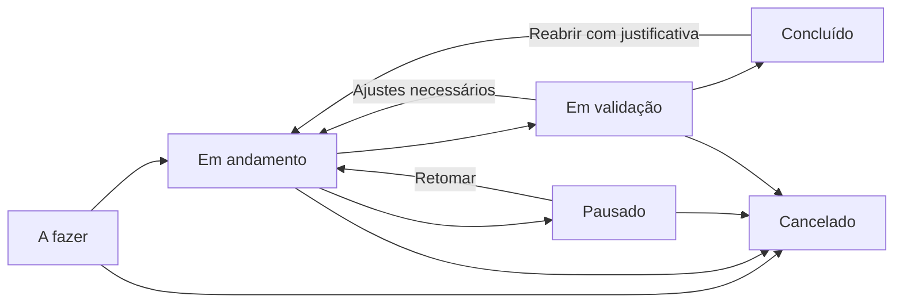

# Proposta para o novo Gerenciador de Demandas

**Situação:** proposta de produto e arquitetura para discussão. Não descreve uma implementação pronta nem autoriza mudanças no banco.

**Decisão posterior — primeira entrega em 19/10/2026:** o responsável escolheu tabelas novas e convivência com o sistema antigo. O cadastro moderno usa `DJ_DEMANDS`, com anexos e histórico próprios. Essa decisão substitui a alternativa de reaproveitar `JDT_REQUEST_IMPROVEMENTS_SMALL` e `JDT_DEMAND_MANAGEMENT` descrita nas seções 3.1, 10 e 11.2 abaixo. A primeira tela tem somente Nova solicitação e Minhas solicitações; a entrada permite Solicitar demanda ou Reportar erro, e a classificação fica para o futuro gerenciador. Não há migração de dados nem integração ao gerenciador antigo nesta etapa. A implementação e o SQL proposto estão descritos em [Solicitações de demandas](solicitacoes-demandas.md). As demais ideias deste documento continuam como propostas.

O objetivo é criar um gerenciador que ajude a equipe a decidir o que fazer, executar com clareza e mostrar o que foi entregue. A experiência deve acompanhar a modernização de `/app/eventos`, com cadastro simples, informações confiáveis e histórico de decisões.

## 1. O que já foi definido e o que é sugestão

### Diretrizes confirmadas pelo responsável

- Reformular o Gerenciador de Demandas na arquitetura nova.
- Renovar o visual, usando Eventos como referência.
- Manter Atividade como tipo de demanda, na mesma tabela utilizada por Projeto, Melhoria e Erro.
- Retirar atividades recorrentes.
- Rever os status e as funcionalidades existentes.

### Sugestões deste documento

Os fluxos, nomes de status, campos, permissões e etapas de entrega abaixo são recomendações iniciais. Precisam ser discutidos antes da implementação. Em especial, a inclusão de validação da entrega, a nova escala de prioridade e as regras de aprovação ainda não foram decididas.

## 2. Como seria uma boa experiência de uso

Ao abrir o gerenciador, cada pessoa deve conseguir responder rapidamente:

1. O que está comigo e qual é o próximo trabalho?
2. O que está atrasado ou precisa de uma decisão?
3. Quais trabalhos estão impedidos e por quê?
4. O que já foi entregue e ainda aguarda validação?
5. Como está a distribuição do trabalho da equipe?

O solicitante deve conseguir acompanhar o pedido sem depender de mensagens avulsas. O responsável deve atualizar o andamento com poucas ações. O gestor deve conseguir priorizar e redistribuir o trabalho com contexto.

O cadastro começa com poucas informações. Detalhes de planejamento aparecem quando passam a ser necessários. Uma atividade simples não deve exigir o preenchimento de um documento de projeto.

## 3. Modelo único para os quatro tipos

### 3.1. Atividade na mesma tabela dos demais tipos

Pelo SQL versionado, Projeto, Melhoria e Erro são cadastrados em `JDT_REQUEST_IMPROVEMENTS_SMALL`. As atividades criadas diretamente no gerenciador são gravadas em `JDT_DEMAND_MANAGEMENT`, sem `sourceRequestId`.

**A proposta é cadastrar os quatro tipos em `JDT_REQUEST_IMPROVEMENTS_SMALL`, inclusive Atividade.** A atividade terá um `requestId` nessa tabela e seguirá o mesmo mecanismo de vínculo com o gerenciamento utilizado pelos outros tipos.

Não basta mostrar os quatro tipos na mesma tela: a unificação precisa acontecer no armazenamento dos dados principais e no fluxo de criação.

| Aspecto | Proposta |
|---|---|
| Registro principal | `JDT_REQUEST_IMPROVEMENTS_SMALL` para os quatro tipos. |
| Tipo | Campo `demandType`, aceitando `atividade`, `projeto`, `melhoria` e `erro`. |
| Execução | `JDT_DEMAND_MANAGEMENT`, com vínculo ao registro principal para qualquer tipo aceito para execução. |
| Tarefas | Vinculadas ao gerenciamento, disponíveis para qualquer tipo. |
| Histórico | Preservado e associado à demanda, independentemente do tipo. |
| Recorrência | Sem nova configuração ou geração de ocorrências. |

Os nomes atuais das tabelas são mantidos como referência de compatibilidade. Não é necessário renomeá-las para realizar essa unificação.

### 3.2. Tipo, origem e tamanho são conceitos diferentes

| Conceito | O que representa | Exemplos |
|---|---|---|
| Tipo | Natureza do trabalho. | Atividade, Projeto, Melhoria, Erro. |
| Origem | Como o trabalho entrou. | Solicitação ou cadastro interno. |
| Porte | Dimensão estimada do trabalho, se for útil para a equipe. | Pequeno, médio, grande. |

O tipo não deve determinar em qual tabela a demanda fica. A origem não deve impedir que uma melhoria ou um erro sejam registrados internamente. Porte é uma sugestão opcional, não um campo obrigatório da primeira entrega.

### 3.3. Atividade e tarefa

Uma atividade é uma demanda independente, com responsável, status e entrega próprios. Uma tarefa é uma etapa dentro de uma demanda.

Por exemplo, “Revisar acessos de um painel” pode ser uma atividade. “Conferir grupos”, “Ajustar permissões” e “Validar com a área” podem ser suas tarefas. Projetos, melhorias e erros também podem ter tarefas.

Não se deve criar uma árvore ilimitada de subtarefas. Uma demanda com uma lista de tarefas atende a primeira versão proposta.

## 4. Organização do produto

### 4.1. Solicitações: receber e decidir

Este espaço reúne pedidos que ainda precisam ser analisados. Deve permitir entender o problema, conferir anexos, pedir informações e decidir se o trabalho será aceito.

Estados de análise sugeridos:

- **Em análise:** pedido recebido, aguardando decisão.
- **Aguardando informações:** existe uma pergunta objetiva pendente para o solicitante.
- **Aprovada:** trabalho aceito e vinculado ao gerenciamento.
- **Recusada:** trabalho não aceito, com motivo registrado.

Ao aprovar, a pessoa autorizada define o responsável ou encaminha para uma fila da equipe. A aprovação não deve significar que a execução já começou.

Um cadastro interno pode entrar diretamente em “A fazer” quando realizado por alguém com essa permissão. Ele ainda cria o registro principal na mesma tabela dos demais. A decisão de exigir aprovação para cadastros internos depende da política da área, e não do tipo da demanda.

### 4.2. Demandas: organizar e executar

A tela principal apresenta os trabalhos aceitos para execução. Atalhos sugeridos:

- **Minhas demandas:** trabalhos sob minha responsabilidade.
- **Da equipe:** todos os trabalhos da área aos quais tenho acesso.
- **Sem responsável:** fila que ainda precisa de atribuição.
- **Precisam de atenção:** atrasos, pausas e validações pendentes, com o motivo visível.
- **Histórico:** concluídas e canceladas, com filtros por período.

O padrão inicial pode ser “Minhas demandas” para executores e “Da equipe” para gestores. A preferência de visualização deve ser preservada.

### 4.3. Indicadores: apoiar decisões

Indicadores devem ajudar a identificar acúmulo, atrasos e gargalos. Devem usar o mesmo significado de status, prazo e conclusão das telas operacionais.

Um filtro de período precisa explicar qual data está sendo considerada: abertura, início ou conclusão. Um total da área não pode ser confundido com a quantidade carregada na página.

## 5. Visual e navegação

### 5.1. Base de Eventos

Reaproveitar o shell Vue, a identidade azul JOST, os tokens, a tipografia, as superfícies claras, as bordas suaves e os componentes compartilhados já usados em Eventos.

A página deve ter título, identificação da área e uma ação principal clara: **Nova demanda**. A criação permite escolher um dos quatro tipos conforme a permissão e o canal de entrada.

Esboço conceitual da tela:

```text
Gerenciador de Demandas                     [Nova demanda]
Transformação Digital

[Solicitações] [Demandas] [Indicadores]

[Minhas] [Da equipe] [Sem responsável] [Precisam de atenção]

[Busca] [Tipo] [Status] [Responsável] [Prioridade] [Prazo]

Demandas encontradas: total filtrado        [Cards | Lista]

[Demanda]    [Demanda]    [Demanda]    [Demanda]
[Demanda]    [Demanda]    [Demanda]    [Demanda]

                         [Paginação]
```

O esboço representa organização, não um layout já validado no navegador.

### 5.2. Cards e lista

O card deve mostrar identificação, título, tipo, status, responsável, prioridade e prazo. Quando houver impedimento ou atraso, o motivo deve ser reconhecível sem abrir vários registros.

Descrição extensa, histórico completo e campos administrativos ficam nos detalhes. Cor deve ser acompanhada de texto e, quando útil, ícone.

A lista oferece comparação mais compacta, ordenação e leitura de muitos registros. Cards e lista usam os mesmos filtros e dados. Agrupar por responsável é uma opção, sem criar uma seção separada para atividades.

Kanban é uma evolução possível. Só deve entrar se a movimentação por etapas trouxer benefício para a rotina, mantendo as mesmas validações de transição no backend e uma alternativa acessível por botões.

### 5.3. Filtros e comportamento

- Buscar por identificação e título.
- Combinar múltiplos tipos e status.
- Filtrar por responsável, solicitante, prioridade e situação do prazo.
- Consultar e paginar no servidor, considerando toda a seleção.
- Preservar filtros e posição ao voltar dos detalhes.
- Ter “Limpar filtros” e uma explicação para resultados vazios.
- Permitir compartilhar um endereço que represente a seleção e abrir uma demanda diretamente por link.
- Atualizar a listagem sem sobrescrever um formulário em edição.

### 5.4. Detalhes da demanda

O cabeçalho apresenta título, identificação, tipo, status e ações disponíveis. Abaixo, a organização sugerida é:

| Área | Conteúdo |
|---|---|
| Resumo | Problema ou objetivo, solicitante, responsável, prioridade, datas e entrega esperada. |
| Planejamento | Estimativa, compromissos de prazo e informações de execução que a equipe utilizar. |
| Tarefas | Etapas, responsáveis, prazos opcionais e conclusão. |
| Conversa e histórico | Comentários e eventos de alteração, visualmente diferenciados. |
| Anexos | Evidências e documentos, sujeitos às permissões da demanda. |

Detalhes simples podem usar `AppDialog`, seguindo Eventos. Se o volume de informações tornar o diálogo desconfortável, uma página própria com link direto é preferível. O conteúdo e o formulário não devem ser reiniciados por uma atualização automática de consulta.

## 6. Status e regras de execução

### 6.1. Fluxo sugerido



| Status | Significado | Regra proposta |
|---|---|---|
| A fazer | Trabalho aceito que ainda não começou. | Pode aguardar planejamento ou atribuição. |
| Em andamento | Há execução efetiva. | Exige responsável; registra o início real. |
| Em validação | Entrega disponível para conferência. | Registra resumo da entrega e quem deve validar. |
| Pausado | Execução interrompida. | Exige motivo e registra quando o trabalho foi interrompido. |
| Concluído | Entrega encerrada. | Registra conclusão, autor e resumo do resultado. |
| Cancelado | Trabalho encerrado sem completar a entrega. | Exige justificativa e preserva o histórico. |

“Em validação” depende da definição de quem aprova a entrega. A recomendação é ter a etapa disponível para todos os tipos, com uma política explícita para os casos em que a conclusão direta seja permitida. Não assumir dispensa de validação apenas porque o tipo é Atividade.

Na primeira versão, a pausa é proposta a partir de “Em andamento”. Caso a equipe precise pausar validações, o modelo deve registrar a etapa de origem para permitir a retomada correta.

### 6.2. Prazo, pausa e reabertura

- **Atrasada** é uma situação calculada pelo prazo, não um status que substitui a etapa de execução.
- Demandas concluídas ou canceladas não entram na fila de atrasos ativos. O histórico pode indicar se uma conclusão ocorreu depois do prazo.
- Uma pausa não altera o prazo automaticamente. Motivo e previsão de retomada devem ficar visíveis; quando não houver previsão, mostrar “Sem previsão”.
- Alterar o prazo registra valor anterior, novo valor, autor, data e justificativa.
- Previsão de início, início real, prazo acordado e conclusão real são informações distintas.
- Agendar uma previsão de início não deve, por padrão, iniciar a demanda automaticamente. A continuidade da automação atual é uma decisão pendente.
- Reabrir exige justificativa e revisão do prazo quando necessário. Conclusões e reaberturas anteriores permanecem no histórico.
- Na validação, registrar envio, devolução para ajuste e aceite, permitindo distinguir tempo de execução de tempo aguardando conferência.

Recusar uma solicitação e cancelar uma demanda são decisões diferentes. Os códigos numéricos usados hoje pelo legado precisam de um mapeamento explícito; não devem ser reinterpretados silenciosamente.

## 7. Cadastro e campos

### 7.1. Informações básicas

| Campo | Proposta |
|---|---|
| Tipo | Obrigatório, entre os quatro tipos. |
| Título | Obrigatório, curto e descritivo. |
| Descrição | Obrigatória, explicando objetivo ou problema. |
| Área | Determinada pelo contexto autorizado, validada no backend. |
| Solicitante | Identificado pela sessão; cadastro em nome de outra pessoa exige permissão específica. |
| Origem | Registrada pelo canal de criação. |
| Anexos | Opcionais, com limites e autorização definidos. |

Premissas, problemas atuais e benefícios podem ser apresentados conforme o tipo e a complexidade. A obrigatoriedade atual desses campos deve ser revista com a equipe; não obrigar um texto sem utilidade apenas para conseguir enviar.

Para erros, sugerir informações como comportamento esperado, comportamento observado, impacto e evidência. O formulário continua usando a mesma base de demanda.

### 7.2. Informações de planejamento

Responsável, prioridade, prazo acordado e estimativa são definidos durante a análise ou o planejamento. O backlog pode ter itens sem responsável e sem prazo; iniciar a execução exige atribuição e uma regra clara para compromisso de entrega.

Se a equipe exigir prazo ao iniciar, essa regra deve valer para os quatro tipos. Uma exceção precisa representar uma política de trabalho, e não a forma como o registro foi criado.

### 7.3. Prioridade e esforço

Sugestão de prioridade: **Baixa, Normal, Alta e Crítica**, com critérios de impacto e urgência acordados. “Crítica” deve exigir justificativa e autorização de gestão.

A urgência informada pelo solicitante é uma entrada para análise. A prioridade de execução é uma decisão da equipe. Dentro de uma mesma prioridade, a fila pode ter uma ordem explícita definida pela gestão.

Antes de substituir a escala atual de 1 a 10, definir como cada valor existente será convertido. Não aplicar uma conversão arbitrária.

Manter horas estimadas e realizadas somente se forem usadas para planejar ou analisar entregas. “Horas por dia”, dificuldade e eventual porte precisam ter propósito distinto; evitar vários campos que tentem representar a mesma coisa.

Conclusão de tarefas pode ser exibida como “3 de 5 tarefas”. Não apresentar essa proporção como percentual garantido da entrega, porque tarefas podem ter esforços muito diferentes.

## 8. Colaboração, permissões e notificações

### 8.1. Responsabilidades sugeridas

| Papel | Responsabilidades propostas |
|---|---|
| Solicitante | Criar pedidos, complementar informações e acompanhar os registros permitidos. Validar entregas quando designado. |
| Executor | Atualizar suas demandas e tarefas, registrar andamento e encaminhar entregas para validação. |
| Gestor da área | Analisar entradas, priorizar, atribuir ou reatribuir responsáveis e acompanhar a equipe. |
| Administrador | Administrar acesso e configuração conforme política explícita, com ações relevantes registradas. |

Esses papéis representam responsabilidades propostas, não novos perfis já existentes. A implementação deve mapear as ações para a identidade e as permissões reais do portal.

Leitura, edição, download e alterações de status precisam verificar área, vínculo com a demanda e permissão no backend. Conhecer um ID ou receber um link não concede acesso. A interface apresenta apenas as ações disponíveis, sem substituir essa verificação.

### 8.2. Histórico e conversa

Registrar criação, análise, atribuições, mudanças de prioridade e prazo, transições de status, pausas, reaberturas e validações. Cada evento identifica autor, data e alteração relevante.

Comentários permitem contextualizar decisões sem apagar observações anteriores. A primeira versão pode usar texto simples, sem editor complexo, menções ou chat em tempo real.

### 8.3. Notificações úteis

Sugerir notificações para aprovação ou recusa, atribuição, pedido de informação, envio para validação, conclusão e alteração importante de prazo. Lembretes devem evitar repetições diárias do mesmo aviso sem mudança de contexto.

O canal precisa ser escolhido antes da implementação. E-mail existente pode ser reaproveitado quando autorizado; Teams não é uma dependência obrigatória desta proposta.

A gravação da demanda deve ser confirmada antes do envio externo. Uma falha de notificação não deve induzir o usuário a criar a mesma demanda novamente. Caso haja reenvio automático, ele precisa ter controle de duplicidade e não repetir eventos já enviados.

## 9. Indicadores com significado

| Indicador | Pergunta respondida |
|---|---|
| Solicitações aguardando análise | Há uma fila de entrada acumulada? |
| Demandas por status e tipo | Onde o trabalho está concentrado? |
| Demandas atrasadas | Quais compromissos precisam de atenção? |
| Entregas por período | O que foi efetivamente concluído? |
| Tempo até iniciar | Quanto tempo um trabalho aceito espera? |
| Tempo de execução e validação | Onde estão os principais tempos de espera? |
| Reaberturas e devoluções | As entregas estão exigindo retrabalho? |

Distribuição por responsável deve considerar situação e, quando confiável, esforço estimado. Quantidade de demandas não representa sozinha capacidade ou produtividade individual.

Antes de calcular indicadores, definir datas de referência, tratamento de pausas, reaberturas e registros históricos incompletos. Exibir o que pode ser medido com os dados disponíveis, sem inventar datas ou assumir que ausência de informação significa zero.

## 10. Organização dos dados

### 10.1. Responsabilidade de cada conjunto

```text
JDT_REQUEST_IMPROVEMENTS_SMALL
  Registro principal de Atividade, Projeto, Melhoria e Erro
  Identificação, descrição, origem e informações do pedido
      |
      | zero ou um gerenciamento por registro principal
      v
JDT_DEMAND_MANAGEMENT
  Planejamento e execução após aceite
      |
      +--> tarefas
      +--> histórico de execução
      +--> comentários, se adotados
      +--> vínculos com anexos
```

Uma solicitação recusada pode existir sem gerenciamento. Uma atividade interna aceita diretamente cria o registro principal e o gerenciamento na mesma transação. O vínculo deve impedir duplicação por repetição de clique ou concorrência.

### 10.2. Uma fonte para cada informação

Título, descrição e tipo devem ter como origem principal o registro compartilhado pelos quatro tipos. Planejamento e execução devem ter uma fonte explícita, proposta em `JDT_DEMAND_MANAGEMENT`.

Hoje existem informações operacionais nos dois lados e sincronizações com rotas antigas. A mudança exige um contrato de compatibilidade: quais campos continuam sendo espelhados, qual é a fonte de cada um e quais caminhos podem gravá-los.

O estado da análise e o estado da execução são conceitos distintos. A definição dos novos campos ou códigos depende de revisar o schema real, as restrições e os consumidores atuais. Este documento não propõe reutilizar códigos existentes sem essa revisão.

Requisitos para o desenho físico posterior:

- Vínculos consistentes entre demanda principal, gerenciamento, tarefas e histórico.
- Escritas parametrizadas e transações completas.
- Proteção contra alterações concorrentes, preservando a intenção do `rowVersion` atual.
- Identificação consistente entre interface, links e migração, sem expor dois números sem explicar a relação.
- Dados históricos incompletos identificados, sem preenchimento fictício.
- Cancelamento preservando o registro; exclusão física apenas sob uma política específica, fora do fluxo normal.

Não há DDL ou migration executável nesta proposta. Tipos de coluna, índices, FKs, restrições e estratégia de IDs devem ser definidos e revisados em uma etapa específica.

## 11. Retirada das recorrências e migração

### 11.1. Recorrência

Retirar criação, edição e geração automática de recorrências. Preservar ocorrências já registradas e o histórico necessário para entender o trabalho realizado.

É preciso decidir o tratamento das ocorrências futuras já geradas: quais representam trabalho real e quais são apenas produto da automação. Não cancelar nem excluir esses registros em massa sem revisão.

O job `mon_mon_auto_demandManagement.py` também inicia demandas agendadas. Desativar recorrências não autoriza remover todo o job ou perder o agendamento. As duas responsabilidades precisam ser avaliadas separadamente.

### 11.2. Migração das atividades existentes

Plano proposto, sujeito à revisão e execução autorizada:

1. Inventariar como texto os caminhos de leitura e escrita, incluindo gerenciador, portal do solicitante, rotas antigas, anexos e jobs.
2. Em etapa autorizada de banco, conferir schema, restrições, contagens, vínculos e registros sem correspondência.
3. Preparar um mapeamento entre cada atividade existente e o novo registro em `JDT_REQUEST_IMPROVEMENTS_SMALL`.
4. Criar os registros principais com tipo `atividade`, preservando autor, datas e conteúdo que tenham correspondência válida.
5. Preencher o vínculo de origem no gerenciamento existente, preservando `managementId`, tarefas e histórico.
6. Revisar a apresentação e a resolução dos anexos por código, sem mover ou renomear arquivos automaticamente.
7. Encerrar a geração de recorrências no momento combinado e garantir que os caminhos antigos não continuem criando atividades isoladas.
8. Conciliar os registros antes e depois, com proteção contra reexecução e criação duplicada.

A política de transição precisa definir qual versão pode gravar cada informação durante a publicação. Não manter dois fluxos independentes criando ou atualizando as mesmas demandas.

O retorno de versão também precisa ser planejado: o código antigo pode não aceitar Atividade na tabela compartilhada. Não presumir que basta voltar o código depois que os novos registros existirem.

## 12. Arquitetura proposta

Seguir a arquitetura moderna já implementada em Eventos, mantendo o módulo de demandas independente das rotas antigas.

```text
backend/modules/demands/
  __init__.py
  routes.py
  schemas.py
  services.py
  repository.py
  domain.py          # quando necessário para regras e transições
  integration.py     # quando necessário para notificações ou adaptações

frontend/src/features/demands/
  pages/
  components/
  api.ts
  types.ts
```

- Rotas traduzem HTTP e contratos; serviços aplicam autorização, regras e transações; repositório concentra SQL parametrizado.
- Reutilizar a engine TD, identidade, CSRF, paginação e tratamento de erros da infraestrutura moderna.
- Reutilizar `PageHeader`, `RecordCard`, `CardGrid`, `AppDialog`, `RequestState`, componentes Volt e estilos compartilhados.
- Buscar, filtrar, contar e paginar no servidor.
- Manter regras de tipo e status no backend; o frontend apresenta as opções permitidas para o registro atual.
- Isolar adaptações necessárias ao legado, evitando importar rotas, schedulers ou utilitários com efeitos durante o import.

Página e API poderiam usar `/app/demandas` e `/api/v1/demands`, respectivamente. Esses caminhos são sugestões a confirmar no desenho de navegação; não implicam renomear ou remover as rotas atuais nesta etapa.

## 13. O que simplificar e o que deixar para depois

| Item | Direção proposta |
|---|---|
| Armazenamento especial de atividades | Encerrar; usar a tabela principal dos demais tipos. |
| Atividades recorrentes | Retirar, preservando registros e histórico existentes. |
| Cadastro interno exclusivo de atividades | Evoluir para cadastro dos tipos permitidos ao usuário. |
| Separação visual entre atividades e outras demandas | Retirar; tipo passa a ser filtro e identificação. |
| Campos obrigatórios sem uso claro | Rever com a equipe antes de manter. |
| Avisos no mural | Avaliar uso real; não carregar automaticamente para a nova tela. |
| Início automático por agendamento | Decidir separadamente da recorrência. |
| Kanban, calendário, dependências e múltiplos níveis de tarefas | Evoluções opcionais, após validar o fluxo básico. |
| Teams, menções e automações avançadas | Opcionais; dependem de necessidade e autorização próprias. |

## 14. Etapas de entrega sugeridas

1. **Fechar o desenho:** tipos, campos, análise, execução, prioridade, prazo, validação e permissões.
2. **Preparar dados e transição:** modelo físico, mapeamento das atividades, contratos com o legado e plano de publicação/retorno.
3. **Entregar o núcleo moderno:** cadastro unificado, análise, listagem, detalhes, filtros, tarefas, anexos, histórico e transições definidas.
4. **Completar colaboração e acompanhamento:** comentários, notificações e indicadores conforme o escopo aprovado.
5. **Avaliar evoluções:** visualizações e automações somente com uma necessidade demonstrada pela rotina.

Cada etapa deve indicar o que substitui, quais caminhos antigos continuam ativos e quem é responsável pelas escritas. A retirada de uma tela antiga depende da cobertura das funções que ainda são utilizadas.

## 15. Critérios para considerar a reformulação bem-sucedida

- Os quatro tipos usam a mesma tabela principal e o mesmo mecanismo de vínculo ao gerenciamento.
- Criar uma demanda não depende de escolher Atividade para contornar uma limitação do sistema.
- O usuário entende o status, o próximo passo, o responsável e o compromisso de prazo.
- Aprovar, iniciar, pausar, concluir e cancelar têm significados distintos e registrados.
- Uma atualização concorrente não apaga silenciosamente o trabalho de outra pessoa.
- Filtros, totais e indicadores consideram os dados completos e respeitam as permissões.
- As atividades existentes continuam associadas às suas tarefas, anexos e histórico.
- Nenhuma nova ocorrência recorrente é gerada após a transição definida.
- A interface preserva informações digitadas diante de falhas e oferece recuperação clara.
- O fluxo pode ser usado por teclado e em telas menores.

Esses são critérios de aceitação propostos, não resultados já verificados.

## 16. Decisões pendentes para a próxima conversa

1. Quais status atuais devem mudar? “Em validação” resolve uma necessidade real e quem valida?
2. Atividades podem ser solicitadas por outras áreas ou ficam disponíveis apenas no cadastro interno?
3. Quem pode aprovar, priorizar, reatribuir, cancelar e reabrir?
4. Quais campos de horas, dificuldade e prioridade são efetivamente usados hoje?
5. O início automático agendado e o mural de avisos devem continuar?
6. Quais notificações são úteis e quais geram ruído?
7. Como tratar ocorrências recorrentes já geradas para datas futuras?

## 17. Base da análise e limites

Referências consultadas como texto:

- [README do projeto](../README.md).
- [Arquitetura modernizada](arquitetura-modernizada.md).
- [Padrão visual de Eventos](padrao-visual.md).
- [Registro dos blueprints atuais](../main.py).
- [Domínio do portal de solicitações](../app/routes/demandRequests/domain.py) e [persistência das solicitações](../app/routes/demandRequests/repository.py).
- [Domínio do gerenciador](../app/routes/demandManagement/domain.py), [serviços](../app/routes/demandManagement/services.py), [repositório](../app/routes/demandManagement/repository.py) e [integração com solicitações](../app/routes/demandManagement/integration.py).
- [Interface atual](../app/templates/demandManagement/management.html) e [JavaScript do gerenciador](../app/static/js/demand-management/management.js).
- [Job de recorrência e início agendado](../app/services/jobs/mon_mon_auto_demandManagement.py).

As observações sobre tabelas refletem o SQL versionado. O schema e os dados reais, a aparência final, a usabilidade, as permissões em produção, a migração e a compatibilidade de publicação precisam ser conferidos em ambiente especificamente autorizado.

**O sistema não foi executado; a validação foi somente estática.**
